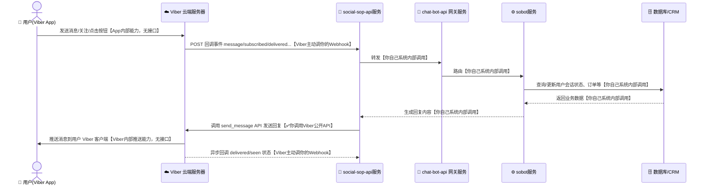
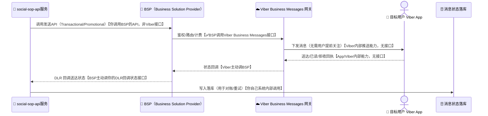
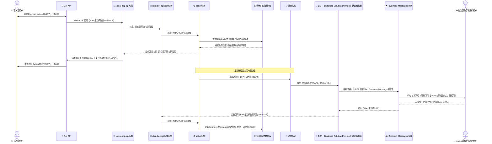
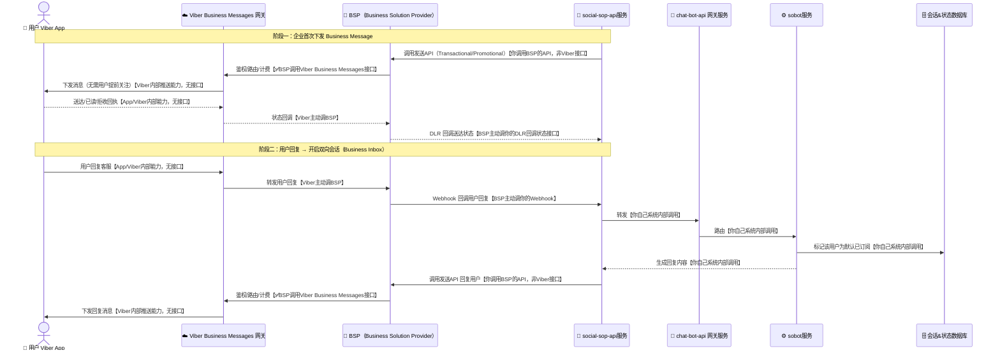

# Viber Bot / Channel / Business Messages 知识与数据流转架构

本文档整理 Viber 生态中 Bot（机器人）、Channel（公共账号/频道）、Business Messages（企业消息，简称 Biz）三者的概念区别、核心用法，以及消息在系统间的数据流转架构图，便于对接 Viber 做客服机器人、营销广播或事务性通知（验证码、订单通知等）。

---

## 一、核心概念区分

Viber 官方对外提供的能力容易混淆，先厘清三个概念：

| 概念 | 定位 | 是否需要用户先订阅 | 典型用途 |
|---|---|---|---|
| **Viber Bot（Public Account + Bot API）** | 类似公众号+机器人，用户主动关注后双向对话 | 需要（用户扫码/点击深链关注） | 客服机器人、社群互动、FAQ 自动回复 |
| **Channel（频道）** | 单向广播为主的公共账号，粉丝订阅后接收内容 | 需要订阅 | 资讯、内容分发、公告 |
| **Business Messages（Viber Biz / Business Inbox）** | 企业向任意 Viber 用户主动发消息（类似短信通道），需通过认证服务商接入 | **不需要**用户预先关注，但需目标用户手机号在 Viber 注册 | 验证码 OTP、订单状态、物流通知、营销触达 |

> 实践中，Bot API 是「用户加你」，Business Messages 是「你主动找用户」（类似 SMS/WhatsApp Business API 的定位），两者账号体系和接入方式都不同，Business Messages 通常需要通过 Viber 认证的 BSP（Business Solution Provider，如 Infobip、Vonage、360dialog 等）或直接向 Viber 商务申请。

---

## 二、Viber Bot API 使用要点

### 1. 创建 Bot

- 登录 <https://partners.viber.com>，创建 Public Account，选择 "Bot" 类型。
- 创建成功后获得 **Auth Token**（每次调用 REST API 都要带在请求头 `X-Viber-Auth-Token`）。

### 2. 设置 Webhook

Bot 收消息是被动接收：Viber 服务器把用户发来的消息 POST 到你配置的 Webhook URL。

```bash
curl -X POST -H "Content-Type: application/json" \
     -H "X-Viber-Auth-Token: <YOUR_AUTH_TOKEN>" \
     -d '{
           "url": "https://your-domain.com/viber/webhook",
           "event_types": ["delivered", "seen", "failed", "subscribed", "unsubscribed", "conversation_started"],
           "send_name": true,
           "send_photo": true
         }' \
     https://chatapi.viber.com/pa/set_webhook
```

- Webhook 必须是 **HTTPS**，且证书有效（不能是自签名）。
- 本地开发可用 `ngrok` 之类工具把本地端口暴露成公网 HTTPS 地址用于联调。

### 3. 接收消息（Webhook 收到的回调）

用户发消息、关注、取关、消息送达/已读等事件都会回调到 Webhook，示例（文本消息事件）：

```json
{
  "event": "message",
  "timestamp": 1610000000000,
  "message_token": 4912661846655238145,
  "sender": {
    "id": "01234567890A=",
    "name": "John McClane",
    "avatar": "https://avatar-url"
  },
  "message": {
    "type": "text",
    "text": "Hello Bot"
  }
}
```

服务端收到后需要在合理时间内返回 `HTTP 200`，否则 Viber 会判定失败并重试。

### 4. 主动发消息（回复用户）

```bash
curl -X POST -H "Content-Type: application/json" \
     -H "X-Viber-Auth-Token: <YOUR_AUTH_TOKEN>" \
     -d '{
           "receiver": "01234567890A=",
           "type": "text",
           "sender": {"name": "MyBot"},
           "text": "你好，我是客服机器人"
         }' \
     https://chatapi.viber.com/pa/send_message
```

- 只能给「已关注/已和 Bot 产生过对话」的用户主动发消息（这是与 Business Messages 的关键区别）。
- 消息类型支持：text、picture、video、file、rich media（卡片/按钮）、keyboard（自定义键盘菜单）等。

### 5. 广播（Broadcast）

```bash
curl -X POST -H "Content-Type: application/json" \
     -H "X-Viber-Auth-Token: <YOUR_AUTH_TOKEN>" \
     -d '{
           "broadcast_list": ["userId1", "userId2", "..."],
           "type": "text",
           "sender": {"name": "MyBot"},
           "text": "限时活动通知"
         }' \
     https://chatapi.viber.com/pa/broadcast_message
```

- 单次 `broadcast_list` 最多 300 个接收者，量大需分批调用，并注意限速。

---

## 三、Business Messages（Biz）使用要点

- 定位类似 SMS/WhatsApp Business API：**无需用户提前关注**，企业可直接向已注册 Viber 的手机号发送验证码、订单通知、营销消息。
- 接入方式：多数企业通过 **BSP（第三方认证服务商）** 接入，而不是直接对接 Viber，因为 Viber 对 Business Messages 的资质审核、发送方（Sender ID）注册都通过 BSP 完成。
- 消息类型：
  - **Transactional（事务性）**：OTP、订单状态、账单提醒，几乎实时送达，不受营销频控限制。
  - **Promotional（营销）**：受频率限制与用户退订（opt-out）规则约束。
- 计费：按条计费，价格因国家/地区不同（类似国际短信定价模型）。
- 送达状态：BSP 一般会提供回调（delivered / seen / undelivered / rejected）用于对账和重试。

> 如果你的场景是「验证码/通知类消息批量发给客户手机号」，应该选 **Business Messages**（走 BSP）；如果是「用户主动加你、双向聊天」，应该选 **Bot API**。

---

## 四、数据流转架构图

图形约定（四张图统一用时序图 + 表情符号，一眼区分「设备 / 平台 / 企业服务 / 存储 / 第三方」）：

| 图形 | 含义 |
|---|---|
| 📱（人形 actor） | 手机/用户 App 终端 |
| ☁️ | Viber 云平台（Bot API / Business Messages 网关） |
| 🚦 / ⚙️ / 🔔 | 企业侧服务组件（网关、业务逻辑、Webhook） |
| 🗄️ / 📨 | 数据存储（数据库、消息队列） |
| 🏢 / 🔗 | 第三方系统（业务系统、BSP） |

### 1. Viber Bot API（双向对话）数据流

每条箭头后面用【】标出这一步「有没有接口调用、谁调用的」：



图例：**✅你调用Viber公开API**＝全图唯一一次你真正发起的接口调用；**Viber主动调你的Webhook**＝需要你提前用 `set_webhook` 注册好地址，但请求由 Viber 发起；**App/Viber内部能力**＝Viber 自家客户端-服务端协议，你既碰不到也无需实现；**你自己系统内部调用**＝跟 Viber 完全无关，是你自己代码/数据库之间的调用。

### 2. Business Messages（企业主动触达）数据流



> 关键点：**你的服务器全程没有直接调用过 Viber 的接口**——真正调用 Viber Business Messages API 的是 BSP（图中唯一一处 ✅），你只调了 BSP 的发送接口，再被 BSP 回调告知结果。这也是为什么大多数企业接入 Business Messages 都要经过 BSP。

### 3. 整体系统架构（Bot + Business Messages 并存场景）



> 全图两处 ✅ 才是真正打到 Viber 接口的地方：Bot 路径里你自己调 `send_message`；Business Messages 路径里则是 BSP 代你调 Viber 接口，你只碰得到 BSP 的 API。

### 4. Business Messages 完整生命周期（首次下发 + 双向会话）数据流

不依赖图2，自成一张完整的图：前半段是企业首次下发 Business Message 并拿到送达回执，后半段是用户回复后开启的双向会话（Business Inbox）。用户回复后，企业侧内部把这个用户标记为「默认已订阅」，复用跟 Bot 路径一样的会话/订阅状态模型，但**发送通道仍然是 Business Messages（走 BSP），不会变成 Bot API**。



> 关键点：「默认已订阅」只是**你自己数据库里的内部状态**，方便业务逻辑统一处理 Bot 用户和 Business Messages 用户的会话；它不会让 Viber 把这个用户变成你 Bot 账号的粉丝，后续回复也依然要走 BSP/Business Messages 这条通道，直到回复时效窗口到期。

---

## 五、接入注意事项

1. **签名/来源校验**：Webhook 收到请求后应校验请求确实来自 Viber（如校验签名或结合 IP 白名单），避免伪造回调。
2. **幂等处理**：同一 `message_token` 可能因网络重试重复投递，业务侧需按 token 去重。
3. **超时与重试**：Webhook 响应务必在几秒内返回 200，耗时的业务逻辑应异步处理（丢队列），避免被 Viber 判定失败反复重试。
4. **会话有效期**：Bot API 通常要求企业在用户主动发起对话后的一段时间窗口内可自由回复，超出窗口的营销类回复可能受限，需结合官方最新规则确认。
5. **多语言与本地化**：Business Messages 面向不同国家发送时，需注意 Sender ID/模板需按对象国审核。
6. **降级方案**：核心通知（如 OTP）建议做多通道降级（Viber 失败 → 短信兜底），避免单一通道不可达影响业务。

---

## 六、小结

- **Bot API**：用户先关注，双向对话，适合客服/互动场景，通过 Webhook 被动接收 + REST API 主动发送。
- **Channel**：以订阅广播为主的公共账号形态。
- **Business Messages**：企业主动触达任意 Viber 号码，通常经 BSP 接入，适合 OTP、订单通知、营销外呼，按条计费、有送达回执。
- 架构设计核心是「Webhook 接收 + 异步业务处理 + 消息网关路由（Bot vs BSP）+ 状态回执落库对账」，根据「是否需要双向会话」选择合适的接入方式。
