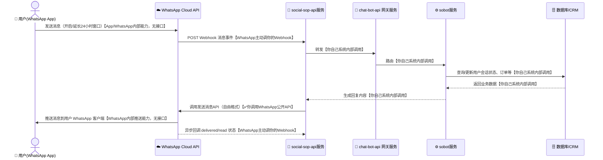
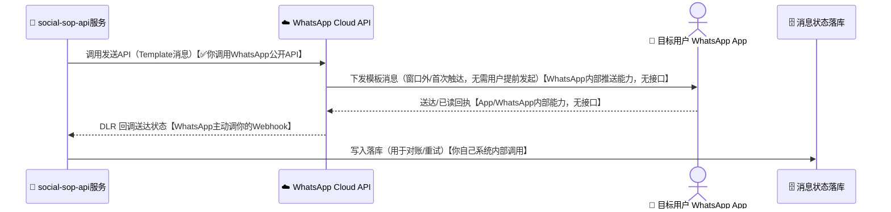
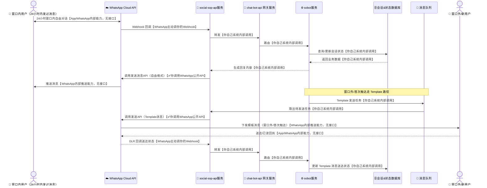
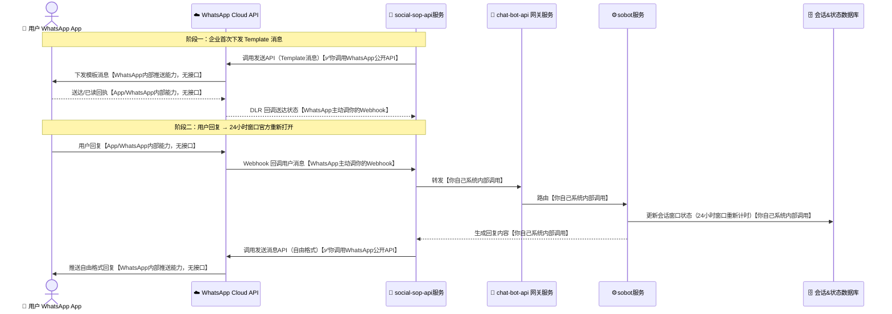

# WhatsApp Business Platform 知识与数据流转架构

本文档整理 WhatsApp Business Platform（Cloud API）的核心概念、使用要点，以及消息在系统间的数据流转架构图，便于对接 WhatsApp 做客服机器人、模板通知（验证码、订单通知）或营销触达。

---

## 一、核心概念区分

WhatsApp 官方对外提供的能力，核心是围绕「24 小时客服窗口」展开的，先厘清几个概念：

| 概念 | 定位 | 是否需要用户先发起 | 典型用途 |
|---|---|---|---|
| **WhatsApp Cloud API（自由格式消息）** | Meta 官方云托管 API，用户发消息后开启 24 小时会话窗口，窗口内可自由双向对话 | 需要（用户 24 小时内发过消息） | 客服机器人、双向对话、FAQ 自动回复 |
| **Message Template（模板消息 / HSM）** | 预先提交 Meta 审核通过的固定格式消息，可在窗口外或首次触达时发送 | 不需要用户先发起，但模板需 Meta 审核通过 | 验证码 OTP、订单状态、物流通知、营销触达 |
| **On-Premises API（已弃用）** | 旧版自托管方案，Meta 已停止支持，官方建议全部迁移到 Cloud API | - | 历史遗留系统 |

> 实践中，WhatsApp 用「24 小时客服窗口」这一套统一机制，取代了 Viber 里 Bot API / Business Messages 两套独立账号体系：**同一个号码、同一个 Cloud API**，窗口内能发自由格式消息，窗口外/首次触达只能发已审核的 Message Template。接入方式上，Meta 提供 **Cloud API 自助直连**（不强制要求第三方），也可以通过 **Meta Business Partner / BSP**（如 Twilio、360dialog、Infobip、MessageBird 等）代管号码和消息发送，两条路径都合法，具体以官方最新文档为准。

---

## 二、WhatsApp Cloud API 使用要点

### 1. 创建 WhatsApp Business 账号（WABA）

- 在 [Meta for Developers](https://developers.facebook.com) 创建 App，关联 WhatsApp 产品，得到 **WABA ID**、**Phone Number ID**、**Access Token**。
- 每次调用 Graph API 都要带 `Authorization: Bearer <ACCESS_TOKEN>` 请求头。

### 2. 设置并验证 Webhook

Webhook 在 Meta App Dashboard 里配置。配置时 Meta 会先发一次 **GET 校验握手**：

```
GET https://your-domain.com/whatsapp/webhook?hub.mode=subscribe&hub.verify_token=<YOUR_VERIFY_TOKEN>&hub.challenge=<CHALLENGE_STRING>
```

你的服务需要校验 `hub.verify_token` 与自己配置的一致，然后原样返回 `hub.challenge` 的值（纯文本），握手才算通过，Meta 才会开始往这个地址推送事件。

### 3. 接收消息（Webhook 收到的回调）

用户发消息、消息送达/已读等事件都会以 POST 形式推给 Webhook：

```json
{
  "object": "whatsapp_business_account",
  "entry": [{
    "id": "<WABA_ID>",
    "changes": [{
      "field": "messages",
      "value": {
        "messaging_product": "whatsapp",
        "metadata": { "phone_number_id": "<PHONE_NUMBER_ID>" },
        "messages": [{
          "from": "8613800138000",
          "id": "wamid.XXXXXXXXXXXX",
          "timestamp": "1700000000",
          "type": "text",
          "text": { "body": "你好" }
        }]
      }
    }]
  }]
}
```

- 请求头带 `X-Hub-Signature-256`，是用你的 **App Secret** 对请求体做 HMAC-SHA256 得到的签名，服务端应校验签名防止伪造回调。
- 服务端需在合理时间内返回 `HTTP 200`，否则 Meta 会判定失败并重试。

### 4. 主动发消息（自由格式，仅限 24 小时窗口内）

```bash
curl -X POST "https://graph.facebook.com/v20.0/<PHONE_NUMBER_ID>/messages" \
     -H "Authorization: Bearer <ACCESS_TOKEN>" \
     -H "Content-Type: application/json" \
     -d '{
           "messaging_product": "whatsapp",
           "to": "8613800138000",
           "type": "text",
           "text": { "body": "你好，我是客服机器人" }
         }'
```

- 只能在用户最近一次发消息后的 **24 小时窗口内**自由发送任意内容的消息；超出窗口只能发已审核的 Message Template。
- 消息类型支持：text、image、document、audio、video、interactive（按钮/列表）等，具体以官方最新文档为准。

### 5. 发送 Message Template（窗口外 / 首次触达）

```bash
curl -X POST "https://graph.facebook.com/v20.0/<PHONE_NUMBER_ID>/messages" \
     -H "Authorization: Bearer <ACCESS_TOKEN>" \
     -H "Content-Type: application/json" \
     -d '{
           "messaging_product": "whatsapp",
           "to": "8613800138000",
           "type": "template",
           "template": {
             "name": "order_confirmation",
             "language": { "code": "zh_CN" },
             "components": [
               { "type": "body", "parameters": [{ "type": "text", "text": "SO20240001" }] }
             ]
           }
         }'
```

- 模板需要先在 Meta Business Manager 里提交内容审核，审核通过后才能调用发送。
- 单次调用只能发给一个号码，批量触达需要自己按号码循环调用并注意限速。

---

## 三、Message Template（模板消息）使用要点

- 定位类似 Viber Business Messages / SMS：**无需用户提前发起对话**，企业可直接向已注册 WhatsApp 的手机号发送验证码、订单通知、营销消息，前提是模板已通过审核。
- 接入方式：**Cloud API 支持企业自助直连 Meta**，不像 Viber Business Messages 那样必须经第三方 BSP；也可以选择通过 Meta Business Partner（Twilio、360dialog、Infobip、MessageBird 等）代管号码/计费，二者都是官方支持的合法路径。
- 模板分类：
  - **Authentication（身份验证）**：一次性验证码 OTP，格式受限但审核快、送达优先级高。
  - **Utility（通知类）**：订单状态、账单提醒、物流通知，跟用户近期的一次交易相关。
  - **Marketing（营销类）**：促销、活动通知，受频控与用户屏蔽/退订规则约束。
- 计费：按对话（conversation-based pricing）或按模板类别计费，具体价格随国家/地区和 Meta 最新计费策略调整，以官方最新文档为准。
- 送达状态：Webhook 会推送 `sent → delivered → read`（或 `failed`）状态回调，用于对账和重试。
- **24 小时窗口的核心规则**：用户任意一次消息（包括对 Template 的回复）都会重新打开/延长这 24 小时窗口，窗口内可自由对话，窗口到期后又只能发 Template 触达。

> 如果场景是「验证码/通知类消息批量发给客户手机号，用户之前没主动联系过你」，用 **Message Template**；如果是「用户正在跟你对话，24 小时内」，直接用**自由格式消息**即可，两者用的是同一个 Cloud API 和同一个号码。

---

## 四、数据流转架构图

图形约定（四张图统一用时序图 + 表情符号，一眼区分「设备 / 平台 / 企业服务 / 存储」）：

| 图形 | 含义 |
|---|---|
| 📱（人形 actor） | 手机/用户 WhatsApp App 终端 |
| ☁️ | WhatsApp Cloud API（Meta 官方平台） |
| 🚦 / ⚙️ / 🔔 | 企业侧服务组件（网关、业务逻辑、Webhook） |
| 🗄️ / 📨 | 数据存储（数据库、消息队列） |
| 🏢 | 触发发送的业务系统（订单/风控/营销平台） |

### 1. Cloud API 自由格式消息（24 小时窗口内双向对话）数据流

每条箭头后面用【】标出这一步「有没有接口调用、谁调用的」：



图例：**✅你调用WhatsApp公开API**＝全图唯一一次你真正发起的接口调用；**WhatsApp主动调你的Webhook**＝需要你提前在 Meta App Dashboard 配置并通过校验握手的 Webhook 地址，但请求由 WhatsApp/Meta 发起；**App/WhatsApp内部能力**＝WhatsApp 自家客户端-服务端协议，你既碰不到也无需实现；**你自己系统内部调用**＝跟 WhatsApp 完全无关，是你自己代码/数据库之间的调用。

### 2. Message Template（企业主动触达）数据流



> 关键点：**Cloud API 允许企业直连 Meta，不强制要求第三方 BSP**——这条边（`A->>VC`）就是你自己真正调用的 WhatsApp 公开接口，跟 Viber Business Messages 必须经 BSP 代调不同。如果选择走 Meta Business Partner/BSP 代管号码，则 `A` 与 `VC` 之间会多一层 BSP 转发，但那是可选路径，不是硬性要求。

### 3. 整体系统架构（窗口内对话 + Template 触达并存场景）



> 全图两处 ✅ 才是真正打到 WhatsApp 接口的地方，而且都是你自己直接调用的——因为 Cloud API 本身就是统一入口，不像 Viber 那样需要区分 Bot API 和 Business Messages 两个不同网关，也不强制要求 BSP 中转。

### 4. Template 消息重新打开 24 小时窗口（完整生命周期）数据流

不依赖图2，自成一张完整的图：前半段是企业首次下发 Template 消息并拿到送达回执，后半段是用户回复后**官方重新打开 24 小时窗口**。这里跟 Viber 不同——Viber 的「默认已订阅」只是企业自己数据库里的内部标记，而 WhatsApp 的 24 小时窗口重开是 **Meta 平台层面的官方规则**，不是企业自己模拟出来的行为。



> 关键点：用户一旦回复（哪怕只是回一个 Template 消息），Meta 就会在平台层面重新计时 24 小时窗口——这是 **WhatsApp 官方机制**，企业只需要在自己数据库里同步记录这个窗口的到期时间，不需要（也无法）自己「模拟」订阅状态。

---

## 五、接入注意事项

1. **Webhook 校验握手**：上线前必须先通过 `hub.challenge` 的 GET 校验，否则 Meta 不会推送任何事件；后续每次收到 POST 都应校验 `X-Hub-Signature-256` 签名防止伪造。
2. **幂等处理**：同一条消息（按 `id`/`wamid`）可能因网络重试重复投递，业务侧需去重。
3. **超时与重试**：Webhook 响应务必尽快返回 200，耗时的业务逻辑应异步处理（丢队列），避免被 Meta 判定失败反复重试。
4. **24 小时窗口计时**：窗口以用户最近一条消息的时间为准滚动计算，业务逻辑要准确维护这个到期时间，避免窗口外误发自由格式消息被拒。
5. **模板审核与本地化**：Message Template 提交审核有内容规范（不能包含营销之外类别的措辞、变量占位符要匹配），面向不同国家/语言要分别提交对应语言版本的模板。
6. **降级方案**：核心通知（如 OTP）建议做多通道降级（WhatsApp 失败 → 短信兜底），避免单一通道不可达影响业务。

---

## 六、小结

- **Cloud API 自由格式消息**：24 小时窗口内可双向自由对话，适合客服/互动场景，通过 Webhook 被动接收 + REST API 主动发送。
- **Message Template**：企业主动触达任意已注册号码，模板需 Meta 审核，适合 OTP、订单通知、营销外呼，按对话/模板类别计费、有送达回执。
- 跟 Viber 最大的不同：WhatsApp 用**统一的 Cloud API + 24 小时窗口规则**取代了「Bot API vs Business Messages 两套账号体系」，且 **BSP 是可选项而非硬性要求**——企业可以直连 Meta，不像 Viber Business Messages 那样必须经第三方转发。
- 架构设计核心依然是「Webhook 接收 + 异步业务处理 + 消息网关路由 + 状态回执落库对账」，根据「用户是否在 24 小时窗口内」选择自由格式消息还是 Message Template。
