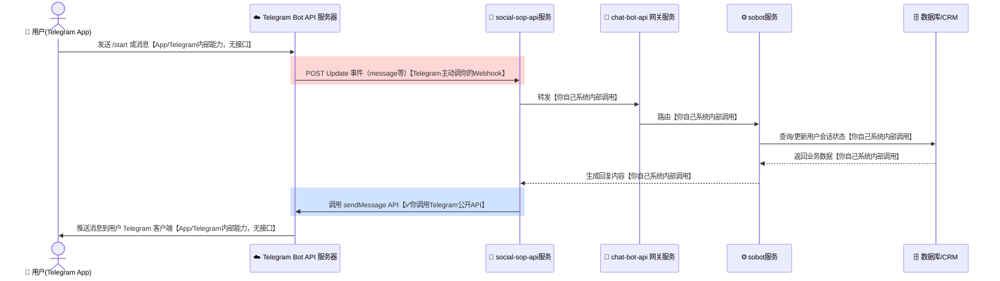
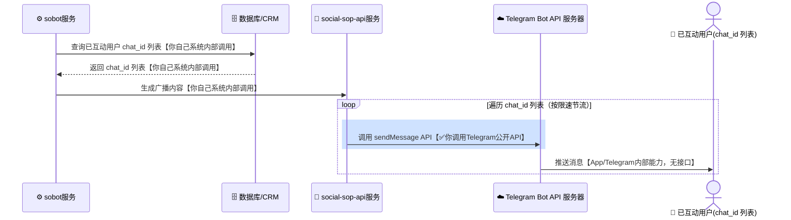
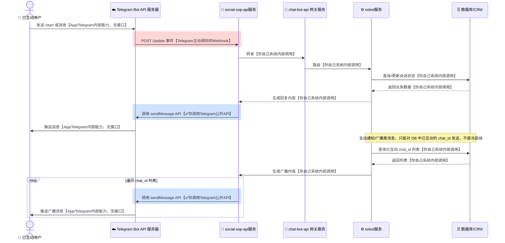

# Telegram Bot 知识与数据流转架构

本文档整理 Telegram Bot API 的核心概念、使用要点，以及消息在系统间的数据流转架构图，便于对接 Telegram 做客服机器人、社群机器人或面向已互动用户的通知/广播。

---

## 一、核心概念区分

Telegram 只有**一个**对外接入方式，没有 Viber/WhatsApp 那种「Bot vs 企业消息」的双轨模式：

| 概念 | 定位 | 是否需要用户先互动 | 典型用途 |
|---|---|---|---|
| **Telegram Bot API** | 用户主动 `/start` 或发消息后，双向对话 | 需要（用户必须主动发起） | 客服机器人、社群机器人、面向已互动用户的通知/广播 |

> **关键差异**：Telegram 没有 Viber Business Messages、也没有 WhatsApp Message Template 那种「无需用户提前互动、企业可对任意手机号/账号冷启动发消息」的能力。这是 Telegram 的机器人隐私设计决定的——**不管通过什么服务商或什么方式，Bot 都无法主动联系一个从未跟它互动过的用户**。也没有 BSP（第三方认证服务商）这个角色，Bot 直接对接 Telegram 自己的 Bot API 服务器，不需要、也不存在中间商。

---

## 二、Telegram Bot API 使用要点

### 1. 创建 Bot

- 在 Telegram 里找 **@BotFather**，发送 `/newbot` 按提示创建，获得 **Bot Token**（形如 `123456:ABC-DEF...`，每次调用 REST API 都要带在 URL 里）。

### 2. 设置 Webhook（或改用长轮询）

Telegram 支持两种接收消息的方式，二选一：

**方式一：Webhook（推荐用于生产环境）**

```bash
curl -X POST "https://api.telegram.org/bot<TOKEN>/setWebhook" \
     -H "Content-Type: application/json" \
     -d '{
           "url": "https://your-domain.com/telegram/webhook",
           "secret_token": "<YOUR_RANDOM_SECRET>",
           "allowed_updates": ["message", "callback_query", "my_chat_member"]
         }'
```

- Webhook 必须是 **HTTPS**。
- Telegram 默认**不对请求做签名**，建议设置 `secret_token`：Telegram 之后每次回调都会在请求头 `X-Telegram-Bot-Api-Secret-Token` 带上这个值，你的服务端要校验它是否匹配。
- 建议同时把入站流量限制在 Telegram 官方公布的 IP 段，双重防伪造。

**方式二：长轮询（本地开发/低并发场景）**

```bash
curl "https://api.telegram.org/bot<TOKEN>/getUpdates?offset=<LAST_UPDATE_ID+1>"
```

- 主动轮询拉取更新，不需要公网 HTTPS 地址，适合本地调试；生产环境一般还是用 Webhook。

### 3. 接收消息（Webhook 收到的回调）

```json
{
  "update_id": 100000001,
  "message": {
    "message_id": 42,
    "from": { "id": 123456789, "is_bot": false, "first_name": "John" },
    "chat": { "id": 123456789, "type": "private" },
    "date": 1700000000,
    "text": "Hello Bot"
  }
}
```

服务端收到后应尽快返回 `HTTP 200`；`chat.id` 是后续调用 `sendMessage` 时唯一需要的目标标识。

### 4. 主动发消息（回复用户）

```bash
curl -X POST "https://api.telegram.org/bot<TOKEN>/sendMessage" \
     -H "Content-Type: application/json" \
     -d '{
           "chat_id": 123456789,
           "text": "你好，我是客服机器人"
         }'
```

- 只能给 `chat_id` **已经存在**（即用户已经 `/start` 过或发过消息）的对象发消息；没有类似 `broadcast_list` 的批量下发接口，需要自己在业务侧循环调用。
- 消息类型支持：text、photo、video、document、inline keyboard（按钮）、reply keyboard（自定义键盘）等。

---

## 三、广播（仅限已互动用户）

- Telegram **没有**面向任意用户/手机号的冷启动广播接口；所谓「广播」本质上是业务侧自己维护一份「已互动 `chat_id` 列表」，然后循环调用 `sendMessage` 逐个发送。
- 速率限制：官方建议单聊约 1 条/秒，群组/广播场景整体约 30 条/秒，超出会被限流（`429 Too Many Requests`，响应里带 `retry_after`），批量广播要做限速/排队重试。
- 没有消息模板审核机制，也没有分类（Transactional/Promotional）限制——只要 `chat_id` 存在，什么类型的消息都可以发，规则比 Viber/WhatsApp 宽松，但前提仍然是「对方必须先互动过」。

---

## 四、数据流转架构图

图形约定：

| 图形 | 含义 |
|---|---|
| 📱（人形 actor） | 手机/用户 App 终端 |
| ☁️ | Telegram Bot API 云服务器 |
| 🚦 / ⚙️ / 🔔 | 企业侧服务组件（网关、业务逻辑、Webhook） |
| 🗄️ | 数据库存储 |

Telegram 没有「首次下发 + 双向会话」这种两阶段生命周期（因为企业永远不能先发起），所以这里只有 **3 张图**，不是 4 张：Bot 双向对话、广播已互动用户、整体架构。

### 1. Telegram Bot API（双向对话）数据流



图例：**✅你调用Telegram公开API**＝你真正发起的接口调用；**Telegram主动调你的Webhook**＝需要你提前用 `setWebhook` 注册好地址，但请求由 Telegram 发起；**App/Telegram内部能力**＝Telegram 自家客户端-服务端协议，你既碰不到也无需实现；**你自己系统内部调用**＝跟 Telegram 完全无关，是你自己代码/数据库之间的调用。

### 2. 广播已互动用户数据流



> 关键点：这条链路只能对 **数据库里已存在的 `chat_id`** 循环发送，不是冷启动——从头到尾没有一步能让 Bot 联系上一个从未互动过的用户，这跟 Viber Business Messages / WhatsApp Message Template 有本质区别。

### 3. 整体系统架构（双向对话 + 广播 共用同一套后端）



> 全图只有一类真正打接口的边（标蓝）：`WH->>TG` 调 `sendMessage`，双向对话和广播走的是**同一个接口**，区别只在于目标 `chat_id` 是实时来自 Webhook 事件、还是从数据库批量查出来的列表——这也是 Telegram 跟 Viber/WhatsApp 最大的不同：没有第二套「企业消息」接口，也没有 BSP 这一层。

---

## 五、接入注意事项

1. **Webhook 校验**：Telegram 默认不签名请求，务必设置 `secret_token` 并校验请求头 `X-Telegram-Bot-Api-Secret-Token`，同时建议限制入站 IP 为 Telegram 官方公布的段。
2. **HTTPS 要求**：Webhook 地址必须是有效证书的 HTTPS，自签名证书需要额外走 `setWebhook` 的证书上传流程。
3. **限速**：单聊约 1 条/秒，整体广播约 30 条/秒（以官方最新文档为准），超限会收到 `429` + `retry_after`，批量广播要做限速队列而不是硬重试。
4. **没有会话时效窗口**：不同于 WhatsApp/Messenger 的 24 小时窗口机制，Telegram 只要 `chat_id` 存在就能随时调用 `sendMessage`，不需要考虑「窗口过期后要不要用模板」的问题。
5. **没有模板审核**：不像 WhatsApp Message Template 需要预先提审，Telegram 消息内容没有平台层面的审核流程，但仍需遵守 Telegram 的机器人使用政策（反垃圾信息规则）。
6. **大文件场景**：云端 Bot API 对上传/下载文件大小有限制，如需处理更大文件可以自建 **Local Bot API Server**（自托管），这是基础设施选择，不是引入第三方 BSP。

---

## 六、小结

- Telegram 只有 **Bot API** 一条接入路径，没有 Viber Business Messages / WhatsApp Message Template 那种冷启动能力，也没有 BSP 概念。
- 「广播」本质上是对已互动用户 `chat_id` 列表的批量 `sendMessage` 循环调用，不是对任意用户的下发。
- 架构上双向对话和广播共用同一套后端（`social-sop-api服务` 接 Webhook、`chat-bot-api 网关服务` 路由、`sobot服务` 处理业务逻辑、数据库存会话与 `chat_id` 列表），差异只在触发源是实时 Webhook 事件还是批量查询结果。
