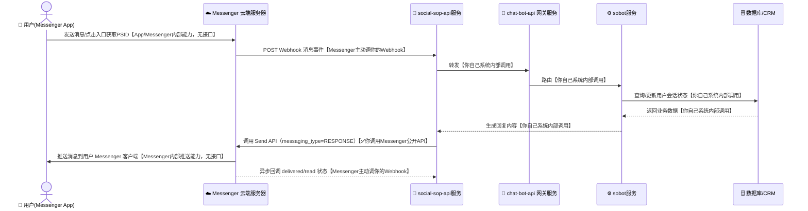
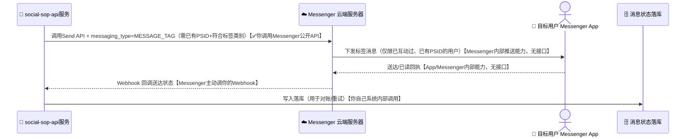
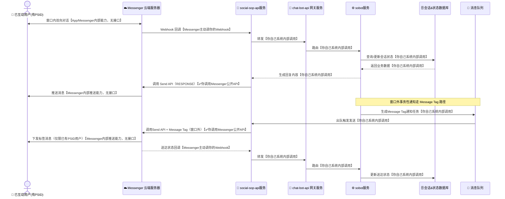
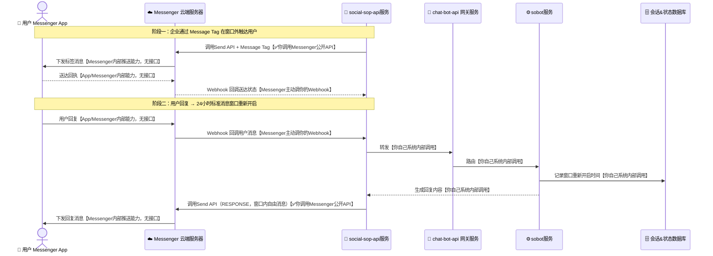

# Facebook Messenger 知识与数据流转架构

本文档整理 Meta（Facebook）Messenger Platform 的核心概念、接入要点，以及消息在系统间的数据流转架构图，便于对接 Messenger 做客服机器人或事务性通知。

---

## 一、核心概念区分

跟 Viber（Bot/Channel/Business Messages 三分）、WhatsApp（Session/Template 两分）不太一样，Messenger 只有**一体化的 Page Bot**，核心是「24 小时标准消息窗口」与窗口外的「Message Tag」构成的连续体：

| 概念 | 定位 | 是否需要已获得 PSID | 典型用途 |
|---|---|---|---|
| **24 小时标准消息窗口内** | 用户发消息后开启/续期 24 小时的免费窗口，期间可发任意内容 | 需要（用户必须先与 Page 互动过） | 客服对话、日常问答、富媒体交互 |
| **Message Tag（标签消息）** | 窗口外，仅限 Meta 允许的特定场景类别 | 需要已有 PSID，且内容必须落在允许类别内 | 确认类更新、账户类更新等事务性通知，**不能**用于营销 |

> **关键差异**：Messenger 没有 Viber Business Messages / WhatsApp Message Template 那种「对任意手机号冷启动触达」的能力。你必须先拿到用户的 **PSID（Page-Scoped ID）**才能给他发消息，而 PSID 只能通过用户主动与你的 Page 互动获得（点击 Send to Messenger 按钮、m.me 链接、Messenger checkbox plugin、评论互动插件、Click-to-Messenger 广告等），不存在凭手机号或任意 Facebook 账号主动发起对话的方式。

---

## 二、Messenger Platform 使用要点

### 1. 创建 Page + Meta App

- 创建 Facebook Page，在 [Meta for Developers](https://developers.facebook.com) 创建 App 并绑定该 Page。
- 生成 **Page Access Token**（调用 Send API 时使用）。

### 2. 设置 Webhook

Meta 会先对你的 Webhook URL 发起一次 GET 校验握手：

```
GET https://your-domain.com/messenger/webhook
    ?hub.mode=subscribe
    &hub.verify_token=<YOUR_VERIFY_TOKEN>
    &hub.challenge=<CHALLENGE_STRING>
```

服务端逻辑：校验 `hub.verify_token` 与你配置的一致后，原样返回 `hub.challenge` 字符串（HTTP 200）。

后续所有事件都以 `POST` JSON 方式推送到该 URL，请求头带 `X-Hub-Signature-256`（基于 App Secret 的 HMAC-SHA256 签名），服务端应校验此签名，拒绝伪造请求。

### 3. 接收消息（Webhook 收到的回调）

```json
{
  "object": "page",
  "entry": [
    {
      "id": "<PAGE_ID>",
      "time": 1610000000000,
      "messaging": [
        {
          "sender": { "id": "<PSID>" },
          "recipient": { "id": "<PAGE_ID>" },
          "timestamp": 1610000000000,
          "message": {
            "mid": "mid.xxxxxxxx",
            "text": "Hello"
          }
        }
      ]
    }
  ]
}
```

服务端需在合理时间内返回 `HTTP 200`，否则 Meta 会判定失败并重试。

### 4. 主动发消息（Send API）

```bash
curl -X POST "https://graph.facebook.com/v20.0/me/messages?access_token=<PAGE_ACCESS_TOKEN>" \
     -H "Content-Type: application/json" \
     -d '{
           "recipient": {"id": "<PSID>"},
           "messaging_type": "RESPONSE",
           "message": {"text": "你好，我是客服机器人"}
         }'
```

- `messaging_type` 决定了这条消息属于哪种场景：
  - `RESPONSE`：24 小时窗口内，对用户消息的响应。
  - `UPDATE`：24 小时窗口内，企业主动发起的更新（仍需在窗口内）。
  - `MESSAGE_TAG`：窗口外发送，必须同时带上 `tag` 字段指明具体标签类别，且内容要与该类别匹配。
- 只能给**已经拿到 PSID** 的用户发消息，PSID 无法凭手机号或用户名主动获取。
- Messenger 没有像 Viber `broadcast_message` 那样的批量广播接口，"群发"本质上是业务侧自己遍历 PSID 列表逐个调用 Send API，且同样要遵守窗口/Tag 规则。

---

## 三、24 小时消息窗口与 Message Tag 使用要点

- 用户每发一条消息，24 小时窗口就会重新开启/续期，期间可用 `RESPONSE`/`UPDATE` 自由发送任意内容。
- 窗口外，只能使用 `MESSAGE_TAG` 发送符合 Meta 当前允许类别的消息（例如确认类更新、账户类更新等），且内容必须与标签类别匹配，**不得**用于营销推广。允许的标签清单和使用规则 Meta 会不定期调整，具体以官方最新文档为准。
- 计费、频控等细节同样请以官方文档为准。

> 如果你的场景是「用户主动来聊」，走 24 小时窗口内自由消息；如果是「窗口已过，但有正当理由要通知用户特定事务」，必须匹配一个被允许的 Message Tag 类别，而不能当成营销群发渠道使用。

---

## 四、数据流转架构图

图形约定（四张图统一用时序图 + 表情符号，一眼区分「设备 / 平台 / 企业服务 / 存储」）：

| 图形 | 含义 |
|---|---|
| 📱（人形 actor） | 手机/用户 Messenger App 终端 |
| ☁️ | Messenger 云平台（Graph API / Webhook 基础设施） |
| 🚦 / ⚙️ / 🔔 | 企业侧服务组件（网关、业务逻辑、Webhook/API 入口） |
| 🗄️ / 📨 | 数据存储（数据库、消息队列） |
| 🏢 | 触发方系统（如订单/风控/营销平台） |

### 1. 24 小时窗口内双向对话数据流



图例：**✅你调用Messenger公开API**＝你真正发起的接口调用；**Messenger主动调你的Webhook**＝需要你提前配置好 Webhook 并通过校验握手，但请求由 Meta 发起；**App/Messenger内部能力**＝Messenger 自家客户端-服务端协议，你既碰不到也无需实现；**你自己系统内部调用**＝跟 Messenger 完全无关，是你自己代码/数据库之间的调用。

### 2. Message Tag（窗口外特定场景消息）数据流



> 关键点：Message Tag 只能发给**已经拿到 PSID** 的用户，且消息内容必须落在 Meta 允许的类别里——它不是像 Viber Business Messages / WhatsApp Message Template 那样可以对任意手机号冷启动触达的通道，触达范围严格受限于「谁已经跟你的 Page 互动过」。

### 3. 整体系统架构（窗口内 + Message Tag 并存场景）



> 全图两处 ✅ 都是你自己直接调用 Messenger 公开接口——跟 Viber/WhatsApp 不同，Messenger 没有 BSP 中间层，企业始终是直接对接 Meta。

### 4. Messenger 完整生命周期（Message Tag 触达 + 窗口重开）数据流

不依赖上一张图单独存在，自成一张完整的图：前半段是企业通过 Message Tag 在窗口外触达一个已有 PSID 的用户，后半段是用户回复后 24 小时窗口重新开启。



> 关键点：这里的"窗口重新打开"是 **Messenger 平台层面的官方机制**——只要用户回复，24 小时免费消息窗口就会按 Meta 规则自动重新计时，企业侧只需要在自己数据库里记录这个时间点供业务逻辑参考，不需要像 Viber 文档里那样自己发明一个"默认已订阅"的内部标记去模拟这件事。

---

## 五、接入注意事项

1. **签名校验**：Webhook 收到请求后必须校验 `X-Hub-Signature-256`（HMAC-SHA256，基于 App Secret），确认请求确实来自 Meta。
2. **PSID 获取**：只能通过 Send to Messenger 按钮、m.me 链接、Messenger checkbox plugin、评论互动插件、Click-to-Messenger 广告等认可入口获得，不存在凭手机号主动发起对话的方式。
3. **messaging_type 规则**：`RESPONSE`/`UPDATE` 必须在 24 小时窗口内使用；`MESSAGE_TAG` 必须在窗口外使用且内容匹配标签类别；允许的标签清单和内容限制 Meta 会不定期调整，务必查最新官方文档。
4. **幂等处理**：同一条消息的 `mid` 可能因网络重试重复投递，业务侧需去重。
5. **超时与重试**：Webhook 响应务必尽快返回 200，避免被 Meta 判定失败反复重试。
6. **降级方案**：核心通知建议做多通道降级（Messenger 触达失败 → 短信/邮件兜底），因为 Messenger 强依赖「用户已互动、已有 PSID」这个前提，触达覆盖率天然低于短信/WhatsApp Template。

---

## 六、小结

- Messenger 只有一体化的 Page Bot，没有 Viber（Bot/Channel/Business Messages）或 WhatsApp（Session/Template）那样明显的产品分裂，而是「24 小时窗口 + Message Tag」构成的一个连续体。
- **无法对任意手机号或任意用户冷启动触达**——必须先有 PSID，这是比 WhatsApp Template 更严格的限制。
- 24 小时窗口的开启/重开是 Meta 官方机制，企业侧只需要记录/参考它，不需要像 Viber 那样自己造一个"默认已订阅"的 workaround。
- 架构设计核心依然是「Webhook 接收 + 异步业务处理 + 消息网关路由 + 状态回执落库对账」，跟 Viber/WhatsApp 共用同一套企业后端（social-sop-api服务 / chat-bot-api 网关服务 / sobot服务 / 数据库）。
