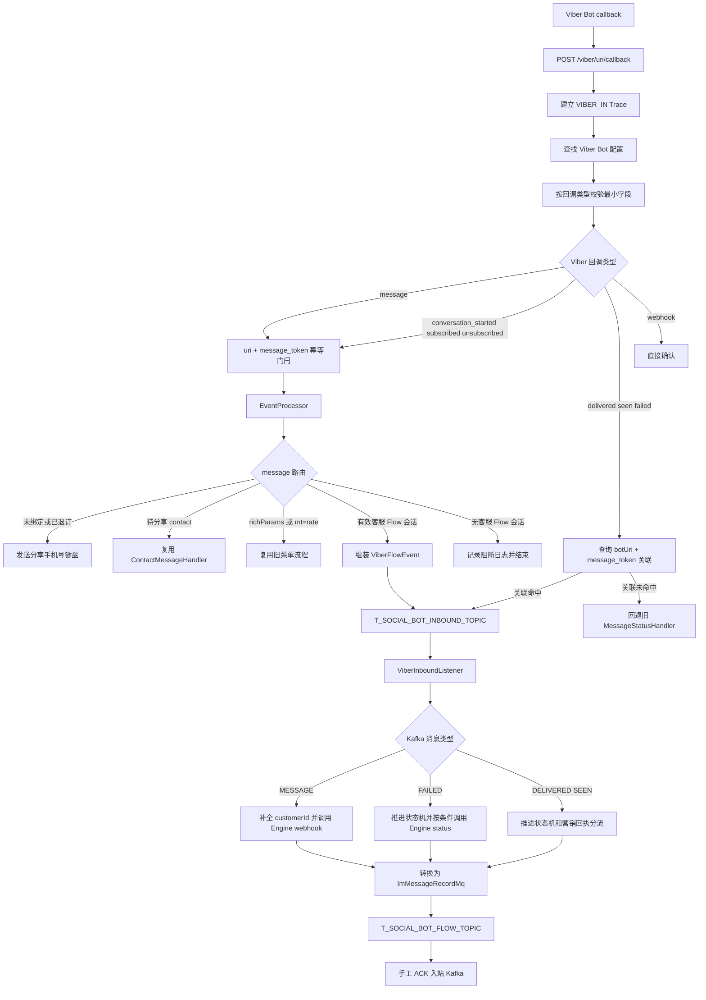

# ViberBot 客服 SOP 侧入站链路开发计划

生成时间：2026-07-14 ; 最后修改时间：2026-07-26

本文记录 `social/social-sop-api/sop-gateway` 当前已经实现的 Viber Bot 客服入站链路。
代码是本文件的事实基准；向 Viber 发送消息见
`ViberBot客服SOP侧出站链路开发计划.md`。

## 1. 当前实现结论

| 能力 | 当前状态 | 代码事实 |
| --- | --- | --- |
| Viber Bot 回调入口 | 已实现 | `POST /viber/{uri}/callback`，Bean 接收 `ViberEventDto`，保留请求头 |
| Webhook 签名校验 | 未实现 | 当前只检查 Bot 配置和回调结构，没有读取签名头进行验签 |
| 回调幂等 | 已实现 | `uri + message_token`，确定性生成 UUID `messageId` |
| 用户注册与绑定 | 复用生产链路 | 分享手机号后交给现有 `ContactMessageHandler` |
| 已退订用户重新进入 | 已实现 | 已绑定但 `flag != 1` 的普通消息也进入分享手机号流程 |
| 客服 Flow 路由 | 已实现 | 只有有效 Redis 客服会话的普通消息才能转客服 |
| 入站 Kafka | 已实现 | `T_SOCIAL_BOT_INBOUND_TOPIC`，key 为 Viber userId |
| Engine 入站接口 | 已实现 | `POST /social/messages/webhook` |
| Flow 记录 Topic | 已实现 | 转换为 `ImMessageRecordMq` 后发布 `T_SOCIAL_BOT_FLOW_TOPIC` |
| 回执统一消费 | 已实现 | `delivered/seen/failed` 命中 token 关联后进入同一入站 Topic |
| DLT | 不使用 | 有限重试耗尽后记录完整消息并提交恢复后的位点 |

## 2. 入站主流程



## 3. HTTP 入口与结构校验

### 3.1 Viber Bot 回调

```http
POST /viber/{uri}/callback
Content-Type: application/json
```

代码位置：

- `com.digiplus.sop.gateway.callback.ViberWebHookController#viberCallback`
- `com.digiplus.sop.gateway.callback.validation.ViberCallbackValidator#validate`

入口行为：

1. 建立 `[VIBER_IN]` Trace。
2. 记录 `uri`、Viber 回调类型、`message_token` 和请求头数量。
3. 调试模式下仅对 `message` 回调打印最多 255 个 Unicode 字符的消息体预览。
4. 按固定平台 `viber` 和 `{uri}` 查找 Bot 配置；不存在返回 `404`。
5. 设置 `platform` 和 `uri`，执行结构级校验。
6. 校验不通过时返回 HTTP 200 和 `rejected!`，不进入业务编排。
7. 可重试异常返回 `503`，未知异常返回 `500`，成功返回 HTTP 200 和 `success!`。

当前没有实现：

- 没有基于原始 `byte[]` 计算 HMAC。
- 没有读取并校验 Viber 签名请求头。
- `@RequestHeader Map<String,String>` 当前用于入口观测和后续安全扩展。

### 3.2 最小字段矩阵

| Viber 回调类型 | 必填字段 |
| --- | --- |
| 所有已支持类型 | `event`、`message_token` |
| `message` | `sender.id`、`message.type` |
| `message/text` | `message.text` |
| `message/picture` | `message.media` |
| `message/contact` | `message.contact.phone_number` |
| `conversation_started`、`subscribed` | `user.id` |
| `unsubscribed`、`delivered`、`seen`、`failed` | `user_id` |
| `webhook` | 无额外字段 |

未知回调类型会在校验层拒绝。

## 4. 幂等与 messageId

代码位置：

- `com.digiplus.sop.gateway.callback.ViberCallbackOrchestrator`
- `com.digiplus.sop.gateway.callback.idempotency.ViberInboundIdempotencyService`

规则：

```text
业务键 = uri + ":" + message_token
messageId = UUID.nameUUIDFromBytes("viber:inbound:" + uri + ":" + message_token)
Redis key = sop:viber:inbound:{uri}:{message_token}
```

只有可能产生用户、注册、Flow 或 Kafka 副作用的回调进入该门闩：

- `message`
- `conversation_started`
- `subscribed`
- `unsubscribed`

`delivered/seen/failed` 使用独立的 message_token 状态机；`webhook` 不产生业务副作用。

状态：

- `PROCESSING`：正在执行，默认 TTL 60 秒。
- `QUEUED`：客服消息已经进入入站 Topic。
- `COMPLETED`：本地注册、订阅或旧 Flow 处理完成。

处理异常时仅删除当前执行者持有的 `PROCESSING`，使 Viber 重投能够继续；终态重复回调返回
`IDEMPOTENT_ACK`。

## 5. 用户准入、退订与分享手机号

代码位置：

- `ViberAdmissionDecider`
- `ViberRouteDecider`
- `ViberMessageCoordinator`
- `ViberPhoneShareStateService`
- `ContactMessageHandler`

准入标准：

- `t_channel_sub_user.login_name` 非空表示已经完成绑定。
- `flag = 1` 表示当前订阅。
- 未绑定或 `flag != 1` 均不能直接进入客服消息 Kafka。

当前路由：

| 用户状态 / 消息 | 处理 |
| --- | --- |
| 未绑定用户发送普通消息 | 关闭客服会话，发送分享手机号键盘 |
| 已绑定但已退订用户发送普通消息 | 同样发送分享手机号键盘，不直接进入默认 Flow |
| 系统正在等待手机号且收到 `contact` | 交给现有 `ContactMessageHandler` |
| 未经系统提示直接发送 `contact` | 不进入注册处理器；按准入状态阻断或进入客服普通消息路径 |
| 注册成功 | 更新 `loginName`、身份索引并执行已选择的 Flow |

奖励保持现有逻辑：`ContactMessageHandler` 仍调用 FreeSpin 和标签奖励接口；重复发放由下游
固定 `transactionId` 幂等控制，SOP 不增加首次注册判断。

## 6. 客服 Flow 与旧流程隔离

### 6.1 客服 Flow 会话

`ViberFlowSessionService` 使用 Redis 保存：

```text
key = VIBER_FLOW_SESSION_{botUri}:{viberUserId}
value = flowName + scenarioGroup + enteredAt
默认 TTL = 86400 秒
```

`ViberFlowEnterAction` 只有在用户已绑定且 `flag=1` 时才：

1. 激活客服 Flow 会话。
2. 发送开放输入框的客服欢迎键盘。
3. 发送失败时立即撤销会话。

### 6.2 普通消息路由

优先级：

1. 手机号分享门闩和绑定状态。
2. 订阅状态。
3. 旧菜单控制文本：包含 `richParams` 或 `mt=rate`。
4. Redis 客服 Flow 会话。

只有第 4 项命中有效会话才发布客服消息。没有有效会话时记录
`MESSAGE_BLOCKED_OUTSIDE_CUSTOMER_FLOW`，不回退到普通文本旧 Flow。

### 6.3 客服入口按钮

`ViberKeyboardButtonFactory` 在非客服 Flow、非分享手机号节点的键盘底部追加纯图片按钮：

```text
viber://pa?chatURI={uri}&context={context}
```

按钮文本为空，图片使用 `BgMedia`。已经处于客服 Flow 时不再追加。

## 7. Kafka 内部模型

### 7.1 入站 Topic

```text
Topic: T_SOCIAL_BOT_INBOUND_TOPIC
配置: sop.viber.cs.inbound.topic
默认消费者组: VIBER_CS_INBOUND_GROUP
分区 key: ViberFlowEvent.viberUserId
```

消息回调的 userId 来自 `sender.id`，状态回执来自 `user_id`。同一用户的普通消息因此进入同一
Kafka 分区；回执不依赖该顺序，但复用相同分区规则。

### 7.2 ViberFlowEvent

当前 schemaVersion 为 `3`，类型包括：

- `MESSAGE`
- `DELIVERED`
- `SEEN`
- `FAILED`
- `SEND_FAILED`

内部消息类型保留 Viber 信息：

- `TEXT`
- `IMAGE`
- `VIDEO`
- `RICH`
- `FILE`
- `STICKER`
- `CONTACT`
- `LOCATION`
- `URL`
- `UNKNOWN`

Kafka 内不提前把未知类型改成 `other`。

### 7.3 Engine 边界

`MessageWebhookRequestAssembler` 将单条消息提交给：

```http
POST /social/messages/webhook
```

Engine 请求中的 `message` 是单个对象，不是数组。

类型规则：

- `TEXT -> text`
- `IMAGE -> image`
- `VIDEO -> video`
- 其他类型在 Engine 边界转换为 `other`
- 文件优先传递 `[fileName] mediaUrl`

`customerId` 若为空，消费者通过进程内 `CustomerIdentityIndex` 查询；缓存未命中时调用
`CustomerRepository#getCustomerByLoginName` 并回填双向索引。

## 8. 回执处理

1. `EventProcessor` 对 `delivered/seen/failed` 先调用
   `ViberMessageStatusService#enqueueIfTrackedMessage`。
2. 通过 `botUri + message_token` 查询 Redis。
3. 命中客服或营销出站关联时，组装回执并发布统一入站 Topic。
4. 未命中时回退历史 `MessageStatusHandler`，不干扰旧 Bot 消息记录。
5. Kafka 消费者推进状态机。
6. 仅 `FAILED` 且推进后的当前状态仍为 `FAILED` 时调用：

```http
POST /social/message/status
```

   当前没有额外检查 `statusAccepted` 和 `sendMode`，因此重复或营销 `FAILED` 也可能上报。
7. `REPLY` 回调不进入旧营销记录 Topic。
8. `MARKET` 的 `DELIVERED/SEEN` 按处理后的当前状态分别发布
   `MSG_RECORD_CENTER_DELIVERED_TOPIC` 和 `MSG_RECORD_CENTER_SEEN_TOPIC`。
   当前没有检查 `statusAccepted`，重复回调可能重复发布。

状态规则：

```text
SENT -> FAILED | DELIVERED | SEEN
FAILED -> DELIVERED | SEEN
DELIVERED -> SEEN
SEEN -> 不再变化
```

## 9. Flow Topic 与 ACK

`ViberFlowEventPublisher` 将内部消息转换为 `List<ImMessageRecordMq>` JSON 后发布：

```text
Topic: T_SOCIAL_BOT_FLOW_TOPIC
配置: sop.viber.cs.flow.topic
```

- `MESSAGE`、所有已关联回执和 `SEND_FAILED` 可以发布。
- 状态机拒绝的乱序或重复回调携带 `statusAccepted=false`；Flow 发布器记录
  `FLOW_PUBLISH_SKIPPED`，不实际写入 Flow Topic。
- Kafka 消费者只有在 Engine、营销回执和 Flow Topic 等必需动作全部成功后才手工 ACK。
- 消费异常使用固定间隔有限重试。
- 重试耗尽后记录 Topic、分区、offset、key、完整 payload 和异常，并提交恢复位点。
- 当前不创建 DLT。

## 10. 配置清单

统一配置类：`com.digiplus.sop.gateway.support.ViberCsProperties`

| 配置 | 默认值 | 用途 |
| --- | --- | --- |
| `sop.viber.cs.debug-enabled` | `true` | 输出消息预览、Engine 请求、Flow payload 和身份索引明细 |
| `sop.viber.cs.message-source` | `sobot` | Engine 与 Flow 消息来源 |
| `sop.viber.cs.flow-session-ttl-seconds` | `86400` | 客服 Flow 会话 TTL |
| `sop.viber.cs.phone-share-state-ttl-seconds` | `1800` | 分享手机号许可 TTL |
| `sop.viber.cs.inbound.topic` | `T_SOCIAL_BOT_INBOUND_TOPIC` | 统一入站 Topic |
| `sop.viber.cs.inbound.group` | `VIBER_CS_INBOUND_GROUP` | 消费者组 |
| `sop.viber.cs.inbound.concurrency` | `3` | 监听器并发 |
| `sop.viber.cs.inbound.publish-timeout-seconds` | `10` | Kafka 发布等待时间 |
| `sop.viber.cs.inbound.retry-interval-ms` | `1000` | 消费失败重试间隔 |
| `sop.viber.cs.inbound.retry-count` | `3` | 消费失败重试次数 |
| `sop.viber.cs.flow.topic` | `T_SOCIAL_BOT_FLOW_TOPIC` | Flow 记录 Topic |
| `sop.viber.cs.flow.publish-timeout-seconds` | `10` | Flow 发布等待时间 |

仍由独立 `@Value` 读取、尚未收进 `ViberCsProperties` 的配置：

| 配置 | 默认值 |
| --- | --- |
| `sop.viber.inbound.processing-timeout-seconds` | `60` |
| `sop.viber.inbound.idempotency-ttl-seconds` | `86400` |
| `sop.viber.inbound.rate-limit.messages-per-minute` | `60` |
| `sop.viber.inbound.rate-limit.registration-attempts-per-ten-minutes` | `5` |

## 11. 代码位置

| 职责 | 代码位置 |
| --- | --- |
| HTTP 回调入口 | `callback/ViberWebHookController.java` |
| 结构校验 | `callback/validation/ViberCallbackValidator.java` |
| 回调编排 | `callback/ViberCallbackOrchestrator.java` |
| 回调幂等 | `callback/idempotency/ViberInboundIdempotencyService.java` |
| 消息准入 | `callback/routing/ViberAdmissionDecider.java` |
| 消息路由 | `callback/routing/ViberRouteDecider.java` |
| 消息协调 | `callback/handler/ViberMessageCoordinator.java` |
| 分享手机号处理 | `callback/handler/message/ContactMessageHandler.java` |
| 客服 Flow 入口 | `callback/action/ViberFlowEnterAction.java` |
| 客服入口按钮 | `helper/ViberKeyboardButtonFactory.java` |
| 入站消息组装 | `service/viber/ViberInboundMessageAssembler.java` |
| 入站 Kafka 发布 | `service/viber/ViberInboundEventPublisher.java` |
| 状态回执关联 | `service/viber/ViberMessageStatusService.java` |
| 统一 Kafka 消费 | `listener/ViberInboundListener.java` |
| Engine 请求转换 | `service/viber/MessageWebhookRequestAssembler.java` |
| Flow 记录转换 | `support/ToImMessageRecordConverter.java` |
| Flow Kafka 发布 | `service/viber/ViberFlowEventPublisher.java` |
| Kafka 重试配置 | `conf/KafkaConsumeConfig.java` |

## 12. 当前剩余事项

1. Webhook 签名校验尚未实现；当前代码不能证明请求一定来自 Viber。
2. Engine 非成功业务码只有统一拒绝和重试，没有细分可重试/终态错误码。
3. `phoneEncry` 当前直接来自 `ChannelSubUser.phone`，仍需持续保证该字段存储的是约定的加密串。
4. 入站幂等和限流配置仍使用 `sop.viber.inbound`，尚未统一到 `sop.viber.cs`。
5. Kafka 重试耗尽后会提交位点且无 DLT，需要依赖日志告警和人工补偿。
6. Engine failed 上报和营销旧 Topic 发布没有统一检查 `statusAccepted`，重复回调可能重复触发
   下游。

## 13. 验收清单

1. 新用户普通消息收到分享手机号键盘，不能进入客服 Kafka。
2. 已绑定但已退订用户普通消息同样收到分享手机号键盘。
3. 点击系统分享手机号按钮后复用现有注册链路；重复奖励由下游幂等。
4. `richParams` 和 `mt=rate` 继续进入旧菜单流程。
5. 只有客服 Flow 激活后，文本、图片、视频和其他类型消息才进入入站 Topic。
6. 同一 `uri + message_token` 重投得到相同 `messageId` 且不重复发布。
7. Engine 收到单个 `message` 对象和毫秒时间戳。
8. Engine 成功后才发布 Flow Topic，Flow 成功后才 ACK。
9. `failed` 处理后当前状态仍为 `FAILED` 时上报 Engine；`delivered/seen` 不上报 Engine。
10. 营销 `delivered/seen` 按当前状态进入旧记录中心 Topic；重复副作用是当前已记录问题。
