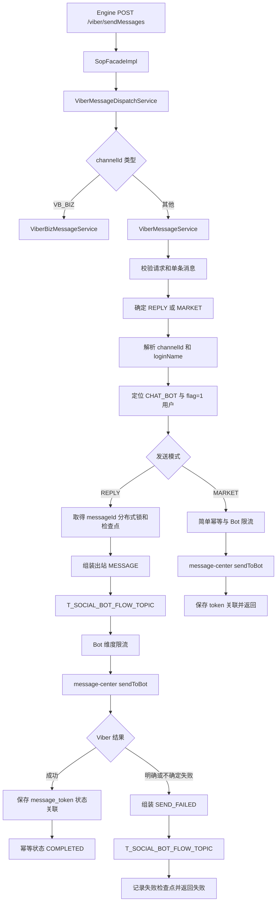

# ViberBot 客服 SOP 侧出站链路开发计划

生成时间：2026-07-14 ; 最后修改时间：2026-07-26

本文记录 `social/social-sop-api/sop-gateway` 当前已经实现的 Viber 出站链路。重点是
`VB_CB` 的客服回复；`VB_BIZ` 由独立 Viber Biz 服务处理，不复用 Bot 会话定位和
message-center Bot API 请求。

## 1. 当前实现结论

| 能力 | 当前状态 | 代码事实 |
| --- | --- | --- |
| Engine 调用入口 | 已实现 | `POST /viber/sendMessages` |
| Bot / Biz 分流 | 已实现 | `ViberMessageDispatchService` 按 channelId 分流 |
| 单条消息校验 | 已实现 | 每次请求必须且只能包含一个消息项 |
| 支持类型 | 已实现 | `text/image/video/rich` |
| 用户定位 | 已实现 | loginName 优先；仅 customerId 时通过双向索引恢复 loginName |
| 订阅校验 | 已实现 | 只查 `botUri + loginName + flag=1` |
| 客服回复幂等 | 已实现 | Redis 分布式锁和可恢复检查点状态机 |
| 营销幂等 | 已实现 | Redis 简单终态缓存 |
| Bot 集群限流 | 已实现 | Redisson `RRateLimiter`，默认每 Bot 10 QPS |
| Flow 前置消息记录 | 客服回复已实现 | 调用 Viber 前发布 `MESSAGE` 到 Flow Topic |
| 发送失败记录 | 客服回复已实现 | 发布 `SEND_FAILED` 到 Flow Topic |
| SDK 发送 | 已实现 | `Messenger.viber().sendToBot` |
| token 状态关联 | 已实现 | messageId 与 `botUri + message_token` 双索引 |
| 客服消息数据库落库 | SOP 不执行 | 通过 Flow Topic 交给下游 |

## 2. 出站主流程



## 3. Engine 调用 SOP

### 3.1 接口

```http
POST /viber/sendMessages
Content-Type: application/json
```

Feign 契约：

```java
@FeignClient(name = "c66-social-sop-api", contextId = "viber")
SimpleResult<ViberMessageResp> sendViberMessages(ViberMessageReq request)
```

代码位置：

- `com.digiplus.sop.gateway.facade.SopFacade`
- `com.digiplus.sop.gateway.facade.impl.SopFacadeImpl`
- `com.digiplus.sop.gateway.service.viber.ViberMessageDispatchService`

### 3.2 请求结构

```json
{
  "channelId": "BP_VB_CB_bptestbot1",
  "loginName": "user01",
  "customerId": "950000000000000001",
  "messageId": "engine-message-id",
  "phoneEncry": "",
  "message": [
    {
      "type": "text",
      "content": "Hello"
    }
  ],
  "timestamp": 1785036570921,
  "messageSource": "sobot",
  "market": false
}
```

约束：

1. `channelId` 和 `messageId` 必填。
2. `loginName/customerId` 至少提供一个。
3. `message` 必须包含且只能包含一个非空元素。
4. `timestamp` 按毫秒传递。
5. `market=false` 为客服回复 `REPLY`，`market=true` 为营销 `MARKET`。

### 3.3 响应结构

业务对象：

```json
{
  "messageToken": "6262006934517515605",
  "viberStatus": 0,
  "viberStatusMessage": "ok",
  "billingStatus": 0
}
```

外层使用 `SimpleResult<ViberMessageResp>`。字段含义：

- `messageToken`：Viber Bot API 返回的 `message_token`。
- `viberStatus`：供应商原始状态码。
- `viberStatusMessage`：供应商原始状态文本。
- `billingStatus`：SDK 扩展属性中的计费状态。

SOP 错误码：

| 错误码 | 当前语义 |
| --- | --- |
| `4000` | 请求参数、channelId、消息类型或 URL 校验失败 |
| `1001` | 正在处理、限流、关联待恢复或发送结果不确定 |
| `2001` | 未订阅、目标不存在或 Viber 明确终态拒绝 |

## 4. channelId 与用户定位

### 4.1 channelId

格式：

```text
{两位产品线}_{两位渠道}_{两位子类型}_{完整名称}
```

Viber Bot 客服只接受：

```text
{productLine}_VB_CB_{botName}
```

解析器只拆前三个下划线，`botName` 中允许继续包含下划线。

子类型：

- `CB = CHAT_BOT`
- `CH = CHANNEL`
- `BZ = BUSINESS_ACCOUNT / BUSINESS`

### 4.2 用户身份

1. `loginName` 非空时直接使用。
2. 仅提供 `customerId` 时，通过 `CustomerIdentityIndex` 查找 loginName。
3. 进程内缓存未命中时调用 `CustomerRepository#queryByCustomerId`。
4. Bot 按 `platform=viber + botName` 查找，并再次要求 `botType=CHAT_BOT`。
5. 用户按 `botUri + loginName + flag=1` 查找。
6. 未找到订阅用户时返回 `2001`，不调用 Viber。

## 5. 消息类型

| 类型 | 必填字段 | Viber SDK 映射 |
| --- | --- | --- |
| `text` | `content` | `text` |
| `image` | `imageUrl` | `picture`，描述来自 `imageText`，缩略图传空串 |
| `video` | `videoUrl`、正数 `videoSize` | `video` |
| `rich` | `content`、`imageUrl`、`buttonLabel`、`buttonUrl` | `rich_media` |

限制：

- `videoSize` 最大 26 MB。
- `videoUrl` 和 `imageUrl` 必须为 HTTPS。
- `buttonUrl` 允许 HTTP 或 HTTPS。
- `buttonLabel` 长度为 1 到 30。
- sender 使用 Bot 配置中的 `botName`，最大 28 个字符。
- `tracking_data` 固定为 `{messageId}:0`。

`rich` 当前构造为三段：

1. 上方文本，6 列 3 行。
2. 中间图片，6 列 3 行。
3. 下方可点击按钮，6 列 1 行。

请求 JSON 超过 30 KB 时拒绝发送。

## 6. 客服回复可恢复状态机

代码位置：

- `ViberMessageService#processReply`
- `ViberOutboundIdempotencyService#executeStateful`
- `ViberOutboundIdempotencyRecord`

Redis 幂等键：

```text
sop:viber:outbound:idempotency:{messageId}
```

状态：

| 状态 | 语义 |
| --- | --- |
| `PROCESSING` | 初始化出站工作流 |
| `MESSAGE_FLOW_PENDING` | 出站原消息等待 Flow Topic ACK |
| `MESSAGE_RECORDED` | 出站原消息已被 Flow Topic 接收 |
| `SEND_IN_PROGRESS` | SDK 已开始调用，但结果尚未形成检查点 |
| `VIBER_ACCEPTED` | Viber 已接受，等待 token 关联 |
| `SEND_FAILED_FLOW_PENDING` | `SEND_FAILED` 等待 Flow Topic ACK |
| `RETRYABLE_FAILED` | Viber 明确返回可重试拒绝，等待相同 messageId 重试 |
| `RESULT_UNCERTAIN` | 最终结果不确定，自动重发被阻止 |
| `COMPLETED` | Viber 已接受且 token 关联完成 |
| `SENT` | 兼容旧简单幂等的成功终态 |
| `FAILED_FINAL` | 明确终态失败，自动重发被阻止 |

客服回复顺序：

```text
PROCESSING
  -> MESSAGE_FLOW_PENDING
  -> MESSAGE_RECORDED
  -> SEND_IN_PROGRESS
  -> VIBER_ACCEPTED
  -> COMPLETED
```

失败顺序：

```text
SEND_IN_PROGRESS
  -> SEND_FAILED_FLOW_PENDING
  -> RETRYABLE_FAILED | RESULT_UNCERTAIN | FAILED_FINAL
```

相同 `messageId` 重入时：

- 已完成副作用不重复执行。
- `RETRYABLE_FAILED` 增加 `sendAttempt`，重新发布一条出站 `MESSAGE` 后再发送。
- `RESULT_UNCERTAIN` 和 `SEND_IN_PROGRESS` 不自动重发，避免重复送达。
- `COMPLETED` 直接返回历史成功结果。
- `FAILED_FINAL` 直接返回历史失败结果。

## 7. Flow Topic 记录

客服回复在调用 Viber 前发布 `ViberFlowEventType.MESSAGE`：

```text
T_SOCIAL_BOT_FLOW_TOPIC
```

发送失败后发布 `ViberFlowEventType.SEND_FAILED`。两者均通过
`ToImMessageRecordConverter` 转换为 `List<ImMessageRecordMq>` JSON。

当前边界：

- `REPLY` 执行上述前置消息记录和失败记录。
- `MARKET` 使用简单发送流程，不执行客服回复的 Flow 前置检查点。
- SOP 不把客服消息持久化到本地业务表。

## 8. message-center 调用

代码位置：

- `com.digiplus.sop.gateway.service.viber.ViberOutboundSendService`
- `com.digiplus.foundation.messaging.Messenger`

调用：

```text
Messenger.viber().sendToBot(ViberBotMessagePayload)
```

Payload：

- `traceId = messageId`
- `botToken = BotTokenConfig.token`
- `receiver = ChannelSubUser.subId`
- `sender.name = BotTokenConfig.botName`
- `tracking_data = messageId:0`

普通客服回复不使用 `broadcast_message`。

## 9. 供应商结果处理

`ViberMessageService` 优先使用 SDK 的 `ViberResponseStatus`，缺失时再由原始状态码映射。

当前特殊处理：

- `RECEIVER_NOT_SUBSCRIBED`：更新本地用户为退订，返回 `2001`。
- `TOO_MANY_REQUESTS`：返回 `1001`。
- 其他明确拒绝：返回 `2001`。
- 传输异常或无法确认结果：发布 `SEND_FAILED`，状态为 `RESULT_UNCERTAIN`，返回 `1001`。
- 成功但 `message_token` 为空：记录错误日志，当前仍完成客服幂等状态，但无法建立回执关联。

## 10. token 状态关联

成功返回非空 `message_token` 后保存两类 Redis 索引：

```text
viber:cs:outbound:message:{messageId}:0
viber:cs:bot:{botUri}:message_token:{messageToken}:status
```

记录内容包括：

- `messageId`
- `messageToken`
- `botUri`
- `channelId`
- `loginName`
- `customerId`
- `sendMode`
- `sendAttempt`
- `traceId`
- 当前状态和过期时间

状态关联 TTL 由 `ViberOutboundStatusService.STATUS_TTL_SECONDS` 固定为 86400 秒，当前不读取
`ViberCsProperties`。出站幂等检查点使用独立的可配置 TTL。

收到 `delivered/seen/failed` 后按 `botUri + message_token` 关联原消息，再进入统一入站 Topic。

## 11. 回执状态机

```text
SENT -> FAILED | DELIVERED | SEEN
FAILED -> DELIVERED | SEEN
DELIVERED -> SEEN
SEEN -> SEEN
```

语义：

- `FAILED` 之后的 `DELIVERED/SEEN` 是更强事实，可以推进。
- `DELIVERED` 之后的 `FAILED` 被拒绝。
- `SEEN` 不再回退。
- 状态未发生变化时 `statusAccepted=false`；消费者仍会调用 Flow 发布器，但
  `ViberFlowEventPublisher` 会记录 `FLOW_PUBLISH_SKIPPED` 并跳过实际发布。

客服回复：

- `FAILED` 回调处理后，只要当前缓存状态仍是 `FAILED` 就调用 Engine
  `POST /social/message/status`。
- 当前代码没有同时检查 `statusAccepted` 或 `sendMode`，因此重复 `FAILED` 可能重复上报，
  已关联的营销 `FAILED` 也会进入该接口。这是当前实现问题，不应描述成已经完成严格去重。
- `DELIVERED/SEEN` 只推进状态、记录日志并发布 Flow Topic。

营销消息：

- `DELIVERED/SEEN` 根据处理后的当前状态额外进入旧记录中心 Topic。
- 当前发布器没有检查 `statusAccepted`，重复同状态回调可能再次发布，由旧记录中心承担幂等。

## 12. 配置

统一配置类：`ViberCsProperties`

| 配置 | 默认值 | 用途 |
| --- | --- | --- |
| `sop.viber.cs.debug-enabled` | `true` | 输出完整出站请求和 Flow payload |
| `sop.viber.cs.flow.topic` | `T_SOCIAL_BOT_FLOW_TOPIC` | 客服消息及状态记录 |
| `sop.viber.cs.flow.publish-timeout-seconds` | `10` | Flow Topic ACK 超时 |
| `sop.viber.cs.outbound.idempotency-processing-ttl-seconds` | `60` | 初始处理中缓存 TTL |
| `sop.viber.cs.outbound.idempotency-ttl-seconds` | `86400` | 客服出站幂等检查点 TTL；token 状态关联另由代码固定为 86400 秒 |
| `sop.viber.cs.outbound.rate-limit-requests-per-second` | `10` | 每 Bot 集群 QPS |

## 13. 代码位置

| 职责 | 代码位置 |
| --- | --- |
| Feign 门面 | `facade/SopFacade.java` |
| HTTP 实现 | `facade/impl/SopFacadeImpl.java` |
| 协议分流 | `service/viber/ViberMessageDispatchService.java` |
| Bot 业务编排 | `service/viber/ViberMessageService.java` |
| 会话定位 | `service/viber/ViberConversationLocator.java` |
| channelId 解析 | `utils/ChannelIdParser.java` |
| 身份双向索引 | `service/viber/CustomerIdentityIndex.java` |
| 幂等检查点 | `service/viber/ViberOutboundIdempotencyService.java` |
| 集群限流 | `service/viber/ViberOutboundRateLimiter.java` |
| SDK 适配 | `service/viber/ViberOutboundSendService.java` |
| Flow 消息组装 | `service/viber/ViberFlowEventAssembler.java` |
| Flow 发布 | `service/viber/ViberFlowEventPublisher.java` |
| token 状态关联 | `service/viber/ViberOutboundStatusService.java` |
| 回调关联与入站发布 | `service/viber/ViberMessageStatusService.java` |
| 统一回执消费 | `listener/ViberInboundListener.java` |

## 14. 当前剩余事项

1. 成功但 `message_token` 为空时仍会完成客服幂等状态，后续回执无法关联。
2. token 关联写入失败返回 `1001`，没有独立后台恢复任务；相同 messageId 可从
   `VIBER_ACCEPTED` 检查点继续关联。
3. Redis 状态关联默认只保留 24 小时，超过 TTL 的晚到回执会回退旧链路。
4. Kafka 重试耗尽无 DLT，只保留完整日志。
5. Webhook 签名校验尚未实现，状态回调来源仍依赖网络边界和 Bot 配置。

## 15. 验收清单

1. `VB_CB` 进入 Bot 链路，`VB_BIZ` 进入 Biz 链路。
2. 每次请求只能发送一条消息。
3. `loginName` 或 `customerId` 任一可唯一定位用户。
4. 未订阅用户不会调用 Viber。
5. `text/image/video/rich` 分别形成正确 SDK 请求。
6. 客服回复在 SDK 调用前先发布 `MESSAGE` 到 Flow Topic。
7. 明确失败和不确定失败均发布 `SEND_FAILED`。
8. 同一 `messageId` 重试按检查点恢复，不重复已确认动作。
9. 成功后可由 `message_token` 找回 Engine `messageId`。
10. `FAILED/DELIVERED/SEEN` 按状态机更新缓存并记录 `statusAccepted`；当前副作用尚未全部按
    `statusAccepted` 去重。
