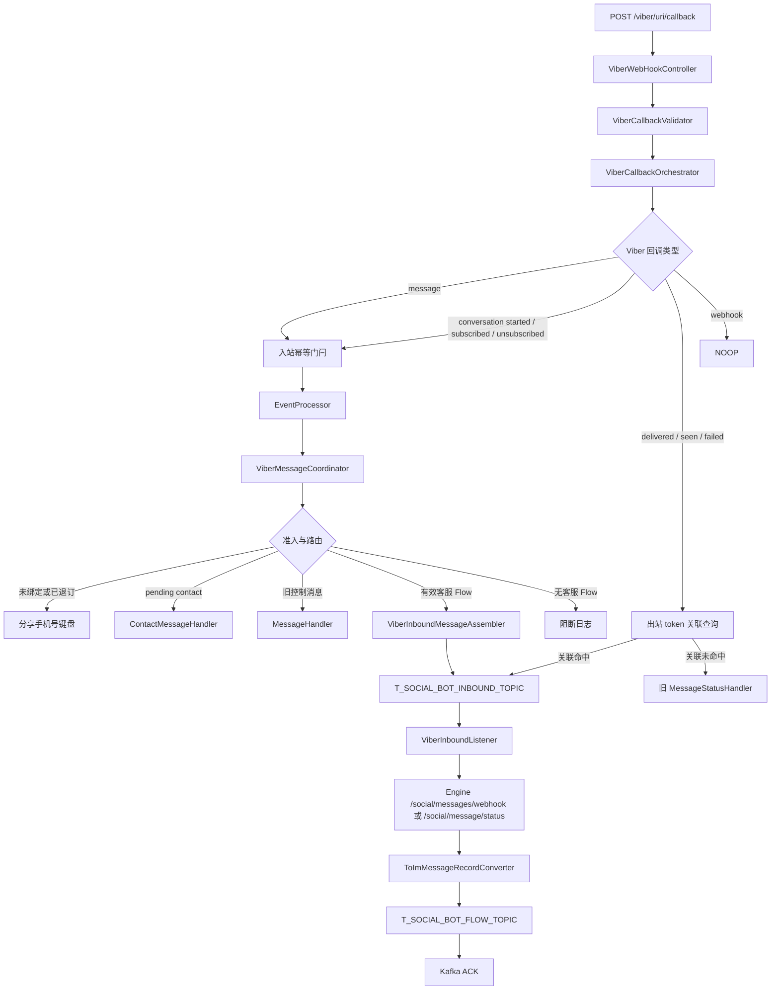
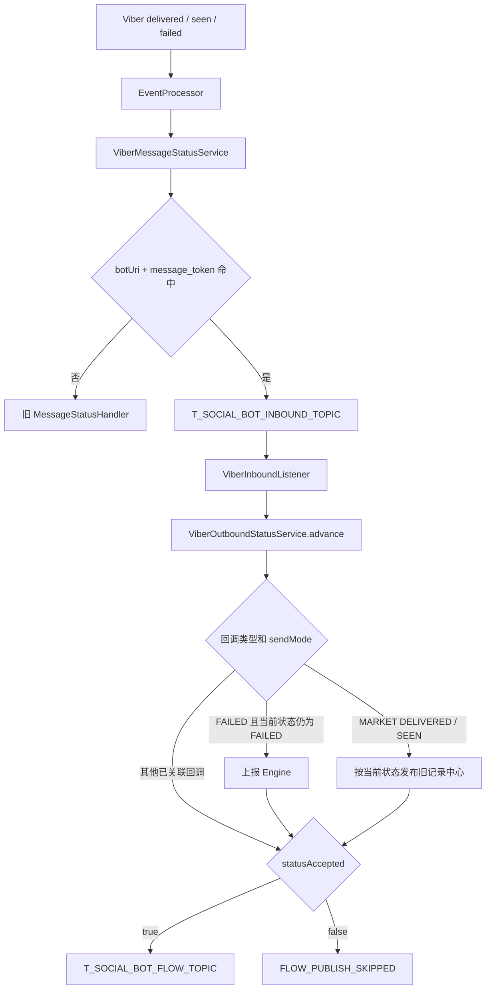

# ViberBot 客服 SOP 侧当前实现流程复核

生成时间：2026-07-15 ; 最后修改时间：2026-07-26

本文以 `social/social-sop-api/sop-gateway` 当前代码为准，复核 Viber Bot 客服入站、出站和
状态回执链路。计划细节分别见：

1. `ViberBot客服SOP侧入站链路开发计划.md`
2. `ViberBot客服SOP侧出站链路开发计划.md`

## 1. 入站当前实现



### 1.1 步骤与代码位置

| 步骤 | 当前行为 | 代码位置 |
| --- | --- | --- |
| IN-01 | Bean 接收 `ViberEventDto` 和请求头，建立 `[VIBER_IN]` Trace | `ViberWebHookController#viberCallback` |
| IN-02 | 按 `platform=viber + uri` 查找 Bot 配置 | `ViberWebHookController#handleViberCallback` |
| IN-03 | 按回调类型校验最小字段；当前不验签 | `ViberCallbackValidator#validate` |
| IN-04 | `message/conversation_started/subscribed/unsubscribed` 使用 `uri + message_token` 幂等 | `ViberCallbackOrchestrator`、`ViberInboundIdempotencyService` |
| IN-05 | 用户级消息和注册尝试限流 | `ViberInboundRateLimiter#allow` |
| IN-06 | 未绑定和已退订用户均进入分享手机号流程 | `ViberAdmissionDecider`、`ViberRouteDecider` |
| IN-07 | 待分享 `contact` 复用现有注册处理器 | `ContactMessageHandler#processMessageInner` |
| IN-08 | `richParams`、`mt=rate` 进入旧菜单逻辑 | `ViberLegacyMessageMatcher` |
| IN-09 | 只有有效客服 Flow 会话的普通消息才转客服 | `ViberFlowSessionService`、`ViberRouteDecider` |
| IN-10 | 保留供应商原生类型和完整字段，组装 schema v3 | `ViberInboundMessageAssembler` |
| IN-11 | 发布 `T_SOCIAL_BOT_INBOUND_TOPIC`，key 为 Viber userId | `ViberInboundEventPublisher`、`ViberFlowPartitionKeyBuilder` |
| IN-12 | MESSAGE 补全 customerId 后调用 Engine | `ViberInboundListener#submitMessageToEngine` |
| IN-13 | Engine 边界只保留 text/image/video，其他变为 other | `MessageWebhookRequestAssembler` |
| IN-14 | 转换为 `List<ImMessageRecordMq>` 并发布 Flow Topic | `ToImMessageRecordConverter`、`ViberFlowEventPublisher` |
| IN-15 | 必需动作成功后手工 ACK | `ViberInboundListener#consume` |

### 1.2 与原计划相比已经变化的事实

1. 回调入口不再使用动态 `{platform}`，固定为 `/viber/{uri}/callback`。
2. 当前不执行 Webhook 签名校验；文档不得写成“验签已完成”。
3. `message` 请求 Engine 时是单个对象，不是数组。
4. `ViberFlowEvent` 当前 schemaVersion 为 3。
5. `FILE/STICKER/CONTACT/LOCATION/URL/UNKNOWN` 可以进入客服 Kafka，在 Engine 边界降级为
   `other`，不是入口直接丢弃。
6. 已绑定但已退订用户发送普通消息不会直接进入默认 Flow，而是先显示分享手机号键盘。
7. `customerId` 在 Kafka 消费端通过本地双向索引和用户域查询补全。
8. 转换器实际名称为 `ToImMessageRecordConverter`，不存在
   `ViberFlowEventToImMessageRecordConverter`。
9. 统一配置类名称为 `ViberCsProperties`，不存在 `ViberCustomerServiceProperties`。

## 2. 出站当前实现

```mermaid
flowchart TD
    A[POST /viber/sendMessages] --> B[SopFacadeImpl]
    B --> C[ViberMessageDispatchService]
    C --> D{channelId}
    D -->|VB_CB| E[ViberMessageService]
    D -->|VB_BIZ| F[ViberBizMessageService]
    E --> G[校验和目标定位]
    G --> H{REPLY / MARKET}

    H -->|REPLY| I[ViberOutboundIdempotencyService]
    I --> J[发布出站 MESSAGE 到 Flow Topic]
    J --> K[ViberOutboundRateLimiter]
    K --> L[ViberOutboundSendService]
    L --> M[Messenger.viber().sendToBot]
    M --> N{发送结果}
    N -->|成功| O[ViberOutboundStatusService 保存 token 关联]
    O --> P[COMPLETED]
    N -->|失败或不确定| Q[发布 SEND_FAILED 到 Flow Topic]
    Q --> R[失败检查点]

    H -->|MARKET| S[简单幂等]
    S --> K
```

### 2.1 步骤与代码位置

| 步骤 | 当前行为 | 代码位置 |
| --- | --- | --- |
| OUT-01 | Engine 使用 `POST /viber/sendMessages` | `SopFacade#sendViberMessages` |
| OUT-02 | 根据 channelId 分流 Bot 与 Biz | `ViberMessageDispatchService#send` |
| OUT-03 | 校验单条 `text/image/video/rich` | `ViberMessageService#validate` |
| OUT-04 | `isMarket` 转换为 `REPLY/MARKET` | `ViberMessageService#innerSend` |
| OUT-05 | loginName 缺失时按 customerId 反查 | `CustomerIdentityIndex#findLoginName` |
| OUT-06 | 只定位 CHAT_BOT 和 `flag=1` 用户 | `ViberConversationLocator#locate` |
| OUT-07 | 同 messageId 使用分布式锁与 Redis 检查点 | `ViberOutboundIdempotencyService` |
| OUT-08 | REPLY 在发送前发布 `MESSAGE` 到 Flow Topic | `ViberMessageService#publishMessageFlow` |
| OUT-09 | 每 Bot 使用 Redisson 集群限流 | `ViberOutboundRateLimiter#acquire` |
| OUT-10 | 组装 SDK payload 并唯一调用一次 `sendToBot` | `ViberOutboundSendService#send` |
| OUT-11 | 失败或不确定结果发布 `SEND_FAILED` | `ViberMessageService#prepareSendFailed` |
| OUT-12 | 成功后保存 messageId / message_token 双索引 | `ViberOutboundStatusService#saveAccepted` |
| OUT-13 | 返回 `SimpleResult<ViberMessageResp>` | `ViberMessageService#toReplyResponse` |

### 2.2 当前可恢复检查点

```text
PROCESSING
  -> MESSAGE_FLOW_PENDING
  -> MESSAGE_RECORDED
  -> SEND_IN_PROGRESS
  -> VIBER_ACCEPTED
  -> COMPLETED
```

失败：

```text
SEND_FAILED_FLOW_PENDING
  -> RETRYABLE_FAILED | RESULT_UNCERTAIN | FAILED_FINAL
```

这是当前代码已经实现的行为，不再是计划中的后续优化。

### 2.3 与旧文档相比已经变化的事实

1. 出站业务类为 `ViberMessageService`，不是 `ViberReplyService`。
2. 返回类型为 `ViberMessageResp`，不是 `ViberReplyResp`。
3. 客服回复已经实现前置 `MESSAGE` 记录和发送失败 `SEND_FAILED` 记录。
4. 客服回复已经实现细粒度可恢复检查点，而不是简单的三态幂等。
5. 视频当前已由 message-center DTO 和 SDK 支持，要求 `videoSize` 且最大 26 MB。
6. rich 消息当前为文本、图片、按钮三段布局。
7. `tracking_data` 为 `{messageId}:0`，状态主关联键仍是 `message_token`。
8. 状态关联失败可由 `VIBER_ACCEPTED` 检查点在同 messageId 重入时继续，不会重新调用 SDK。

## 3. 状态回执当前实现



状态转换：

| 当前状态 | 可接受的新状态 |
| --- | --- |
| `SENT` | `FAILED`、`DELIVERED`、`SEEN` |
| `FAILED` | `DELIVERED`、`SEEN` |
| `DELIVERED` | `SEEN` |
| `SEEN` | 无 |

被拒绝的乱序、重复或弱状态设置 `statusAccepted=false`。当前 `ViberInboundListener` 仍会
调用 Flow 发布器，但 `ViberFlowEventPublisher` 会记录 `FLOW_PUBLISH_SKIPPED` 并跳过实际
发布。

当前副作用门闩并不完整：

- `FAILED` 上报只判断处理后状态是否仍为 `FAILED`，未检查 `statusAccepted` 和
  `sendMode`。
- 营销 `DELIVERED/SEEN` 发布只检查处理后当前状态，未检查 `statusAccepted`。
- 因此重复 `FAILED` 可能再次上报 Engine，重复营销送达/已读可能再次发布旧记录 Topic。

## 4. Kafka 与持久化边界

客服链路实际使用两个主要 Topic：

| Topic | 内容 | 生产者 | 消费者 |
| --- | --- | --- | --- |
| `T_SOCIAL_BOT_INBOUND_TOPIC` | Viber 用户消息和命中关联的状态回执 | Webhook 线程 | `ViberInboundListener` |
| `T_SOCIAL_BOT_FLOW_TOPIC` | `List<ImMessageRecordMq>` 形式的入站、出站和状态记录 | 入站消费者、出站服务 | 下游记录消费者 |

营销状态还会使用：

- `MSG_RECORD_CENTER_DELIVERED_TOPIC`
- `MSG_RECORD_CENTER_SEEN_TOPIC`

SOP 不为客服消息新增业务表。Redis 用于短期会话、幂等检查点、身份索引辅助和 token 状态关联；
客服业务记录由下游消费 Flow Topic 后持久化。

## 5. Trace 与调试日志

| 场景 | 前缀 | traceId 来源 |
| --- | --- | --- |
| Viber 回调和用户消息 | `[VIBER_IN]` | 回调入口生成 |
| Engine 出站调用 | `[VIBER_OUT]` | 优先使用请求 messageId |
| 状态回执消费 | `[VIBER_OUT]` | 继承关联记录中的原 Trace |

调试模式 `sop.viber.cs.debug-enabled=true` 时输出：

- 回调 `message` 的 255 字符预览。
- 完整 `ViberMessageReq`。
- `ViberFlowEvent` Kafka 消费 payload。
- 提交 Engine 前的 `MessageWebhookReq` JSON。
- 发布 Flow Topic 前的 `List<ImMessageRecordMq>` JSON。
- loginName/customerId 双向索引的具体值。

## 6. 当前仍存在的问题

| 编号 | 代码事实 | 影响 |
| --- | --- | --- |
| C-01 | Bot Webhook 没有签名校验 | 入口来源真实性依赖网关和网络边界 |
| C-02 | Kafka 重试耗尽后提交位点且没有 DLT | 需要日志告警和人工补偿 |
| C-03 | 成功但 message_token 为空时仍完成客服幂等状态 | 后续回执无法关联 |
| C-04 | Engine 错误码未分类 | 所有非接受响应均触发相同 Kafka 重试 |
| C-05 | token 状态关联由 `ViberOutboundStatusService` 固定保留 24 小时 | 晚到回执可能回退旧链路，且不能通过 Nacos 调整 |
| C-06 | 入站幂等和限流配置仍使用 `sop.viber.inbound` | 配置前缀尚未完全统一 |
| C-07 | `DEFAULT_FLOW_ENTRY` 分支和 `ViberDefaultFlowEntryHandler` 仍保留，但当前路由不再产生该分支 | 兼容代码处于不可达状态 |
| C-08 | 状态回调副作用没有统一检查 `statusAccepted` | 重复 failed 可能重复上报 Engine，重复营销 delivered/seen 可能重复发旧 Topic |

## 7. 关键代码索引

### 7.1 入站

- `callback/ViberWebHookController.java`
- `callback/ViberCallbackOrchestrator.java`
- `callback/validation/ViberCallbackValidator.java`
- `callback/idempotency/ViberInboundIdempotencyService.java`
- `callback/routing/ViberAdmissionDecider.java`
- `callback/routing/ViberRouteDecider.java`
- `callback/handler/ViberMessageCoordinator.java`
- `callback/handler/message/ContactMessageHandler.java`
- `callback/action/ViberFlowEnterAction.java`
- `service/viber/ViberInboundMessageAssembler.java`
- `service/viber/ViberInboundEventPublisher.java`
- `listener/ViberInboundListener.java`

### 7.2 出站与回执

- `facade/SopFacade.java`
- `facade/impl/SopFacadeImpl.java`
- `service/viber/ViberMessageDispatchService.java`
- `service/viber/ViberMessageService.java`
- `service/viber/ViberOutboundSendService.java`
- `service/viber/ViberOutboundIdempotencyService.java`
- `service/viber/ViberOutboundStatusService.java`
- `service/viber/ViberMessageStatusService.java`
- `service/viber/ViberMarketReceiptPublisher.java`
- `service/viber/ViberFlowEventAssembler.java`
- `service/viber/ViberFlowEventPublisher.java`
- `support/ToImMessageRecordConverter.java`

## 8. 复核结论

当前 Viber Bot 客服双向主链路已经连通：

```text
Viber -> SOP -> Kafka -> Engine -> Flow Topic
Engine -> SOP -> Flow Topic -> Viber -> 回执 -> Kafka -> Engine/Flow Topic
```

文档中不应再把入站、出站、message-center、token 关联、客服消息记录或 failed 上报描述为
“尚未实现”。剩余问题以第 6 章列出的当前代码事实为准。
