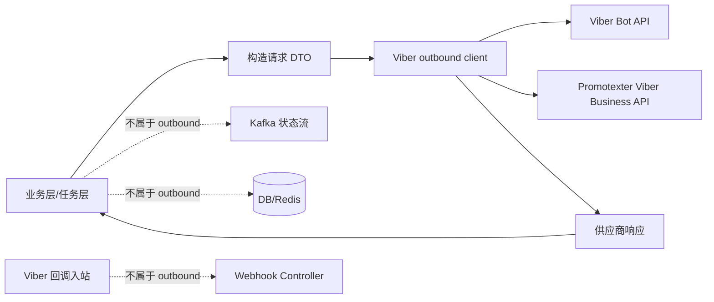

# Viber 主动请求接口规格

生成时间：2026-07-08 ; 最后修改时间：2026-07-26

本文档从 `Viber主动请求能力提取计划.md` 中拆出“主动请求 Viber/供应商”的实现细节，供其他 agent 在另一个项目中封装同类能力时使用。本文只描述本系统主动请求外部 Viber Bot API、Viber Channel API 与 Viber Business 供应商接口的能力；Viber 回调本系统的入站接口、Flow DSL、任务编排、用户绑定和 Kafka 状态流不属于本文封装范围。

## 1. 上下文

当前 `social-sop-api/sop-gateway` 中，主动请求 Viber 的能力主要集中在以下类：

| 能力分组 | 包 + 类名 | 主要函数 | 说明 |
| --- | --- | --- | --- |
| Viber Bot / Channel 官方 API | `com.digiplus.sop.gateway.service.ViberApiService` | 接口定义 | 当前 Viber Bot API 的本地服务接口。 |
| Viber Bot / Channel 官方 API 实现 | `com.digiplus.sop.gateway.service.impl.ViberApiServiceImpl` | `sendMsg`、`sendKeyboard`、`sendChannelMessage`、`getAccountInfo`、`setWebhook`、`initializeWebhook`、`getUserDetails`、`getOnline`、`sharePhone` | 直接使用 `RestTemplate` 请求 `https://chatapi.viber.com/pa`。 |
| Viber Business 供应商 API | `com.digiplus.sop.gateway.service.ViberBizApiService` | `sendBizMsg` | 直接使用 `RestTemplate` 请求 Promotexter `https://api.promotexter.com/viber/send`。 |
| 任务发送入口 | `com.digiplus.sop.gateway.service.MessageTaskService` | `sendBotRecord`、`sendRecord`、`sendOtpRecord`、`sendBotMsgByLimiter`、`sendBizMsgByLimiter`、`sendBizOtpMsgByLimiter` | 业务层负责任务、幂等、状态回写和 Kafka，不应整体搬入 outbound client。 |
| 模板发送入口 | `com.digiplus.sop.gateway.listener.SendTemplateMsgListener` | `sendViberMessageOpen`、`sendViberMessageRemind` | 通过模板构造 Viber Bot 消息并调用 `sendKeyboard`。 |
| Channel 发送入口 | `com.digiplus.sop.gateway.facade.impl.SopFacadeImpl` | `sendChannelMessage` | 由 operation 侧 Feign 触发，最终调用 `sendChannelMessage`。 |
| Webhook 初始化入口 | `com.digiplus.sop.gateway.web.SystemController` | `setWebHook` | 先 `getAccountInfo`，再 `initializeWebhook`。 |
| 用户资料查询入口 | `com.digiplus.sop.gateway.helper.ChannelSubUserHelper` | `getUserDetails`、`convertViberInfo` | 根据 Viber user id 请求用户资料。 |
| 在线状态查询入口 | `com.digiplus.sop.gateway.web.ViberController` | `getOnline` | 测试/管理接口，调用 Viber `get_online`。 |

推荐在新项目中拆成三个轻量 client，而不是复制整个 `ViberApiServiceImpl`：

```text
ViberBotOutboundClient        // send_message / post
ViberBusinessOutboundClient   // Promotexter /viber/send
ViberAccountOutboundClient    // get_account_info / set_webhook / get_user_details / get_online
```

## 2. 官方安全模型与本地实现差异

### 2.1 主动请求鉴权

Viber 官方 REST Bot API 使用 `X-Viber-Auth-Token` 作为 Bot API 请求鉴权头。官方文档说明该 token 是 Bot 账号的唯一密钥，所有请求都需要携带该 HTTP Header。

当前代码实现：

| 项 | 当前实现 |
| --- | --- |
| Header 名 | `X-Viber-Auth-Token` |
| Content-Type | `application/json; charset=UTF-8` |
| Header 构造位置 | `com.digiplus.sop.gateway.service.impl.ViberApiServiceImpl#getHeaders()`、`getHeaders(String authToken)` |
| token 来源 1 | `ThreadContext.getValue(BOT_TOKEN_CONFIG).getToken()` |
| token 来源 2 | `SensitiveConfigProvider#getConfigValue("viber.auth.token")` |
| token 来源 3 | `CachePrefix.VIBER_BOT_URI_TOKEN`，在 `sendKeyboard(..., uri, token)` 中按 Bot URI 取 token |
| token 来源 4 | 调用方显式传入，例如 `SystemController.setWebHook(...)`、`SopFacadeImpl.sendChannelMessage(...)` |

新项目封装建议：

1. 出站 client 不要自己查 DB；token 应由调用方或 token provider 传入。
2. 日志中不要打印完整 token。
3. 如果按 uri 查 token，应放在调用方或独立 token provider 中，不应耦合进 HTTP client。

### 2.2 回调验签

Viber 官方文档中的“签名”用于回调入站校验，不用于本系统主动请求 Viber。官方说明：Viber 回调会带 `X-Viber-Content-Signature`，签名算法是 HMAC-SHA256，key 为 Bot authentication token，value 为原始 JSON 请求体。

当前代码现状：

| 项 | 当前实现 |
| --- | --- |
| 主动请求是否需要签名 | 不需要；只需要 `X-Viber-Auth-Token`。 |
| 回调验签是否已实现 | 在 `sop-gateway` 代码中未搜索到 `X-Viber-Content-Signature`、HMAC、SHA256 相关实现。 |
| 新项目如果只封装主动请求 | 不需要实现回调验签。 |
| 新项目如果也接收 Viber 回调 | 需要实现 HMAC-SHA256 验签，并必须使用原始请求 body 参与计算。 |

回调验签建议伪代码：

```text
expected = hex(HMAC_SHA256(key = botToken, value = rawRequestBody))
actual = request.header("X-Viber-Content-Signature")
valid = constantTimeEquals(expected, actual)
```

注意：验签必须使用未被 JSON 解析器重新格式化的原始 body，否则空格、字段顺序或转义差异可能导致签名不一致。

### 2.3 Viber Business 供应商鉴权

Promotexter Viber Business 发送接口不是 Viber 官方 REST Bot API 页面中的 Bot API。当前项目按供应商接口要求把 `apiKey`、`apiSecret`、`from` 等字段放在 JSON body 中，HTTP Header 只设置 `Content-Type: application/json`。

当前代码实现位置：`com.digiplus.sop.gateway.service.ViberBizApiService#sendBizMsg`。

## 3. 接口清单

### 3.1 Viber Bot 发送消息

| 项 | 说明 |
| --- | --- |
| 外部地址 | `https://chatapi.viber.com/pa/send_message` |
| 当前代码 HTTP 方法 | `PUT` |
| 当前实现 | `com.digiplus.sop.gateway.service.impl.ViberApiServiceImpl#sendMsg`、`sendKeyboard`、`sharePhone` |
| 官方能力 | 给已订阅 Bot 的 Viber 用户发送 text、picture、video、file、location、contact、sticker、rich media、url 等消息；官方说明请求 JSON 最大 30KB。 |
| 鉴权 | Header `X-Viber-Auth-Token: <bot token>` |
| Content-Type | `application/json; charset=UTF-8` |
| 主要调用方 | `MessageTaskService#sendBotMsgByLimiter`、`SendTemplateMsgListener#sendViberMessageOpen`、`SendTemplateMsgListener#sendViberMessageRemind`、多个 callback action/handler、`SessionExpiredJob`、`ViberController#resetViberMenu` |

当前 DTO：

| DTO | 包 + 类名 | 字段 |
| --- | --- | --- |
| 基础发送 DTO | `com.digiplus.sop.gateway.dto.req.message.SendMsgReq` | `receiver`、`min_api_version`、`tracking_data`、`type` |
| 键盘/富媒体发送 DTO | `com.digiplus.sop.gateway.dto.req.SendKeyboardReq` | `receiver`、`min_api_version`、`tracking_data`、`type`、`text`、`media`、`thumbnail`、`keyboard`、`rich_media` |
| 响应 DTO | `com.digiplus.sop.gateway.dto.resp.SendMsgResp` | `status`、`status_message`、`message_token`、`chat_hostname`、`billing_status` |

关键参数：

| 参数 | 来源 | 说明 |
| --- | --- | --- |
| `receiver` | `MessageRecord`、`ChannelSubUser`、Viber 回调上下文 | Viber user id。官方要求用户已订阅，`conversation_started` 场景允许发送一次 welcome message。 |
| `type` | 模板、流程 action、helper | 消息类型，当前常见 `text`、`picture`、`rich_media`。 |
| `min_api_version` | helper 固定或模板构造 | 当前分享手机号和富媒体场景常用 7。 |
| `text` | 模板或流程节点 | 文本内容。 |
| `media` / `thumbnail` | 模板或流程节点 | 图片、URL 或缩略图。 |
| `keyboard` | `ViberKeyboardHelper`、各 action | 自定义键盘按钮。 |
| `rich_media` | 模板 DSL | 富媒体卡片。 |

当前业务附加行为：

1. `sendKeyboard(..., uri, token)` 会根据 `uri` 选择 token，未显式传 token 时从 Redis `VIBER_BOT_URI_TOKEN` 读取。
2. BP 默认 Bot 存在计费开关：`viber.message.status`、`viber.message.limit`、`viberKeyboardHelper.getBillingStatus()`。
3. `sendKeyboard` 对 HTTP 调用使用 `RetryUtil.execute(..., 3, 1000)`。
4. 发送成功且 `status == 0` 时，当前实现会调用 `ChannelMessageRecordHelper#recordKeyboardSend(...)` 保存渠道消息流水。
5. `MessageTaskService` 调用后会把发送结果封装成 `MessageRecord` 投递到 `MSG_RECORD_UPDATE_TOPIC`，这不属于 outbound client 职责。

新项目封装建议：

```text
SendMsgResp sendBotMessage(String botToken, SendKeyboardReq request)
```

出站 client 只返回供应商响应，不负责：

- 查 `MessageRecord`
- 查 Bot 配置
- Redis 幂等
- 写 Kafka
- 记录渠道流水
- 判断任务状态

### 3.2 Viber Channel 主动发送

| 项 | 说明 |
| --- | --- |
| 外部地址 | `https://chatapi.viber.com/pa/post` |
| 当前代码 HTTP 方法 | `PUT` |
| 当前实现 | `com.digiplus.sop.gateway.service.impl.ViberApiServiceImpl#sendChannelMessage` |
| 主要调用方 | `com.digiplus.sop.gateway.facade.impl.SopFacadeImpl#sendChannelMessage` |
| 鉴权 | Header `X-Viber-Auth-Token: <channel/bot token>` |
| Content-Type | `application/json; charset=UTF-8` |
| 响应 DTO | `com.digiplus.sop.gateway.dto.resp.SendChannelMsgResp` |

当前 DTO：`com.digiplus.sop.gateway.dto.req.SendChannelMsgReq`

| 字段 | 说明 |
| --- | --- |
| `from` | 当前由 `BotTokenConfig.superAdminSubId` 填充。 |
| `type` | 消息类型。 |
| `text` | 文本内容。 |
| `media` | 媒体 URL。 |
| `thumbnail` | 缩略图 URL。 |
| `size` | 文件或媒体大小。 |
| `duration` | 视频时长。 |

注意：

1. 当前 Viber 官方 REST Bot API 页面没有像 `send_message` 一样单独展开 `/pa/post` 章节；但错误码中出现了 “post to public account” 相关描述，当前代码也实际使用 `/pa/post`。
2. 迁移到新项目时，应优先用当前线上可用行为保持兼容；如果目标项目需要全新接入，应向 Viber 或供应商确认 `/pa/post` 的最新有效性。

### 3.3 Viber Business 供应商发送

| 项 | 说明 |
| --- | --- |
| 外部地址 | `https://api.promotexter.com/viber/send` |
| 当前代码 HTTP 方法 | `POST` |
| 当前实现 | `com.digiplus.sop.gateway.service.ViberBizApiService#sendBizMsg` |
| 主要调用方 | `MessageTaskService#sendBizMsgByLimiter`、`MessageTaskService#sendBizOtpMsgByLimiter` |
| Header | `Content-Type: application/json` |
| 鉴权 | 当前通过 body 中的 `apiKey`、`apiSecret`、`from` 表达，不使用 `X-Viber-Auth-Token`。 |
| 响应 DTO | `com.digiplus.sop.gateway.dto.resp.SendBizMsgResp` |

当前 DTO：`com.digiplus.sop.gateway.dto.req.message.SendBizMsgReq`

| 字段 | JSON 字段 | 说明 |
| --- | --- | --- |
| `apiKey` | `apiKey` | Promotexter API key。 |
| `apiSecret` | `apiSecret` | Promotexter API secret。 |
| `senderViberId` | `from` | 供应商侧 Viber sender id。 |
| `receiverPhoneNumber` | `to` | 接收手机号。当前业务通常补 `63` 菲律宾国家码。 |
| `sendText` | `text` | 消息正文。 |
| `type` | `type` | `Transactional` 或 `Promotional`。 |
| `image` | `image` | 图片 URL。 |
| `caption` | `caption` | 图片标题或说明。 |
| `url` | `url` | 行为按钮 URL。 |
| `ttl` | `ttl` | 有效期，当前示例为 `72 * 60 * 60` 秒。 |
| `dlrCallback` | `dlrCallback` | DLR 回调地址。 |
| `eventCallback` | `eventCallback` | 已读/点击事件回调地址。OTP 类型当前不设置。 |
| `referenceId` | `referenceId` | 本系统发送记录 id，回调时用于关联 `recordId`。 |
| `smsFrom` | `sms_from` | SMS fallback sender。 |
| `smsText` | `sms_text` | SMS fallback 文本。 |
| `templateId` | `templateId` | 模板 ID。 |
| `templateParams` | `templateParams` | 模板参数，当前含 `pin`、`business_platform_name`、`code_validity_time`。 |
| `templateLang` | `templateLang` | 模板语言。 |

账号选择逻辑：

1. `ViberBizApiService#sendBizMsg(req, type, lineage)` 会通过 `BizBotConfigLoader#getBizBotTokenConfigs(req.getAccountName(), "VIBER", lineage)` 获取账号。
2. `lineage` 为 `gp` 时使用 `gp`，否则默认 `bp`。
3. 如果查不到账号配置，使用 Nacos 默认配置：
   - `api.key`
   - `api.secret`
   - `viber.sender.id`
4. `dlrCallback` 固定构造为：
   - `{viber.webHook.base.url}/viber/{accountName}/dlr`
5. 当 `type` 为空时设置 `eventCallback`：
   - `{viber.webHook.base.url}/viber/{accountName}/event`
6. `type = "otp"` 时当前只设置 DLR callback，不设置 event callback。

当前响应 DTO：`com.digiplus.sop.gateway.dto.resp.SendBizMsgResp`

| 字段 | 说明 |
| --- | --- |
| `code` | 供应商响应码。 |
| `message` | 供应商响应消息。 |
| `transactionId` | 供应商交易 ID，当前写入 `MessageRecord.messageToken`。 |
| `requestId` | 供应商请求 ID。 |

新项目封装建议：

```text
SendBizMsgResp sendBusinessMessage(ViberBusinessCredential credential, SendBizMsgReq request)
```

出站 client 不负责：

- 根据 `accountName` 查 DB 或缓存
- 补手机号国家码
- 决定 `Transactional` / `Promotional`
- 设置 Kafka 状态流
- 建立 `transactionId -> recordId` Redis 映射

### 3.4 获取 Bot 账号信息

| 项 | 说明 |
| --- | --- |
| 外部地址 | `https://chatapi.viber.com/pa/get_account_info` |
| 当前代码 HTTP 方法 | `POST` |
| 当前实现 | `com.digiplus.sop.gateway.service.impl.ViberApiServiceImpl#getAccountInfo` |
| 主要调用方 | `com.digiplus.sop.gateway.web.SystemController#setWebHook` |
| 请求体 | 空 body |
| 鉴权 | Header `X-Viber-Auth-Token: <bot token>` |
| 响应 DTO | `com.digiplus.sop.gateway.dto.resp.GetAccountInfoResp` |

响应字段：

| 字段 | 说明 |
| --- | --- |
| `status`、`status_message` | 调用结果。 |
| `id` | Viber account id；Channel 场景当前作为 channel id 使用。 |
| `name` | 账号名称。 |
| `uri` | Bot URI；Chat Bot Webhook 路径使用该值。 |
| `icon`、`background`、`category`、`subcategory`、`location`、`country` | 账号展示信息。 |
| `webhook` | 当前注册的 Webhook URL。 |
| `event_types` | 当前订阅的事件类型。 |
| `subscribers_count` | 订阅数。 |
| `members` | 成员信息，当前用于提取管理员信息。 |

当前业务上下文：

`SystemController#setWebHook` 先调用 `getAccountInfo(token)`，如果是 Chat Bot，则设置回调路径 `/viber/{uri}/callback`；如果是 Channel，则使用 `id` 作为 channelId 并设置 `/viber/{channelId}/channelCallback`。

### 3.5 设置 Webhook

| 项 | 说明 |
| --- | --- |
| 外部地址 | `https://chatapi.viber.com/pa/set_webhook` |
| 当前代码 HTTP 方法 | `PUT` |
| 当前实现 | `com.digiplus.sop.gateway.service.impl.ViberApiServiceImpl#initializeWebhook`、`setWebhook`、`getSetWebhook` |
| 主要调用方 | `com.digiplus.sop.gateway.web.SystemController#setWebHook` |
| 鉴权 | Header `X-Viber-Auth-Token: <bot token>` |
| 请求 DTO | `com.digiplus.sop.gateway.dto.req.SetWebhook` |
| 响应 DTO | 复用 `SetWebhook` 中的 `status`、`status_message` |

当前请求字段：

| 字段 | JSON 字段 | 当前逻辑 |
| --- | --- | --- |
| `url` | `url` | 如果入参为空，使用配置 `viber.webHook`；否则使用 `viber.webHook.base.url + webHookShortUrl`。 |
| `eventTypes` | `event_types` | Chat Bot 默认设置 `delivered`、`seen`、`failed`、`subscribed`、`unsubscribed`、`conversation_started`。 |
| `sendName` | `send_name` | Chat Bot 设置为 `true`。 |
| `sendPhoto` | `send_photo` | Chat Bot 设置为 `true`。 |

Channel 特殊逻辑：

如果 Webhook 路径包含 `channelCallback`，当前 `getSetWebhook` 只设置 `url`，不设置 `event_types`、`send_name`、`send_photo`。

官方行为要点：

1. Webhook URL 必须是有效 HTTPS 地址，且证书需要被信任。
2. 设置 Webhook 后，Viber 会向该 URL 发送一次 `webhook` callback，用 HTTP 200 判断可用性。
3. `message`、`subscribed`、`unsubscribed` 是强制事件；`delivered`、`seen`、`failed`、`conversation_started` 可通过 `event_types` 配置。

### 3.6 获取用户资料

| 项 | 说明 |
| --- | --- |
| 外部地址 | `https://chatapi.viber.com/pa/get_user_details` |
| 当前代码 HTTP 方法 | `PUT` |
| 当前实现 | `com.digiplus.sop.gateway.service.impl.ViberApiServiceImpl#getUserDetails` |
| 主要调用方 | `com.digiplus.sop.gateway.helper.ChannelSubUserHelper#getUserDetails`、`convertViberInfo`、`ImportOldViberUserJob` |
| 请求 DTO | `com.digiplus.sop.gateway.dto.req.GetUserDetailsReq` |
| 响应 DTO | `com.digiplus.sop.gateway.dto.resp.GetUserDetailsResp` |
| 重试 | 当前使用 `RetryUtil.execute(..., 3, 1000)` |

请求字段：

| 字段 | 说明 |
| --- | --- |
| `id` | Viber user id，通常来自回调中的 sender id 或 user id。 |

官方限制：

同一个 user id 在 12 小时内最多请求 2 次。新项目封装时建议在调用方增加缓存或限流，避免把用户资料刷新做成高频请求。

### 3.7 获取在线状态

| 项 | 说明 |
| --- | --- |
| 外部地址 | `https://chatapi.viber.com/pa/get_online` |
| 当前代码 HTTP 方法 | `PUT` |
| 当前实现 | `com.digiplus.sop.gateway.service.impl.ViberApiServiceImpl#getOnline` |
| 主要调用方 | `com.digiplus.sop.gateway.web.ViberController#getOnline` |
| 请求 DTO | `com.digiplus.sop.gateway.dto.req.GetOnlineReq` |
| 响应 DTO | `com.digiplus.sop.gateway.dto.resp.GetOnlineResp` |

请求字段：

| 字段 | 说明 |
| --- | --- |
| `ids` | Viber user id 列表。官方限制单次最多 100 个。 |
| `uri` | 当前 DTO 中存在，但官方请求体只需要 `ids`；代码中未在 `ViberApiServiceImpl#getOnline` 特殊处理该字段。 |

## 4. 当前代码旁路

以下类存在直接请求 Viber 的历史或工具路径，不建议新项目复制：

| 包 + 类名 | 情况 |
| --- | --- |
| `com.digiplus.sop.gateway.job.ImportOldViberUserJob` | 使用 `ViberApiService#getUserDetails`，同时存在静态 `sendKeyboard` 直接请求 `https://chatapi.viber.com/pa/send_message`。 |
| `com.digiplus.sop.gateway.job.ImportApOldViberUserJob` | 存在直接 `get_user_details` 和 `send_message` 请求，并有硬编码 token。 |
| `com.digiplus.sop.gateway.utils.ImportXlsx` | 存在直接 `send_message` 请求，并有硬编码 token。 |
| `com.digiplus.sop.gateway.utils.ViberTools` | 本地工具类，多处直接请求 Viber API，并有硬编码 token。 |

新项目迁移时应把这些视为反例：不要在业务代码中散落 URL、token 和 `RestTemplate.exchange(...)`。

## 5. 推荐封装接口

### 5.1 Bot / Channel

```java
public interface ViberBotOutboundClient {
    SendMsgResp sendMessage(String botToken, SendKeyboardReq request);

    SendChannelMsgResp postToChannel(String botToken, SendChannelMsgReq request);
}
```

实现要求：

1. 只负责 HTTP 请求、响应解析、错误封装。
2. 不负责构造业务消息模板。
3. 不负责 session、Redis、DB、Kafka。
4. token 由调用方显式传入。
5. 日志中对 token、receiver、手机号做脱敏。

### 5.2 Business

```java
public interface ViberBusinessOutboundClient {
    SendBizMsgResp sendBusinessMessage(ViberBusinessCredential credential, SendBizMsgReq request);
}
```

`ViberBusinessCredential` 建议包含：

| 字段 | 说明 |
| --- | --- |
| `apiKey` | 供应商 API key。 |
| `apiSecret` | 供应商 API secret。 |
| `senderViberId` | 供应商 sender id，对应当前 body 字段 `from`。 |

调用方负责填充：

- `accountName`
- `receiverPhoneNumber`
- `referenceId`
- `dlrCallback`
- `eventCallback`
- `lineage`
- `type`

### 5.3 Account

```java
public interface ViberAccountOutboundClient {
    GetAccountInfoResp getAccountInfo(String botToken);

    SetWebhook setWebhook(String botToken, SetWebhook request);

    GetUserDetailsResp getUserDetails(String botToken, String userId);

    GetOnlineResp getOnline(String botToken, List<String> userIds);
}
```

## 6. 实现细节建议

| 主题 | 建议 |
| --- | --- |
| HTTP Client | 新项目优先使用统一的 HTTP client 配置，设置 connect/read timeout，不要裸用默认 `RestTemplate`。 |
| Retry | 只对网络瞬断、5xx、429 等可重试错误重试；不要对 4xx 参数错误重试。当前代码统一 `3 次 + 1000ms`，可作为兼容参考。 |
| 错误模型 | 保留 HTTP status、供应商 `status/status_message`、响应 body 摘要。 |
| 日志 | 请求日志必须脱敏 token、手机号、apiSecret。 |
| 限流 | `get_user_details` 有官方频率限制，应在调用方做缓存或限流。 |
| 幂等 | outbound client 不负责业务幂等；业务层用 `recordId`、`transactionId`、Redis 映射处理。 |
| 回调地址 | Business `dlrCallback`、`eventCallback` 应由调用方按部署域名生成，不应写死在 client。 |
| 官方方法差异 | 当前代码对多个 Viber Bot API 使用 `PUT`，并对 `get_account_info` 使用 `POST`。如果目标项目是新接入，应用当前代码兼容性前，建议再与 Viber 当前官方接口规范确认 HTTP method。 |

## 7. 与当前业务链路的关系

新项目如果只封装主动请求能力，只需要覆盖图中的右侧供应商请求部分：



当前 `sop-gateway` 中，供应商响应会继续进入以下业务处理，但这些不应移入 outbound client：

| 后续处理 | 当前位置 |
| --- | --- |
| 发送成功/失败后构造 `MessageRecord` | `MessageTaskService#sendBotMsgByLimiter`、`sendBizMsgByLimiter`、`sendBizOtpMsgByLimiter` |
| 投递 `MSG_RECORD_UPDATE_TOPIC` | `MessageTaskService`、`SendTemplateMsgListener` |
| 记录渠道消息流水 | `ChannelMessageRecordHelper#recordKeyboardSend`、`recordPushSend` |
| 建立 `messageToken -> recordId` 映射 | `MessageTaskService#sendBotMsgByLimiter`、`sendWhatsappBizMsgByLimiter` 等业务方法 |
| 处理 Viber 回调验签和事件 | 当前项目尚未实现验签；事件处理在 `ViberWebHookController` 与 handler 链路中 |

## 8. 参考资料

- Viber Developers Hub: Viber REST API  
  https://developers.viber.com/docs/api/rest-bot-api/
- 当前代码：
  - `social-sop-api/sop-gateway/src/main/java/com/digiplus/sop/gateway/service/ViberApiService.java`
  - `social-sop-api/sop-gateway/src/main/java/com/digiplus/sop/gateway/service/impl/ViberApiServiceImpl.java`
  - `social-sop-api/sop-gateway/src/main/java/com/digiplus/sop/gateway/service/ViberBizApiService.java`
  - `social-sop-api/sop-gateway/src/main/java/com/digiplus/sop/gateway/service/MessageTaskService.java`
  - `social-sop-api/sop-gateway/src/main/java/com/digiplus/sop/gateway/listener/SendTemplateMsgListener.java`
  - `social-sop-api/sop-gateway/src/main/java/com/digiplus/sop/gateway/facade/impl/SopFacadeImpl.java`
  - `social-sop-api/sop-gateway/src/main/java/com/digiplus/sop/gateway/helper/ChannelSubUserHelper.java`
  - `social-sop-api/sop-gateway/src/main/java/com/digiplus/sop/gateway/web/SystemController.java`
