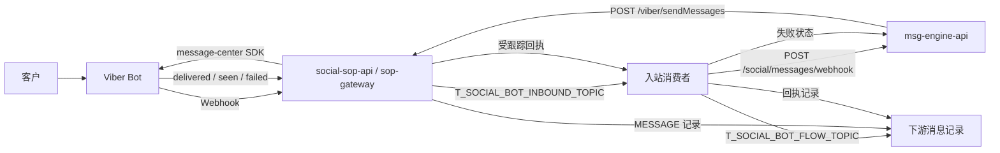
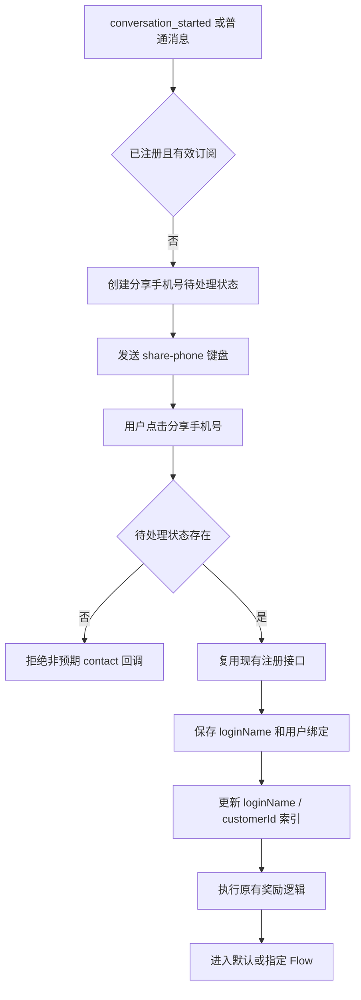
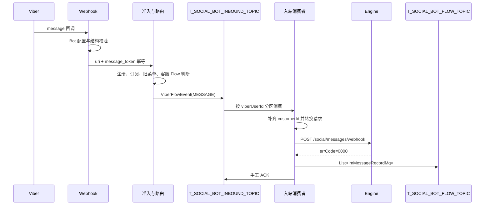
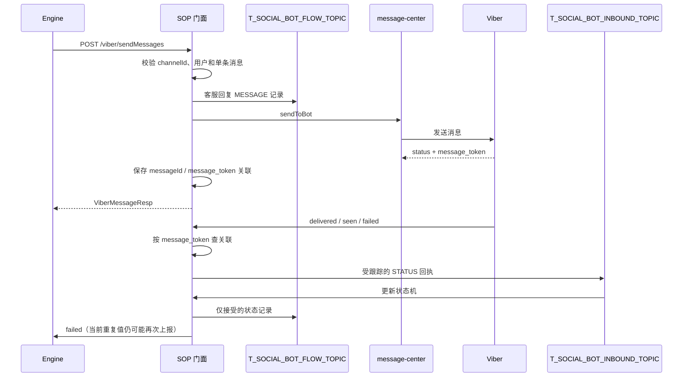

# Viber 客服系统快速交接手册

生成时间：2026-07-26 ; 最后修改时间：2026-07-26

本文面向临时接手 `social-sop-api` Viber 客服链路的开发、测试和运维人员。
实现事实以 `social/social-sop-api/sop-gateway` 当前工作树为准。

## 1. 十分钟接手顺序

1. 先阅读本文第 3 章，确认 SOP、Engine、Kafka、Viber 的职责边界。
2. 再阅读第 5 章，按入站、出站、回执三条主链路理解数据流。
3. 出现问题时先取得 `traceId`、`messageId`、`message_token`、`uri` 和
   `viberUserId`，再按第 9 章搜索日志。
4. 需要修改代码时，按第 6 章的代码索引定位业务入口，不要从 DTO 或工具类反向猜测流程。
5. 涉及跨系统字段、响应和错误码时，以接口设计文档及 Engine 当前 Feign 契约为准。

## 2. 客服相关文档总览

| 阅读优先级 | 文档 | 用途 |
| --- | --- | --- |
| P0 | [本文](Viber客服系统快速交接手册.md) | 快速交接、代码入口、日志字典和故障搜索 |
| P0 | [Viber 客服 SOP 当前实现流程复核](ViberBot客服SOP侧当前实现流程复核.md) | 当前入站、出站流程图以及计划与代码差异 |
| P0 | [ViberBot 客服 SOP 入站开发计划](ViberBot客服SOP侧入站链路开发计划.md) | Webhook、准入、注册、Kafka、Engine 入站链路 |
| P0 | [ViberBot 客服 SOP 出站开发计划](ViberBot客服SOP侧出站链路开发计划.md) | Engine 调用 SOP、Viber 发送和回执关联链路 |
| P1 | [Viber 客服双向消息链路接口设计方案](Viber客服双向消息链路接口设计方案.md) | 跨系统接口、请求响应结构和职责约定 |
| P1 | [Viber 系统接手指南](Viber系统接手说明.md) | Viber 概念、旧系统背景和主要业务流程 |
| P1 | [Viber 消息流](Viber消息流程说明.md) | Viber 主动 API、回调类型和数据流说明 |
| P1 | [ViberBot 客服 SOP 文档索引](ViberBot客服SOP侧文档索引.md) | 入站、出站和实现复核文档入口 |
| P2 | [SOP Gateway 代码审查问题](SOP网关代码审查问题清单.md) | 当前风险、技术债和潜在缺陷 |
| P2 | [Social Operation 与 SOP 能力说明](社媒运营与SOP项目能力说明.md) | Operation 控制面与 SOP 运行时边界 |

下列文档属于早期抽取或 SDK 设计材料，不作为当前客服运行链路的首要依据：

| 文档 | 用途 |
| --- | --- |
| [Viber 出站 API 规格](Viber主动请求接口规格.md) | 迁移 Viber 主动调用能力时的供应商 API 参考 |
| [Viber 出站能力抽取计划](Viber主动请求能力提取计划.md) | 历史抽取方案和上下文 |

## 3. 系统职责与整体结构

### 3.1 职责边界

| 系统 | 当前职责 |
| --- | --- |
| Viber Bot | 向 SOP 投递回调；接收 SOP 通过 SDK 发送的消息 |
| `social-sop-api/sop-gateway` | Webhook、注册/绑定、Flow 路由、消息转换、Kafka 中转、Viber 发送、回执关联 |
| `msg-engine-api` | 接收客户咨询、转发客服网关、持久化客服消息、处理失败回执 |
| `social-operation-api` | Bot、流程、模板和任务等控制面能力；不承接当前 Webhook 运行时 |
| `message-center` | Viber Bot 主动发送 SDK；不承接 SOP 的注册、路由和业务流程 |

### 3.2 总体数据流



### 3.3 关键接口与 Topic

| 类型 | 名称 | 方向与用途 |
| --- | --- | --- |
| HTTP | `POST /viber/{uri}/callback` | Viber Bot -> SOP，统一回调入口 |
| HTTP | `POST /viber/setWebHook` | 管理端显式触发 Webhook 注册 |
| HTTP | `POST /social/messages/webhook` | SOP -> Engine，提交客户咨询 |
| HTTP | `POST /social/message/status` | SOP -> Engine，只设计上报 `failed`；当前重复 `failed` 仍可能再次上报 |
| HTTP | `POST /viber/sendMessages` | Engine -> SOP，发送 Viber 消息 |
| Kafka | `T_SOCIAL_BOT_INBOUND_TOPIC` | SOP 内部统一处理客户消息和受跟踪回执 |
| Kafka | `T_SOCIAL_BOT_FLOW_TOPIC` | 发送 `List<ImMessageRecordMq>` 给下游落库 |
| Kafka | `MSG_RECORD_CENTER_DELIVERED_TOPIC` | 营销消息送达回执的旧链路 |
| Kafka | `MSG_RECORD_CENTER_SEEN_TOPIC` | 营销消息已读回执的旧链路 |

`T_SOCIAL_BOT_INBOUND_TOPIC` 不使用 DLT。消费失败按配置重试，耗尽后输出完整消息日志并提交恢复后的位点。

Webhook 当前 HTTP 语义：

| 场景 | HTTP 结果 |
| --- | --- |
| 正常处理 | `200 success!` |
| 结构校验不通过 | `200 rejected!`，避免 Viber 重复投递无效报文 |
| Bot URI 无配置 | `404` |
| 可重试系统异常 | `503` |
| 未分类系统异常 | `500` |

## 4. 贯穿链路的标识

| 字段 | 来源 | 主要用途 | 排查方法 |
| --- | --- | --- | --- |
| `traceId` | Webhook 新建；出站优先使用请求 `messageId` | 串联一次 SOP 调用栈 | 优先搜索该值 |
| `messageId` | 入站由 `uri + message_token` 稳定生成；出站由 Engine 提供 | 业务幂等和跨系统关联 | 搜索 SOP 与 Engine |
| `message_token` | Viber 回调或发送成功响应 | 关联发送与 `delivered/seen/failed` | 搜索回调和 Redis 日志 |
| `viberUserId` | Viber 回调用户 ID | Kafka 分区键、用户与会话定位 | 搜索同一用户连续消息 |
| `loginName` | 用户绑定/注册后获得 | Engine 用户定位、Kafka 业务数据 | 搜索身份缓存日志 |
| `customerId` | 由 `loginName` 查询并在本地双向索引补齐 | Engine 用户定位 | 搜索 `ENGINE_CUSTOMER_ID_*` |
| `channelId` | 全局产品线 + Viber 通道信息 + Bot URI | Bot 和消息通道定位 | 示例 `BP_VB_CB_bptestbot1` |
| `sendMode` | 出站请求的 `market` 转换 | 区分 `REPLY` 与 `MARKET` 后续处理 | 搜索 `RECEIPT_ROUTE_SELECTED` |
| `statusAccepted` | SOP 回执状态机计算 | 防止弱状态或重复状态写 Flow Topic | 搜索 `VIBER_RECEIPT_PROCESSED` |

回调生成了新的 `traceId` 时，应先用 `message_token` 找到
`STATUS_CORRELATION_HIT`，再读取其中的 `originalTraceId` 追溯原始出站调用。

`step` 只表示当前 `TraceScope` 内的执行顺序。Webhook 与 Kafka 消费者可以复用同一个
`traceId`，但各自从较小的 step 重新计数，因此不能把 step 当成跨线程的全局序号；
应结合时间、`VIBER_CALLBACK`、`VIBER_INBOUND_CONSUME` 或
`VIBER_RECEIPT_CONSUME` 调用栈名称判断先后。

## 5. 三条主流程

### 5.1 新用户或退订用户注册/绑定

现有注册和奖励逻辑保持不变。未绑定用户或已绑定但已退订用户先显示分享手机号键盘；
点击分享手机号后复用现有注册链路。奖励由下游业务接口幂等，本链路不增加重复奖励判断。



重点：

1. `conversation_started.subscribed` 不能单独作为本地订阅事实。
2. 是否允许客户普通消息进入客服链路，还会检查本地用户记录和有效客服 Flow 会话。
3. 分享手机号回调必须命中待处理状态，避免把任意联系人卡片误当成注册请求。
4. 注册成功后才持久化 `loginName`，并继续执行现有 Flow 动作。

### 5.2 客户消息入站



入站消息只在以下条件同时满足时进入客服 Kafka：

1. Viber 回调类型是 `message`。
2. 不属于旧菜单/旧 Flow 的控制消息。
3. 用户已经完成注册/绑定。
4. 本地订阅状态有效。
5. Redis 中存在有效客服 Flow 会话。
6. `uri + message_token` 幂等门闩获取成功。

消息类型在 SOP 内部保留 Viber 原始语义。提交 Engine 时：

| SOP 类型 | Engine 类型 |
| --- | --- |
| `TEXT` | `text` |
| `IMAGE` | `image` |
| `VIDEO` | `video` |
| 其他 | `other` |

### 5.3 客服回复出站与状态回调



当前状态机：

```text
SENT -> FAILED / DELIVERED / SEEN
FAILED -> DELIVERED / SEEN
DELIVERED -> SEEN
SEEN -> 终态
```

业务语义：

1. `FAILED -> DELIVERED` 合法，表示后来确认送达。
2. `DELIVERED -> FAILED` 无效，后到的弱状态不得覆盖已送达。
3. `SEEN` 后不再接受 `DELIVERED` 或 `FAILED`。
4. `statusAccepted=false` 时不写 `T_SOCIAL_BOT_FLOW_TOPIC`，日志为 `FLOW_PUBLISH_SKIPPED`。
5. 当前 Engine 失败上报和营销旧 Topic 发布没有完全统一使用 `statusAccepted`，重复回执仍是已知风险。

## 6. 关键代码位置

以下行号对应 2026-07-26 当前工作树，后续修改可能产生偏移。

### 6.1 Webhook 与分发

| 节点 | 代码位置 | 职责 |
| --- | --- | --- |
| Webhook 管理入口 | `web/SystemController.java:77` | 显式触发 Viber Webhook 注册 |
| Webhook 注册实现 | `service/impl/ViberApiServiceImpl.java:113` | 查询 Bot 信息并调用 Viber `set_webhook` |
| Viber 固定回调入口 | `callback/ViberWebHookController.java:83` | 建立 Trace、读取请求头、Bot 查询、返回 HTTP 状态 |
| 回调结构校验 | `callback/validation/ViberCallbackValidator.java:25` | 校验 Viber 回调类型和必要字段 |
| 回调类型路由 | `callback/ViberCallbackOrchestrator.java:40` | 区分消息、状态和其他 Viber 回调 |
| 旧处理器分派 | `callback/handler/EventProcessor.java:125` | 将 Viber 回调路由到具体处理器 |

### 6.2 注册、准入与 Flow

| 节点 | 代码位置 | 职责 |
| --- | --- | --- |
| 用户准入 | `callback/routing/ViberAdmissionDecider.java:27` | 判断已注册、订阅和准入结果 |
| 消息路由 | `callback/routing/ViberRouteDecider.java:35` | 区分旧 Flow 控制消息与客服消息 |
| 消息协调 | `callback/handler/ViberMessageCoordinator.java:71` | 统一编排注册、旧流程和客服消息 |
| 会话开始处理 | `callback/handler/ConversationHandler.java:92` | 新用户或未订阅用户进入分享手机号流程 |
| 联系人卡片处理 | `callback/handler/message/ContactMessageHandler.java:91` | 校验分享手机号状态并复用注册链路 |
| 分享手机号状态 | `service/viber/ViberPhoneShareStateService.java:36` | 管理 contact 回调的短期准入状态 |
| 客服 Flow 入口 | `callback/action/ViberFlowEnterAction.java:44` | 建立客服 Flow 会话并开放输入框 |
| 身份双向索引 | `service/viber/CustomerIdentityIndex.java:29` | 缓存 `loginName <-> customerId` |

### 6.3 入站 Kafka 与 Engine

| 节点 | 代码位置 | 职责 |
| --- | --- | --- |
| 入站消息组装 | `service/viber/ViberInboundMessageAssembler.java:43` | Viber 回调转换为 `ViberFlowEvent` |
| 入站发布 | `service/viber/ViberInboundEventPublisher.java:39` | 发布统一入站 Topic 并等待 ACK |
| Kafka 分区键 | `service/viber/ViberFlowPartitionKeyBuilder.java:24` | 使用 Viber 用户 ID 保证客户消息顺序 |
| 统一消费者 | `listener/ViberInboundListener.java:68` | 分派 MESSAGE 和 STATUS，控制重试与 ACK |
| Engine 请求组装 | `service/viber/MessageWebhookRequestAssembler.java:31` | 补齐并转换 Engine 入站请求 |
| Flow 记录发布 | `service/viber/ViberFlowEventPublisher.java:43` | 转换并发布 `List<ImMessageRecordMq>` |
| 统一 Kafka DTO | `dto/kafka/ViberFlowEvent.java:26` | 客户消息和回执的内部传输结构 |
| Kafka 消息类型 | `dto/kafka/ViberFlowEventType.java:12` | `MESSAGE/SEND_FAILED/FAILED/DELIVERED/SEEN` |

### 6.4 出站发送与回执

| 节点 | 代码位置 | 职责 |
| --- | --- | --- |
| Engine Feign 契约 | `facade/SopFacade.java:35` | 暴露 `POST /viber/sendMessages` |
| SOP 门面实现 | `facade/impl/SopFacadeImpl.java:112` | 包装出站响应 |
| Viber/Biz 分派 | `service/viber/ViberMessageDispatchService.java:29` | 按 channelId 选择 Bot 或 Biz |
| Bot 出站编排 | `service/viber/ViberMessageService.java:73` | 校验、目标定位、幂等、Flow 记录和发送 |
| SDK 单次调用 | `service/viber/ViberOutboundSendService.java:41` | 构建 payload 并调用 message-center |
| 保存 token 关联 | `service/viber/ViberOutboundStatusService.java:83` | 保存 `messageId/message_token/sendMode` |
| 回执状态推进 | `service/viber/ViberOutboundStatusService.java:167` | 执行 `SENT/FAILED/DELIVERED/SEEN` 状态机 |
| 回执进入 Kafka | `service/viber/ViberMessageStatusService.java:36` | 仅将可关联的状态回调放入统一入站 Topic |
| 营销回执发布 | `service/viber/ViberMarketReceiptPublisher.java:47` | 发布营销 `delivered/seen` 旧 Topic |

### 6.5 配置与日志

| 节点 | 代码位置 | 职责 |
| --- | --- | --- |
| 客服配置 | `support/ViberCsProperties.java:15` | 统一读取 `sop.viber.cs` 配置并支持动态刷新 |
| Trace 工具 | `support/ViberTrace.java` | 维护 `[VIBER_IN]`、`[VIBER_OUT]`、step 和耗时 |

## 7. 日志节点字典

### 7.1 Webhook 注册日志

前缀：`[VIBER_WEBHOOK]`

| 日志节点 | 级别含义 | 说明 |
| --- | --- | --- |
| `action=ACCOUNT_INFO_RECEIVED` | 正常 | 已查询 Bot 账户信息及当前 Webhook |
| `action=ACCOUNT_INFO_FAILED` | 异常 | 查询 Bot 账户信息失败 |
| `action=REGISTER_TRIGGER` | 正常 | 管理入口收到注册请求 |
| `action=REGISTER_REQUEST` | 正常 | 即将调用 Viber `set_webhook` |
| `action=REGISTER_SUCCESS` | 正常 | Viber 接受 Webhook 注册 |
| `action=REGISTER_FAILED` | 异常 | Viber 返回非成功状态 |
| `action=REGISTER_RESULT` | 结果 | 管理入口输出最终成功或失败 |
| `action=REGISTER_SKIPPED` | 提示 | 注册锁未获取，本次没有执行 |
| `action=REGISTER_EXCEPTION` | 异常 | 注册过程中抛出异常 |
| `action=REGISTER_HTTP_FAILED` | 异常 | 请求 Viber API 的 HTTP 调用失败 |

### 7.2 Webhook 回调入口日志

前缀：`[VIBER_IN]`

| 日志节点 | 说明 | 首要关联字段 |
| --- | --- | --- |
| `VIBER_CALLBACK_START` | Viber 回调开始 | `traceId` |
| `logNode=CALLBACK_RECEIVED` | 已收到并反序列化回调 | `uri`、回调类型、`messageToken` |
| `CALLBACK_MESSAGE_PREVIEW` | Debug 模式下输出 message 前 128 字符 | `traceId` |
| `BOT_CONFIG_NOT_FOUND` | URI 未找到 Viber Bot 配置 | `uri` |
| `BOT_CONFIG_RESOLVED` | Bot 配置查找成功 | `uri` |
| `CALLBACK_INVALID` | 结构字段校验失败 | `reason` |
| `logNode=CALLBACK_VALIDATED` | Viber 回调通过结构校验 | 回调类型、`context`、消息类型 |
| `CALLBACK_ROUTE_SELECTED` | 已选择 Viber 回调处理分支 | 回调类型 |
| `CALLBACK_EVENT_UNSUPPORTED` | 暂不支持该 Viber 回调类型 | 回调类型 |
| `CALLBACK_DISPATCHED` | 本次回调处理完成 | `result` |
| `CALLBACK_RETRYABLE` | 可重试异常，HTTP 返回 503 | 异常类型 |
| `CALLBACK_FAILED` | 未知异常，HTTP 返回 500 | 异常堆栈 |
| `VIBER_CALLBACK_END` | Viber 回调结束 | `elapsedMs` |

常见 `CALLBACK_DISPATCHED result`：

| 结果 | 含义 |
| --- | --- |
| `MESSAGE_QUEUED` | 客户消息已进入统一入站 Topic |
| `REGISTRATION_REQUIRED` | 已发送分享手机号键盘，等待用户操作 |
| `LEGACY_COMPLETED` | 已由原有菜单/Flow 链路完成 |
| `NOOP` | 当前分支没有产生新的客服动作，需结合前序日志判断原因 |

### 7.3 幂等与路由日志

| 日志节点 | 说明 |
| --- | --- |
| `IDEMPOTENCY_CHECK` | 使用 `uri + message_token` 检查 Viber 回调幂等 |
| `IDEMPOTENCY_LOCK_BUSY` | 同一 Viber 回调正在处理 |
| `IDEMPOTENCY_HIT` | 已处理过相同 Viber 回调 |
| `IDEMPOTENCY_ACQUIRED` | 已取得处理权 |
| `IDEMPOTENCY_COMMITTED` | 回调处理结果已提交为 `QUEUED/COMPLETED` |
| `IDEMPOTENCY_RELEASED` | 异常后释放处理状态 |
| `MESSAGE_RATE_LIMITED` | 客户消息命中速率限制 |
| `MESSAGE_ROUTE_SELECTED` | 已选择 `FORWARD/LEGACY/REGISTRATION_REQUIRED` 等路由 |
| `CUSTOMER_FLOW_EXITED` | 旧菜单控制消息退出客服 Flow |
| `UNREGISTERED_MESSAGE_BLOCKED` | 未注册用户消息被拦截 |
| `REGISTRATION_REQUIRED` | 用户需要分享手机号并完成注册 |
| `MESSAGE_BLOCKED_OUTSIDE_CUSTOMER_FLOW` | 用户没有有效客服 Flow 会话 |
| `VIBER_IDENTITY_RESOLVED` | 已取得 `loginName` 等用户身份 |
| `VIBER_EVENT_ASSEMBLED` | 已组装内部 `ViberFlowEvent` |
| `VIBER_MESSAGE_UNSUPPORTED` | 当前消息类型暂不支持，保留日志和 TODO |

### 7.4 注册和客服 Flow 日志

| 日志节点 | 说明 |
| --- | --- |
| `PHONE_SHARE_STATE_CREATED` | 已建立分享手机号待处理状态 |
| `PHONE_SHARE_STATE_CREATE_FAILED` | 创建待处理状态失败 |
| `PHONE_SHARE_STATE_LOOKUP_FAILED` | 查询待处理状态失败 |
| `PHONE_SHARE_STATE_CLEARED` | 注册完成后已清理待处理状态 |
| `CONTACT_REGISTRATION_REJECTED` | contact 回调没有匹配的分享手机号状态 |
| `REGISTRATION_STARTED` | 开始执行现有注册链路 |
| `REGISTRATION_FAILED` | 注册失败，结合 `reason` 定位 |
| `REGISTRATION_CONTINUATION_START` | 注册成功后开始后续订阅/Flow 动作 |
| `REGISTRATION_CONTINUATION_STEP_COMPLETED` | 某个后续阶段完成 |
| `REGISTRATION_FLOW_ACTION_START` | 开始进入目标 Flow |
| `REGISTRATION_FLOW_ACTION_COMPLETED` | Flow 动作完成，关注 `keyboardSent` |
| `REGISTRATION_CONTINUATION_FAILED` | 注册后的某个阶段失败 |
| `REGISTRATION_SUCCEEDED` | 注册、身份保存主流程成功 |
| `INPUT_FIELD_UNLOCKED` | 已发送可输入键盘 |
| `INPUT_FIELD_UNLOCK_PENDING` | 输入框开放动作尚未完成 |
| `CUSTOMER_FLOW_ENTRY_BLOCKED` | 因未注册、无 Flow 定义或无会话而阻止进入 |
| `CUSTOMER_FLOW_ENTRY_FAILED` | 进入客服 Flow 失败 |
| `CUSTOMER_FLOW_ENTERED` | 客服 Flow 会话已激活 |
| `CUSTOMER_FLOW_SESSION_INVALID` | Redis 中的客服 Flow 会话无效 |
| `CUSTOMER_ENTRY_BUTTON_APPENDED` | 已在普通 Flow 键盘追加客服入口 |
| `CUSTOMER_ENTRY_BUTTON_SKIPPED` | 因关闭、当前已是客服 Flow、无图片或重复而跳过 |

### 7.5 入站 Kafka、Engine 和 Flow Topic 日志

| 日志节点 | 说明 |
| --- | --- |
| `KAFKA_PUBLISH_START` | 开始发布 `T_SOCIAL_BOT_INBOUND_TOPIC` |
| `KAFKA_PUBLISH_ACK` | 入站 Kafka Broker 已确认 |
| `VIBER_INBOUND_CONSUME_START/END` | MESSAGE 消费调用栈及耗时 |
| `VIBER_RECEIPT_CONSUME_START/END` | STATUS 消费调用栈及耗时 |
| `KAFKA_CONSUMER_RECEIVED` | 消费者收到消息，包含 Topic、分区、位点和类型 |
| `FLOW_EVENT_PAYLOAD` | Debug 模式下输出 `ViberFlowEvent` |
| `IDENTITY_CACHE_HIT` | `loginName/customerId` 本地索引命中 |
| `IDENTITY_CACHE_REFRESHED` | 数据库补偿查询后更新本地索引 |
| `ENGINE_CUSTOMER_ID_LOOKUP_MISS` | 无法由 `loginName` 补齐 `customerId` |
| `ENGINE_CUSTOMER_ID_RESOLVED` | 已补齐 Engine 请求需要的 `customerId` |
| `ENGINE_REQUEST_ASSEMBLED` | Engine 请求已组装 |
| `ENGINE_REQUEST_PAYLOAD` | Debug 模式下输出 `MessageWebhookReq` JSON |
| `ENGINE_MESSAGE_TYPE_NORMALIZED` | 非标准消息类型在 Engine 边界转为 `other` |
| `ENGINE_REQUEST_ACCEPTED` | Engine 返回成功 |
| `ENGINE_REQUEST_REJECTED` | Engine 返回非成功，当前会触发 Kafka 重试 |
| `FLOW_RECORD_PAYLOAD` | Debug 模式下输出 `ImMessageRecordMq` |
| `FLOW_PUBLISH_START/ACK` | 开始发布或成功发布 Flow Topic |
| `FLOW_PUBLISH_SKIPPED` | 回执状态未被状态机接受，不写 Flow Topic |
| `KAFKA_CONSUMER_ACKNOWLEDGED` | 所有必要动作完成，提交 Kafka 位点 |
| `INBOUND_RETRY_EXHAUSTED` | 重试耗尽，输出完整消息并恢复消费 |

### 7.6 出站发送日志

前缀：`[VIBER_OUT]`

| 日志节点 | 说明 |
| --- | --- |
| `VIBER_REPLY_START/END` | Engine 调用 SOP 的完整出站调用栈及耗时 |
| `REQUEST_RECEIVED` | 收到出站请求；Debug 模式输出完整请求 |
| `REQUEST_VALIDATED` | channelId、目标和单条消息校验通过 |
| `REQUEST_INVALID` | 请求字段不合法 |
| `TARGET_RESOLVED` | 已定位 Bot 和 Viber 用户 |
| `TARGET_FAILED` | 无法定位 Bot 或目标用户 |
| `PUSH_RATE_LIMITED` | Viber 发送命中限流 |
| `IDEMPOTENCY_CHECK` | 检查 `messageId/segmentIndex` |
| `IDEMPOTENCY_PROCESSING` | 相同出站请求正在处理 |
| `IDEMPOTENCY_HIT` | 命中已有出站处理状态 |
| `IDEMPOTENCY_CHECKPOINT` | 出站状态机阶段更新 |
| `FLOW_MESSAGE_ASSEMBLED` | 客服回复已转换为内部 Flow 消息 |
| `VIBER_SDK_SEND_START` | 准备调用 message-center |
| `VIBER_SDK_SEND_END` | SDK 调用结束，关注 `success/tokenPresent` |
| `VIBER_SDK_SEND_UNCERTAIN` | SDK 异常，无法确认 Viber 是否接受 |
| `VIBER_RESULT_REJECTED` | Viber 明确返回非成功状态 |
| `VIBER_RESULT_EMPTY` | SDK 没有返回结果 |
| `VIBER_RESULT_TOKEN_MISSING` | 状态成功但缺少 `message_token` |
| `STATUS_ASSOCIATION_START` | 开始保存出站和 Viber token 关联 |
| `STATUS_ASSOCIATION_SAVED` | Redis 关联保存成功 |
| `STATUS_ASSOCIATION_FAILED` | Redis 关联保存失败，后续回执无法识别 |
| `STATUS_TOKEN_CONFLICT` | 同一个 token 对应了不同消息 |
| `STATUS_SEND_MODE_CONFLICT` | token 关联的 REPLY/MARKET 模式冲突 |
| `OUTBOUND_COMPLETED` | 客服回复出站主流程完成 |
| `REQUEST_ACCEPTED` | 营销发送请求已接受 |
| `REQUEST_FAILED` | 出站请求处理失败 |

### 7.7 回执状态日志

| 日志节点 | 说明 |
| --- | --- |
| `STATUS_CORRELATION_LOOKUP` | 按 `botUri + message_token` 查 Redis 关联 |
| `STATUS_CORRELATION_MISS` | 没有找到关联，继续走不受客服跟踪的旧链路 |
| `STATUS_CORRELATION_HIT` | 关联命中，包含 `originalTraceId`、`messageId` 和 `sendMode` |
| `STATUS_SEND_MODE_MISSING` | 旧缓存缺少 REPLY/MARKET 模式 |
| `STATUS_QUEUED` | 回执已放入统一入站 Topic |
| `RECEIPT_ROUTE_SELECTED` | 消费端选择 `REPLY` 或 `MARKET` |
| `STATUS_CACHE_UPDATED` | 状态机推进并写回 Redis |
| `STATUS_STALE_TOKEN_CALLBACK` | 旧 token 的回调，不得覆盖新 token 状态 |
| `VIBER_RECEIPT_PROCESSED` | 输出前后状态及 `accepted` |
| `ENGINE_STATUS_ACCEPTED` | Engine 接受失败状态上报 |
| `ENGINE_STATUS_REJECTED` | Engine 拒绝失败状态上报 |
| `MARKET_RECEIPT_PUBLISH_START/ACK` | 营销送达/已读回执发布旧 Topic |
| `MARKET_RECEIPT_PUBLISH_FAILED` | 营销回执发布失败 |
| `MARKET_RECEIPT_SKIPPED_NON_MARKET` | 非营销消息不发布营销 Topic |
| `MARKET_RECEIPT_SKIPPED_UNSUPPORTED` | 营销回执类型不是 delivered/seen |
| `MARKET_RECEIPT_SKIPPED_STALE` | 过期或弱状态不应发布 |

## 8. 正常链路的日志顺序

### 8.1 已注册客户发送文本

```text
VIBER_CALLBACK_START
CALLBACK_RECEIVED
BOT_CONFIG_RESOLVED
CALLBACK_VALIDATED
CALLBACK_ROUTE_SELECTED
IDEMPOTENCY_CHECK
IDEMPOTENCY_ACQUIRED
MESSAGE_ROUTE_SELECTED route=FORWARD
VIBER_IDENTITY_RESOLVED
VIBER_EVENT_ASSEMBLED
KAFKA_PUBLISH_START
KAFKA_PUBLISH_ACK
IDEMPOTENCY_COMMITTED status=QUEUED
CALLBACK_DISPATCHED result=MESSAGE_QUEUED
VIBER_CALLBACK_END

VIBER_INBOUND_CONSUME_START
KAFKA_CONSUMER_RECEIVED
ENGINE_REQUEST_ASSEMBLED
ENGINE_REQUEST_ACCEPTED
FLOW_PUBLISH_START
FLOW_PUBLISH_ACK
KAFKA_CONSUMER_ACKNOWLEDGED
VIBER_INBOUND_CONSUME_END
```

### 8.2 Engine 发送客服回复

```text
VIBER_REPLY_START
REQUEST_RECEIVED
REQUEST_VALIDATED
TARGET_RESOLVED
IDEMPOTENCY_CHECK
FLOW_MESSAGE_ASSEMBLED
FLOW_PUBLISH_START
FLOW_PUBLISH_ACK
VIBER_SDK_SEND_START
VIBER_SDK_SEND_END success=true tokenPresent=true
STATUS_ASSOCIATION_START
STATUS_ASSOCIATION_SAVED
OUTBOUND_COMPLETED
VIBER_REPLY_END
```

### 8.3 送达或已读回执

```text
VIBER_CALLBACK_START
CALLBACK_RECEIVED
CALLBACK_VALIDATED
CALLBACK_ROUTE_SELECTED
STATUS_CORRELATION_LOOKUP
STATUS_CORRELATION_HIT
STATUS_QUEUED
CALLBACK_DISPATCHED
VIBER_CALLBACK_END

VIBER_RECEIPT_CONSUME_START
KAFKA_CONSUMER_RECEIVED
RECEIPT_ROUTE_SELECTED
STATUS_CACHE_UPDATED
VIBER_RECEIPT_PROCESSED accepted=true
FLOW_PUBLISH_START
FLOW_PUBLISH_ACK
KAFKA_CONSUMER_ACKNOWLEDGED
VIBER_RECEIPT_CONSUME_END
```

### 8.4 用户注册并进入 Flow

```text
REGISTRATION_REQUIRED
PHONE_SHARE_STATE_CREATED
CALLBACK_DISPATCHED result=REGISTRATION_REQUIRED

REGISTRATION_STARTED
REGISTRATION_SUCCEEDED
REGISTRATION_CONTINUATION_START
REGISTRATION_FLOW_ACTION_START
CUSTOMER_FLOW_ENTERED 或默认 Flow 成功日志
REGISTRATION_FLOW_ACTION_COMPLETED
PHONE_SHARE_STATE_CLEARED
INPUT_FIELD_UNLOCKED
```

## 9. 故障排查搜索手册

### 9.1 推荐搜索顺序

1. 有 `traceId`：先搜索 `traceId=<值>`。
2. 有 Viber `message_token`：搜索 `messageToken=<值>`，同时兼容旧日志中的
   `message_token`。
3. 有 Engine `messageId`：搜索 `messageId=<值>`。
4. 只有用户信息：搜索 `viberUserId=<值>` 或 Kafka key。
5. 只有 Bot：搜索 `uri=<Bot URI>`，再用时间窗口缩小。
6. Webhook 完全没有入口日志：搜索 `[VIBER_WEBHOOK]`，并调用 Viber
   `get_account_info` 确认当前注册地址。

### 9.2 现象与关键字

| 现象 | 第一组关键字 | 第二组关键字 | 判断重点 |
| --- | --- | --- | --- |
| Viber 完全没有回调 | `[VIBER_WEBHOOK]`、`REGISTER_SUCCESS` | `VIBER_CALLBACK_START` | Webhook 地址、网关网络、证书和路由 |
| 回调返回 404 | `BOT_CONFIG_NOT_FOUND` | `uri=` | Bot URI 与本地配置不一致 |
| 回调返回 200 但没有业务动作 | `CALLBACK_DISPATCHED`、`result=NOOP` | `MESSAGE_ROUTE_SELECTED`、`STATUS_CORRELATION_MISS` | 是状态未关联、旧流程，还是未进入客服 Flow |
| Deeplink 没进入客服 Flow | `context=`、`CUSTOMER_FLOW_ENTERED` | `CUSTOMER_FLOW_ENTRY_BLOCKED`、`CUSTOMER_FLOW_ENTRY_FAILED` | context 大小写、注册状态、Flow 定义和 Redis 会话 |
| 新用户没看到分享手机号键盘 | `REGISTRATION_REQUIRED` | `PHONE_SHARE_STATE_CREATED`、`after-sendKeyboard-request` | 是否进入注册分支以及 Viber 发送结果 |
| 点击分享手机号没注册 | `REGISTRATION_STARTED` | `CONTACT_REGISTRATION_REJECTED`、`REGISTRATION_FAILED` | 待处理状态、手机号内容和用户域响应 |
| 注册成功但没有输入框 | `REGISTRATION_SUCCEEDED` | `REGISTRATION_FLOW_ACTION_*`、`INPUT_FIELD_UNLOCK*` | Flow 动作和 Keyboard `InputFieldState` |
| 普通消息被丢弃 | `MESSAGE_ROUTE_SELECTED` | `UNREGISTERED_MESSAGE_BLOCKED`、`MESSAGE_BLOCKED_OUTSIDE_CUSTOMER_FLOW` | 注册、订阅和客服 Flow 会话 |
| 回调重复但没再次处理 | `IDEMPOTENCY_HIT` | `IDEMPOTENCY_COMMITTED` | `uri + message_token` 已处理 |
| 客户消息没进 Kafka | `KAFKA_PUBLISH_START` | `KAFKA_PUBLISH_ACK`、`INBOUND_RETRY_EXHAUSTED` | 发布超时或 Broker 配置 |
| Kafka 有消息但 Engine 没收到 | `KAFKA_CONSUMER_RECEIVED` | `ENGINE_REQUEST_ASSEMBLED`、`ENGINE_REQUEST_REJECTED` | 消费组、DTO、Feign 和 Engine 响应 |
| Engine 报 JSON 反序列化失败 | `ENGINE_REQUEST_PAYLOAD` | `ENGINE_REQUEST_REJECTED` | `message` 必须是单个对象，不是数组 |
| customerId 为空 | `IDENTITY_CACHE_HIT` | `IDENTITY_CACHE_REFRESHED`、`ENGINE_CUSTOMER_ID_LOOKUP_MISS` | loginName 与数据库索引 |
| Flow Topic 没有消息记录 | `FLOW_RECORD_PAYLOAD` | `FLOW_PUBLISH_START`、`FLOW_PUBLISH_ACK` | 转换结果和 Kafka 发布 |
| Engine 调用 SOP 失败 | `VIBER_REPLY_START` | `REQUEST_INVALID`、`TARGET_FAILED`、`REQUEST_FAILED` | channelId、用户定位和消息结构 |
| Viber SDK 发送不确定 | `VIBER_SDK_SEND_UNCERTAIN` | `messageId=`、后续 `STATUS_CORRELATION_*` | 不要直接断言消息未发送 |
| Viber 明确拒绝 | `VIBER_RESULT_REJECTED` | `viberStatus`、`viberStatusMessage` | 供应商状态码和请求字段 |
| 发送成功但收不到回执 | `STATUS_ASSOCIATION_SAVED` | `STATUS_CORRELATION_LOOKUP`、`STATUS_CORRELATION_MISS` | token 是否保存、Redis TTL 和 Bot URI |
| 回执状态没有更新 | `VIBER_RECEIPT_PROCESSED` | `accepted=false`、`STATUS_STALE_TOKEN_CALLBACK` | 弱状态、重复状态或旧 token |
| failed 没上报 Engine | `RECEIPT_ROUTE_SELECTED` | `ENGINE_STATUS_ACCEPTED`、`ENGINE_STATUS_REJECTED` | 状态机是否接受、Engine Feign 响应 |
| 营销送达/已读没进旧 Topic | `RECEIPT_ROUTE_SELECTED route=MARKET` | `MARKET_RECEIPT_*` | sendMode、回执类型和 Kafka 发布 |
| 消费反复重试 | `ENGINE_REQUEST_REJECTED` | `INBOUND_RETRY_EXHAUSTED` | Engine 非成功响应、Flow 发布失败 |

### 9.3 可直接使用的组合关键字

```text
[VIBER_IN] traceId=<traceId>
[VIBER_OUT] traceId=<traceId>
messageId=<messageId>
messageToken=<message_token>
message_token":"<message_token>
viberUserId=<viberUserId>
uri=<botUri>
[VIBER_WEBHOOK] tokenSuffix=<token后缀>
event=INBOUND_RETRY_EXHAUSTED
event=VIBER_SDK_SEND_UNCERTAIN
event=STATUS_CORRELATION_MISS
event=ENGINE_REQUEST_REJECTED
event=CUSTOMER_FLOW_ENTRY_FAILED
event=REGISTRATION_FAILED
```

不要只搜索 `event=message`。该值可能指 Viber 回调类型，也可能出现在 JSON
载荷中；应同时带 `[VIBER_IN]`、`uri`、`traceId` 或 `message_token`。

## 10. 配置检查清单

客服配置统一前缀为 `sop.viber.cs`，由 `ViberCsProperties` 读取。

| 配置分组 | 重点 |
| --- | --- |
| `debug-enabled` | 默认 `true`；会输出消息预览和请求 JSON，生产需评估敏感信息 |
| `message-source` | 当前默认 `sobot` |
| `flow-session-ttl-seconds` | 客服 Flow 会话有效期 |
| `phone-share-state-ttl-seconds` | 分享手机号待处理状态有效期 |
| `entry-button.*` | 客服入口按钮开关、图片、context、行列 |
| `flow.topic` | 默认 `T_SOCIAL_BOT_FLOW_TOPIC` |
| `flow.publish-timeout-seconds` | Flow Topic 同步等待时间 |
| `inbound.topic` | 默认 `T_SOCIAL_BOT_INBOUND_TOPIC` |
| `inbound.group` | 默认 `VIBER_CS_INBOUND_GROUP` |
| `inbound.concurrency` | 默认 `3`；同一用户依靠分区键保持顺序 |
| `inbound.retry-*` | 消费重试间隔和次数 |
| `outbound.idempotency-*` | 出站处理状态 TTL |
| `outbound.rate-limit-requests-per-second` | Viber 出站限流 |

旧前缀 `sop.viber.inbound.*` 仍承载回调幂等超时和回调限流配置，排查时不能只检查
`sop.viber.cs.*`。

Feign 重点检查：

```text
feign.message-engine.name
feign.message-engine.url
```

默认服务名为 `c66-fdt-msg-engine-api`。使用 Nacos 服务发现时，优先核对服务名、命名空间、
分组和实例健康状态，不要直接在代码中写 UAT 地址。

## 11. Redis 与持久化边界

SOP 对客服消息不写业务数据库。这里的“不落库”仅指 SOP 不持久化客服消息记录，
不排斥 Redis 临时状态和下游通过 Flow Topic 持久化。

Redis 主要保存：

1. Viber 回调幂等状态。
2. 分享手机号待处理状态。
3. 客服 Flow 会话。
4. 出站 `messageId/segmentIndex` 处理状态。
5. `botUri + message_token` 对应的原消息和 `sendMode`。

出站 token 状态关联当前 TTL 为 24 小时。超过 TTL 后到达的 Viber 回执会出现
`STATUS_CORRELATION_MISS`，不能再进入客服回执新链路。

## 12. 当前已知风险

| 级别 | 风险 | 接手建议 |
| --- | --- | --- |
| P0 | Webhook 当前只有结构校验，没有 Viber 官方签名校验 | 外网入口需要补齐 HMAC 校验；可在 Filter/Interceptor 缓存原始请求字节后验证，不可重新序列化 Bean 代替原始报文 |
| P0 | 入站无 DLT，重试耗尽后只记录完整日志并恢复消费 | 对 `INBOUND_RETRY_EXHAUSTED` 建立告警和人工补偿流程 |
| P1 | `VIBER_SDK_SEND_UNCERTAIN` 无法确认供应商是否接受 | 不应直接重发；结合后续回执、token 和业务幂等判断 |
| P1 | SDK 成功但 token 为空时无法建立回执关联 | 关注 `VIBER_RESULT_TOKEN_MISSING`，后续完善 SDK 契约 |
| P1 | Engine failed 上报未统一受 `statusAccepted` 约束 | 重复 failed 可能重复上报，依赖 Engine 幂等并计划修正 |
| P1 | 营销旧 Topic 发布未统一受 `statusAccepted` 约束 | 重复 delivered/seen 可能重复发布，依赖下游幂等 |
| P1 | 出站 token 关联只保留 24 小时 | 超期回执只能走旧链路或记录关联缺失 |
| P1 | Debug 默认开启 | 日志可能包含请求正文、loginName、customerId、手机号密文和消息内容 |
| P2 | 部分 Engine 错误只记录 Log/TODO，未分类重试性 | 遇到持续重试时结合 Engine 错误码人工判断 |
| P2 | 不支持的 Viber 消息类型只记录 Log/TODO | 关注 `VIBER_MESSAGE_UNSUPPORTED`，避免静默丢失业务咨询 |
| P2 | Webhook 注册不是启动时自动执行 | Bot 新增或地址变更后必须显式注册并查询官方账户信息确认 |

## 13. 交接值班清单

交接人应提供：

1. UAT 和生产 Bot 的 `uri`、Bot 名称、Webhook 地址及 token 保管位置，不在文档写明文 token。
2. Nacos 命名空间、分组、Data ID 和 `sop.viber.cs.*` 当前值。
3. Kafka 集群、四个相关 Topic、消费组和日志平台入口。
4. Redis 集群及客服 Flow、幂等、token 关联的 key 查询权限。
5. Engine 服务名、Feign 配置、健康检查和接口负责人。
6. 最近一次正常入站、出站、delivered、seen、failed 的 `traceId/messageId/message_token` 样本。
7. `INBOUND_RETRY_EXHAUSTED`、`VIBER_SDK_SEND_UNCERTAIN`、
   `STATUS_CORRELATION_MISS` 的告警或人工巡检方式。

接手人第一天建议完成：

1. 使用 `get_account_info` 确认测试 Bot Webhook。
2. 通过 Deeplink 进入 Bot，验证分享手机号、注册和默认 Flow。
3. 进入客服 Flow，发送文本、图片和视频各一条。
4. 确认客户消息进入 Engine 和 Flow Topic。
5. 由 Engine 发送一条客服回复，记录 `messageId` 和 `message_token`。
6. 确认 delivered/seen 回调可通过 token 关联并产生 Flow 记录。
7. 使用一个可控失败场景确认 failed 上报 Engine。
8. 在日志平台分别按 `traceId`、`messageId`、`message_token` 完成一次全链路检索。
