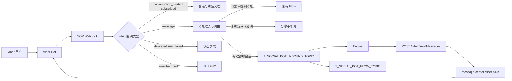
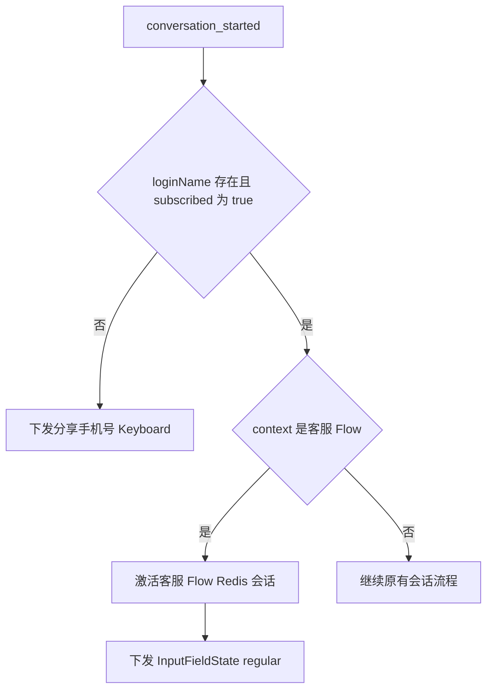
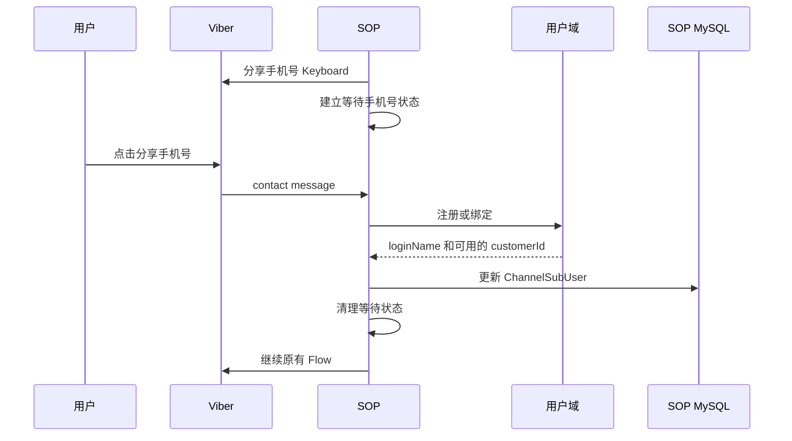
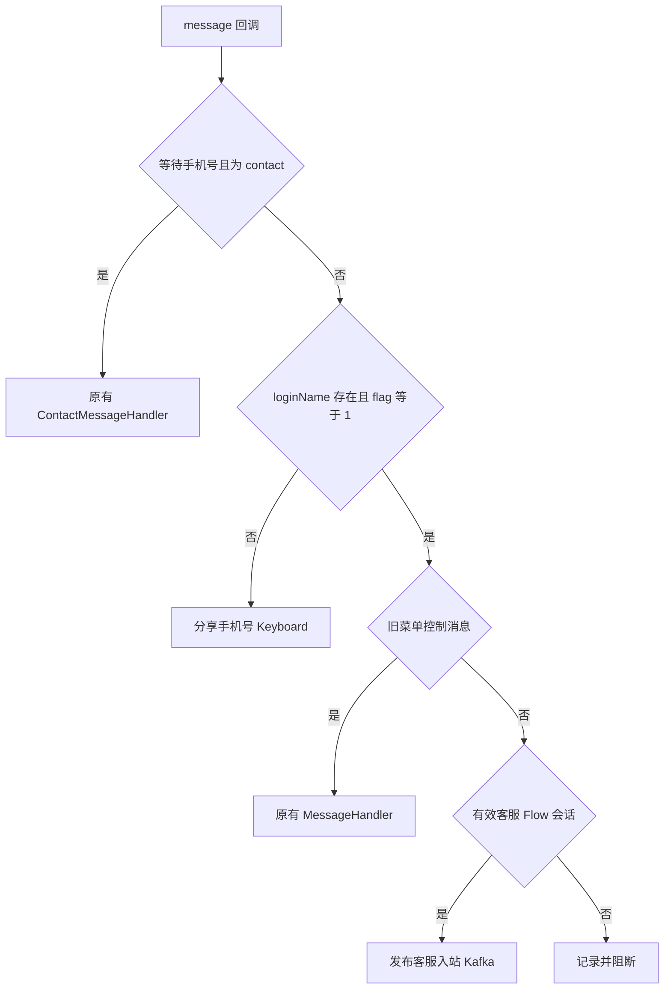
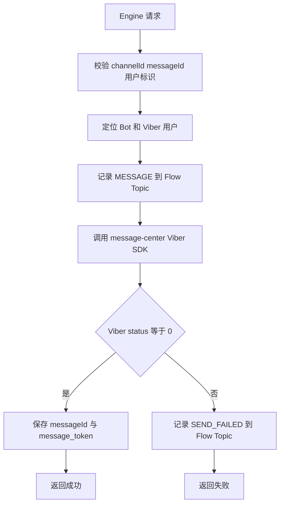
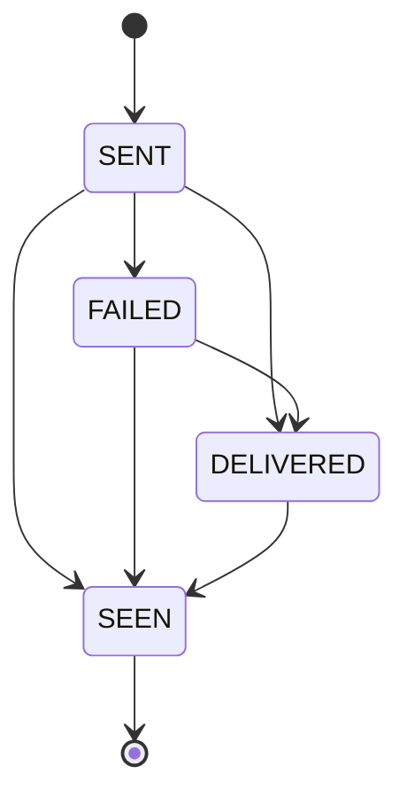

# Viber 消息流程说明

生成时间：2026-07-03 ; 最后修改时间：2026-07-26

本文以 `social/social-sop-api/sop-gateway` 当前代码为准，描述 Viber Bot 的回调、绑定、
旧菜单 Flow、客服入站、客服出站和状态回调。本文只描述 SOP 社媒域；Engine 之后的客服
网关和第三方客服系统视为外部边界。

## 1. 流程全景



## 2. Webhook 注册

### 2.1 触发方式

Webhook 不是应用启动时自动注册。运维或管理方需要调用：

```text
POST /viber/setWebHook
```

入口 `SystemController#setWebHook` 先调用 `get_account_info` 获得 Bot URI，再将
`CHAT_BOT` 回调路径固定为：

```text
/viber/{uri}/callback
```

`ViberApiServiceImpl#initializeWebhook` 将该短路径与 `webHookBaseUrl` 拼接，并调用
Viber `POST /set_webhook`。Viber 返回 `status == 0` 才视为注册成功。

代码位置：

- `social/social-sop-api/sop-gateway/src/main/java/com/digiplus/sop/gateway/web/SystemController.java`
- `social/social-sop-api/sop-gateway/src/main/java/com/digiplus/sop/gateway/service/impl/ViberApiServiceImpl.java`

### 2.2 注册日志

可通过以下日志节点排查：

- `[VIBER_WEBHOOK] action=REGISTER_TRIGGER`
- `[VIBER_WEBHOOK] action=REGISTER_REQUEST`
- `[VIBER_WEBHOOK] action=REGISTER_SUCCESS`
- `[VIBER_WEBHOOK] action=REGISTER_FAILED`
- `[VIBER_WEBHOOK] action=REGISTER_HTTP_FAILED`
- `[VIBER_WEBHOOK] action=REGISTER_SKIPPED`

最终地址应使用 Viber `get_account_info` 返回的 `webhook` 字段复核。

## 3. 回调入口和校验

### 3.1 接口

```text
POST /viber/{uri}/callback
```

请求体直接反序列化为 `ViberEventDto`，并保留
`@RequestHeader Map<String, String> headers`。

代码：

- `ViberWebHookController`
- `ViberEventDto`
- `ViberMessageDto`

### 3.2 当前校验

`ViberCallbackValidator` 执行字段级结构校验：

| 回调类型 | 主要必填字段 |
|---|---|
| 全部已支持回调 | `event`、`message_token` |
| `message` | `sender.id`、`message.type` |
| 文本消息 | `message.text` |
| 图片消息 | `message.media` |
| 联系人消息 | `message.contact.phone_number` |
| `conversation_started` / `subscribed` | `user.id` |
| `unsubscribed` / `delivered` / `seen` / `failed` | `user_id` |

当前没有验证 `X-Viber-Content-Signature`。这不是“验签失败后降级”，而是验签能力尚未实现。

### 3.3 Trace

入口创建 `[VIBER_IN]` Trace：

```text
VIBER_CALLBACK_START
CALLBACK_RECEIVED
BOT_CONFIG_RESOLVED
CALLBACK_VALIDATED
CALLBACK_ROUTE_SELECTED
...
CALLBACK_DISPATCHED
VIBER_CALLBACK_END
```

同一条回调中的入站、出站状态关联和 Kafka 消费日志沿用同一个 `traceId`。

## 4. 回调类型分发

`EventProcessor` 使用回调类型分派：

| Viber 回调类型 | 处理方向 |
|---|---|
| `conversation_started` | 建立会话上下文、绑定判断、deeplink Flow 处理 |
| `subscribed` | 原有订阅处理 |
| `unsubscribed` | 原有退订处理 |
| `message` | 旧 Flow、注册或客服消息路由 |
| `delivered` | 新状态关联；未命中则回退旧状态处理 |
| `seen` | 新状态关联；未命中则回退旧状态处理 |
| `failed` | 新状态关联；未命中则回退旧状态处理 |

未支持的回调类型记录日志后返回 `NOOP`，不阻塞其他类型。

## 5. conversation_started 和 deeplink

### 5.1 普通打开 Bot

Viber 发送 `conversation_started`。当前 `ConversationHandler` 复用原有生产流程：

1. 初始化或读取 `ChannelSubUser`。
2. 尝试恢复用户身份。
3. 未绑定或订阅标志不是 `flag == 1` 时，下发分享手机号 Keyboard。
4. 已满足条件时继续原有会话处理。

### 5.2 客服 deeplink

示例：

```text
viber://pa?chatURI={botUri}&context=Customer_Service
```

`context` 被规范化后与代码中的客服 Flow 常量比较。用户必须有 `loginName`，且本次
`conversation_started.subscribed=true`，才会激活客服 Flow 会话并开放输入框。入口按钮发送的 context 由
`sop.viber.cs.entry-button.context` 控制，默认 `Customer_Service`。



代码：

- `ConversationHandler`
- `ViberFlowEnterAction`
- `ViberFlowSessionService`
- `FlowName`

## 6. 分享手机号和绑定

### 6.1 为什么需要等待状态

Viber 联系人消息本身不能证明用户分享的是自己的手机号。SOP 在主动下发分享手机号按钮时，
通过 `ViberPhoneShareStateService` 建立短期状态。只有该状态存在，联系人消息才进入原有
`ContactMessageHandler`。

### 6.2 处理步骤



`loginName` 是当前绑定成功的权威标志。原有奖励调用不区分首次注册和重新绑定，重复奖励由
下游业务接口按既有交易标识幂等，SOP 不新增额外判断。

## 7. message 回调路由

### 7.1 路由顺序

`ViberRouteDecider` 按以下顺序判断：

1. 联系人消息是否应交给原有分享手机号处理。
2. 用户是否已经绑定。
3. 订阅标志是否为 `flag == 1`。
4. 是否属于旧菜单/Flow 控制消息。
5. 是否存在有效客服 Flow Redis 会话。
6. 消息类型是否受支持。



旧菜单 Flow 没有被客服链路替代。普通消息只有在客服 Flow 有效时才会进入 Engine。

### 7.2 入站幂等

以下回调使用幂等门闩：

- `message`
- `conversation_started`
- `subscribed`
- `unsubscribed`

幂等键：

```text
uri + message_token
```

`messageId` 由该键稳定生成，因此 Viber 重投同一回调时仍使用同一 `messageId`。状态包括
`PROCESSING`、`QUEUED`、`COMPLETED`。

## 8. 客服入站消息

### 8.1 Webhook 到入站 Topic

`ViberInboundMessageAssembler` 生成 `ViberFlowEvent`：

- `schemaVersion = 3`
- `eventType = MESSAGE`
- `messageId` 为稳定 UUID
- `channelId = {business}_VB_CB_{botName}`
- `loginName` 来自已绑定用户
- `customerId` 可为空，消费者阶段再补充
- `messageToken` 保留 Viber `message_token`
- `viberUserId` 保留 Viber 用户 ID
- 时间戳统一使用毫秒

发布：

```text
Topic: T_SOCIAL_BOT_INBOUND_TOPIC
Key: viberUserId
Value: ViberFlowEvent
```

相同用户消息使用同一分区键，保证 Kafka 分区内顺序。

### 8.2 支持的内部消息类型

`ViberFlowMessageItem.MessageType`：

- `TEXT`
- `IMAGE`
- `VIDEO`
- `RICH`
- `FILE`
- `STICKER`
- `CONTACT`
- `LOCATION`
- `URL`
- `UNKNOWN`

内部消息尽量保留 `url`、`thumbnail`、`filename`、`size` 等平台字段。

### 8.3 入站消费者

`ViberInboundListener` 对 `MESSAGE`：

1. 使用 `CustomerIdentityIndex` 补充 `customerId`。
2. 组装单条 `MessageWebhookReq.message`。
3. Debug 模式下打印提交 Engine 的 JSON。
4. 调用 `POST /social/messages/webhook`。
5. Engine 成功后发布 `T_SOCIAL_BOT_FLOW_TOPIC`。
6. 完成动作后手动 ACK。

Engine 请求中的类型只支持：

- `text`
- `image`
- `video`
- `other`

其他内部类型只在 Engine 边界转为 `other`，不会反向改写原 `ViberFlowEvent`。

## 9. Engine 回复用户

### 9.1 SOP 对 Engine 的入口

```text
POST /viber/sendMessages
```

代码：

- `SopFacade#sendViberMessages`
- `SopFacadeImpl#sendViberMessages`
- `ViberMessageDispatchService`

返回：

```json
{
  "success": true,
  "result": {
    "messageToken": "6262026123456789012",
    "viberStatus": 0,
    "viberStatusMessage": "ok",
    "billingStatus": 1
  },
  "failure": false
}
```

### 9.2 Bot 与 Biz 分派

`ViberMessageDispatchService` 根据 `channelId`：

- `VB_BIZ`：进入 Viber Business Messages 实现。
- 其他 Viber Bot 消息：进入 `ViberMessageService`，并要求子类型为 `VB_CB`。

客服流程使用 Viber Bot `CHAT_BOT` 路径。

### 9.3 客服回复发送顺序



客服回复模式使用出站状态机控制恢复。成功调用的 `tracking_data` 当前固定为：

```text
{messageId}:0
```

每次请求只发送一个消息项，因此 `segmentIndex` 当前固定为 `0`。

### 9.4 Bot 消息类型

| 类型 | 当前发送形态 |
|---|---|
| `text` | 文本消息 |
| `image` | 图片消息，空描述按空串处理 |
| `video` | 视频消息，要求 HTTPS，大小不超过 26 MB |
| `rich` | 顶部文本、中间图片、底部按钮 |

`rich` 使用 Viber Rich Media，不把图片 URL 当作按钮本身。

## 10. 状态回调闭环

### 10.1 建立关联

Viber 发送成功后，`ViberOutboundStatusService` 保存：

```text
messageId <-> botUri + message_token
```

并记录 `isMarket`，用于区分客服回复和营销消息。

### 10.2 回调路由

`ViberMessageStatusService` 收到 `delivered`、`seen`、`failed`：

1. 按 `botUri + message_token` 查询新关联。
2. 命中则推进状态机并发布 `T_SOCIAL_BOT_INBOUND_TOPIC`。
3. 未命中则回退旧 `MessageStatusHandler`。

### 10.3 状态机



后到的低状态不覆盖高状态：

- `FAILED -> DELIVERED` 有效。
- `DELIVERED -> FAILED` 无效。
- `SEEN -> DELIVERED` 无效。
- `SEEN -> FAILED` 无效。

### 10.4 消费者动作

| 状态 | 客服回复 | 营销消息 |
|---|---|---|
| `DELIVERED` | 记录 Flow | 记录 Flow，并发原有 Delivered Topic |
| `SEEN` | 记录 Flow | 记录 Flow，并发原有 Seen Topic |
| `FAILED` | 记录 Flow，并调用 Engine 状态接口 | 记录 Flow；当前代码也会调用 Engine 状态接口 |

SOP 不向 Engine 上报 `DELIVERED` 或 `SEEN`。当前 `FAILED` 上报条件是“状态处理后仍为
`FAILED`”，没有检查 `statusAccepted` 和 `sendMode`；因此重复 `FAILED` 或营销 `FAILED`
也可能上报 Engine。

Flow 发布器只实际发布 `statusAccepted=true` 的回执；重复或弱状态记录
`FLOW_PUBLISH_SKIPPED`。营销送达/已读发布器只检查处理后的当前状态，没有检查
`statusAccepted`，重复状态仍可能再次进入旧记录中心 Topic。

## 11. Flow Topic

```text
T_SOCIAL_BOT_FLOW_TOPIC
```

发布前由 `ToImMessageRecordConverter` 将一个 `ViberFlowEvent` 转成
`List<ImMessageRecordMq>`，再以 JSON 投递。主要记录：

- 用户进入客服的消息。
- 客服回复用户的消息。
- 明确发送失败的 `SEND_FAILED`。
- Viber 的 `DELIVERED`、`SEEN`、`FAILED` 回调。

SOP 不把客服消息持久化到自己的业务表。Flow Topic 的下游负责持久化记录。

## 12. Kafka 可靠性

`viberInboundConsumerFactory` 当前配置：

- 手动立即 ACK。
- 并发数和批量大小来自 `ViberCsProperties`。
- 固定 1 秒退避。
- 最多重试 3 次。
- 无 DLT。
- 重试耗尽后输出 Topic、分区、Offset、Key 和完整 Payload。
- 恢复后提交消费位点。

这意味着失败消息不会进入专用死信 Topic，需要通过日志告警和人工补偿发现。

## 13. 数据和缓存

### 13.1 MySQL

与客服链路直接相关的本地数据主要是：

- Bot Token、URI 和业务配置。
- `ChannelSubUser` 的 Viber 用户绑定关系。
- 原有 Flow 定义与 Flow 运行所需配置。

客服消息正文不在 SOP 本地业务表持久化。

### 13.2 Redis

Redis 保存：

- 客服 Flow 会话，默认 24 小时。
- 分享手机号等待状态，默认 30 分钟。
- 入站幂等状态。
- 出站幂等状态。
- 出站 `message_token` 状态关联，由代码固定为 24 小时。
- 发送限流状态。

### 13.3 本地内存

`CustomerIdentityIndex` 使用并发 Map 建立 `loginName` 与 `customerId` 双向索引。缓存未命中时
通过 `CustomerRepository` 查询并回填。该缓存是进程内缓存，重启后重新按需加载。

## 14. 关键配置

统一前缀：

```text
sop.viber.cs
```

关键项：

- `debug-enabled`
- `message-source`
- `flow-session-ttl-seconds`
- `phone-share-state-ttl-seconds`
- `entry-button.enabled`
- `entry-button.image-url`
- `entry-button.text`
- `entry-button.context`
- `entry-button.columns`
- `entry-button.rows`
- `flow.topic`
- `flow.publish-timeout-seconds`
- `inbound.topic`
- `inbound.group`
- `inbound.concurrency`
- `inbound.publish-timeout-seconds`
- `inbound.retry-interval-ms`
- `inbound.retry-count`
- `outbound.idempotency-processing-ttl-seconds`
- `outbound.idempotency-ttl-seconds`
- `outbound.rate-limit-requests-per-second`
- `entry-button.enabled`
- `entry-button.image-url`

## 15. 排障路径

### 15.1 完全没有回调

1. 调用 Viber `get_account_info` 核对 `webhook`。
2. 检查 `/viber/setWebHook` 注册日志。
3. 从外部网络调用回调地址，确认网关和证书可达。
4. 检查网关是否将请求转发到 SOP。
5. 查 `[VIBER_IN] event=VIBER_CALLBACK_START`。

### 15.2 deeplink 没有进入客服

1. 看 `CALLBACK_VALIDATED` 中的 `context`。
2. 检查 `context` 规范化后是否匹配 `FlowName.Customer_Service`，并核对入口按钮的
   `sop.viber.cs.entry-button.context`。
3. 检查用户是否有 `loginName`。
4. 检查 `ChannelSubUser.flag` 是否为 `1`。
5. 查 `CUSTOMER_FLOW_ENTERED` 和开放输入框发送日志。

### 15.3 用户消息未进入 Engine

1. 查 `MESSAGE_ROUTE_SELECTED`。
2. 确认路由为 `FORWARD`，不是 `OUTSIDE_CUSTOMER_FLOW`。
3. 查 `KAFKA_PUBLISH_ACK`。
4. 查 `KAFKA_RECORD_RECEIVED`。
5. 查 `ENGINE_REQUEST_ASSEMBLED` 和 `ENGINE_REQUEST_ACCEPTED`。
6. 查 `FLOW_PUBLISH_ACK`。

### 15.4 出站成功但没有状态回调关联

1. 查 Viber SDK 返回的 `messageToken`。
2. 查 Redis 关联写入日志。
3. 查 `STATUS_CORRELATION_LOOKUP`。
4. 若为 `STATUS_CORRELATION_MISS`，确认 Bot URI、Token 和 TTL。
5. 检查是否回退旧 `MessageStatusHandler`。

## 16. 当前缺口

1. Viber Bot Webhook 没有官方签名校验。
2. 入站 Kafka 没有 DLT。
3. Engine 错误码没有完成重试分类。
4. SDK 成功但 Token 为空时，后续状态无法关联。
5. 状态关联 TTL 当前只有 24 小时。
6. Debug 默认开启，存在敏感消息日志风险。
7. 测试 Controller 位于主代码并缺少显式环境隔离。
8. 普通消息路由不再产生 `DEFAULT_FLOW_ENTRY`，但相关代码仍保留。
9. 状态副作用没有统一使用 `statusAccepted`，重复回调可能重复触发下游。

## 17. 代码索引

| 领域 | 代码 |
|---|---|
| Webhook 入口 | `callback/ViberWebHookController.java` |
| 回调校验 | `callback/validation/ViberCallbackValidator.java` |
| 回调编排 | `callback/ViberCallbackOrchestrator.java` |
| 类型分发 | `callback/handler/EventProcessor.java` |
| 消息协调 | `callback/handler/ViberMessageCoordinator.java` |
| 准入与路由 | `callback/routing/ViberAdmissionDecider.java`、`ViberRouteDecider.java` |
| 分享手机号 | `service/viber/ViberPhoneShareStateService.java` |
| 注册处理 | `callback/handler/message/ContactMessageHandler.java` |
| 客服 Flow | `callback/action/ViberFlowEnterAction.java`、`service/viber/ViberFlowSessionService.java` |
| 入站发布 | `service/viber/ViberInboundEventPublisher.java` |
| 入站消费 | `listener/ViberInboundListener.java` |
| Engine 请求 | `service/viber/MessageWebhookRequestAssembler.java`、`client/MsgEngineServiceFacade.java` |
| 出站门面 | `facade/SopFacade.java`、`facade/impl/SopFacadeImpl.java` |
| 出站服务 | `service/viber/ViberMessageService.java` |
| SDK 发送 | `service/viber/ViberOutboundSendService.java` |
| 状态关联 | `service/viber/ViberOutboundStatusService.java` |
| 状态路由 | `service/viber/ViberMessageStatusService.java` |
| Flow 记录 | `service/viber/ViberFlowEventPublisher.java`、`support/ToImMessageRecordConverter.java` |
