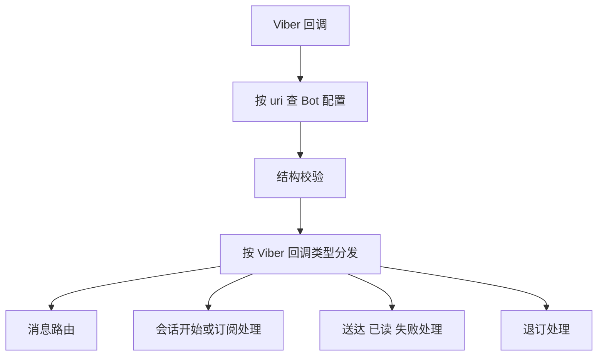
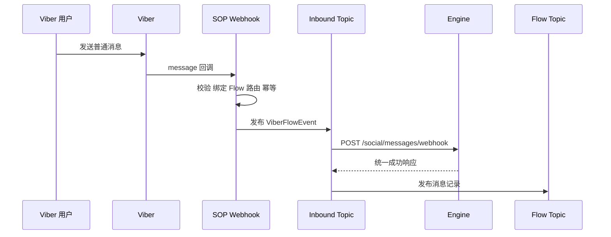
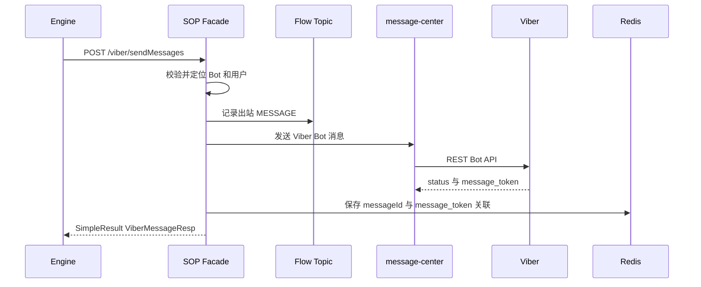

# Viber 系统接手说明

生成时间：2026-07-09 ; 最后修改时间：2026-07-26

本文面向接手 `social` 项目 Viber 能力的维护人员。内容以
`social/social-sop-api/sop-gateway` 当前代码为准，重点说明 Viber Bot、旧菜单 Flow、
客服双向消息、账号绑定、Kafka 和状态回调。`social-campaign-api` 与外部客服系统内部实现
不在本文范围内。

## 1. 先用 Telegram 概念理解 Viber

| Viber 概念 | 可类比的 Telegram 概念 | 当前系统中的含义 |
|---|---|---|
| Viber Bot | Telegram Bot | 用户与机器人会话的主体 |
| Bot Token | Telegram Bot Token | 调用 Viber REST Bot API 的凭证 |
| Bot URI | Bot username/deeplink 标识 | 回调路径、Bot 配置和 `channelId` 的组成部分 |
| Webhook | Telegram Webhook | Viber 将用户消息和状态回调推给 SOP |
| `message_token` | 平台消息 ID | Viber 消息及回调的关联标识 |
| `conversation_started` | 用户首次打开 Bot/带参数启动 | 进入 Bot 或 deeplink 会话的入口回调 |
| `context` | Telegram `/start` 参数 | deeplink 携带的 Flow 上下文 |
| Keyboard | Reply/Inline Keyboard | 菜单按钮、分享手机号按钮和输入框状态 |
| `InputFieldState` | 是否允许自由输入 | `hidden` 隐藏输入框，`regular` 开放输入框 |
| `delivered` / `seen` / `failed` | 送达、已读、失败回调 | 出站消息后续状态 |

与 Telegram 的一个重要差异是：Viber 的输入框是否可见可以由 Bot 下发 Keyboard 控制。
因此旧菜单 Flow 可以保持输入框隐藏，客服 Flow 则通过独立 Keyboard 将输入框切换为
`regular`。

## 2. 项目职责

### 2.1 social-operation-api

该项目负责运营配置和编排，主要包括：

- Bot、账号、模板和任务配置。
- Flow DSL 的配置与变更通知。
- 批量或运营消息的任务编排。
- 将需要 SOP 执行的平台动作投递到运行时链路。

它不直接接收 Viber Bot Webhook，也不是客服消息实时收发的执行入口。

### 2.2 social-sop-api / sop-gateway

该项目是 Viber 运行时网关，主要负责：

- 注册和接收 Viber Webhook。
- 解析 Viber 回调事件。
- 执行用户绑定、旧菜单 Flow 和客服 Flow 的路由。
- 将客服入站消息异步提交给 Engine。
- 接收 Engine 的回复请求并调用 Viber。
- 关联 `messageId` 与 Viber `message_token`。
- 消费送达、已读和失败回调。
- 记录消息 Flow，并兼容原有营销消息状态 Topic。

### 2.3 Engine 边界

SOP 只依赖 Engine 提供的接口，不负责 Engine 之后的客服网关和第三方客服实现：

- 入站：`POST /social/messages/webhook`
- 失败状态：`POST /social/message/status`
- 出站入口：Engine 调用 SOP 的 `POST /viber/sendMessages`

## 3. Viber Bot 配置和 Webhook

### 3.1 Bot 配置

Bot Token、URI、Bot 类型、业务线等信息由 `BotConfigLoader` 加载。回调入口按照 URI
查找对应 Bot 配置；查不到配置时不会进入业务处理。

代码：

- `social/social-sop-api/sop-gateway/src/main/java/com/digiplus/sop/gateway/conf/BotConfigLoader.java`
- `social/social-sop-api/sop-gateway/src/main/java/com/digiplus/sop/gateway/dao/entity/BotTokenConfig.java`

### 3.2 Webhook 不是启动时自动注册

当前代码通过管理接口显式触发注册：

```text
POST /viber/setWebHook
```

处理步骤：

1. 使用 Token 调用 Viber `get_account_info`。
2. 读取账号的 URI。
3. 对 `CHAT_BOT` 拼接 `/viber/{uri}/callback`。
4. 调用 Viber `set_webhook`。
5. 以 Viber 响应 `status == 0` 判断成功。

注册的 Bot 回调类型包括：

- `delivered`
- `seen`
- `failed`
- `subscribed`
- `unsubscribed`
- `conversation_started`

Viber 的 `message` 回调是 Bot Webhook 的基本消息回调；当前 UAT 实际
`get_account_info` 也可用于核对最终 `webhook` 和 `event_types`。

代码：

- `social/social-sop-api/sop-gateway/src/main/java/com/digiplus/sop/gateway/web/SystemController.java`
- `social/social-sop-api/sop-gateway/src/main/java/com/digiplus/sop/gateway/service/impl/ViberApiServiceImpl.java`

### 3.3 Bot 回调地址

```text
POST /viber/{uri}/callback
```

`uri` 是 Bot URI，不是通用平台参数。WhatsApp、Telegram 等平台使用各自的 Controller，
不会进入该 Viber Bot 回调。

入口代码：

- `social/social-sop-api/sop-gateway/src/main/java/com/digiplus/sop/gateway/callback/ViberWebHookController.java`

### 3.4 当前安全边界

Controller 保留了全部请求头，并执行结构校验，但当前代码没有校验 Viber 官方签名。
因此网络入口必须由网关白名单、HTTPS 和访问控制保护；补充官方签名校验仍是明确的安全缺口。

## 4. 回调处理总入口



主入口和分发：

- `ViberWebHookController`
- `ViberCallbackValidator`
- `ViberCallbackOrchestrator`
- `EventProcessor`

入站 Trace 使用 `[VIBER_IN]`，出站和状态关联使用 `[VIBER_OUT]`。同一回调处理期间复用
同一个 `traceId`，日志 `step` 用于定位调用顺序。

Debug 模式由 `sop.viber.cs.debug-enabled` 控制，当前默认值为 `true`。对 `message`
回调，入口会打印最多 255 个 Unicode 码点的消息预览。该配置在生产环境应谨慎开启。

## 5. 新用户、退订用户和手机号绑定

### 5.1 权威绑定标志

当前生产逻辑使用 `ChannelSubUser.loginName` 非空作为绑定完成标志。客服入站请求中的
`customerId` 可通过本地双向索引和用户域查询补充，但它不是 Viber 原生字段。

### 5.2 需要注册的场景

以下情况进入分享手机号流程：

- 新用户没有 `loginName`。
- 普通 `message` 回调中，本地订阅标志不是 `flag == 1`。
- `conversation_started` 回调中，Viber 的 `subscribed` 字段为 `false`。
- 未绑定用户发送普通文本、图片等消息。
- 未绑定或已退订用户通过 deeplink 打开 Bot。

系统执行：

1. 关闭当前客服 Flow 会话。
2. 下发分享手机号 Keyboard。
3. 在 Redis 建立短期“等待手机号”状态。
4. 等待用户点击 `share-phone` 按钮。

关键代码：

- `ViberAdmissionDecider`
- `ViberRouteDecider`
- `ViberMessageCoordinator`
- `ConversationHandler`
- `ViberPhoneShareStateService`

### 5.3 分享手机号后的处理

只有系统已经建立“等待手机号”状态时，联系人消息才会交给原有注册处理器，避免将任意
联系人名片误当成用户自己的手机号。

现有处理链路：

1. 规范化手机号。
2. 调用用户域 Viber 注册/绑定接口。
3. 得到 `loginName`，并在可用时得到 `customerId`。
4. 更新本地 `ChannelSubUser` 绑定信息。
5. 清理等待手机号状态。
6. 继续执行原有菜单/Flow 后续动作。
7. 原有奖励调用保持不变，重复奖励由下游业务接口按既有交易标识幂等。

代码：

- `social/social-sop-api/sop-gateway/src/main/java/com/digiplus/sop/gateway/callback/handler/message/ContactMessageHandler.java`
- `social/social-sop-api/sop-gateway/src/main/java/com/digiplus/sop/gateway/service/UserCenterService.java`
- `social/social-sop-api/sop-gateway/src/main/java/com/digiplus/sop/gateway/helper/ChannelSubUserHelper.java`

当前 SOP 不新增“首次注册才发奖励”的分支，也不修改奖励规则。

## 6. 旧菜单 Flow 与客服 Flow

### 6.1 旧菜单 Flow 保持不变

旧菜单控制消息由 `ViberLegacyMessageMatcher` 识别并交回原有 `MessageHandler`。这些消息
不会进入客服 Kafka。

典型旧链路标识包括：

- 菜单按钮携带的 Flow 参数。
- 评分等既有控制消息。
- 旧 Flow DSL 节点动作。

旧 Flow 的 Keyboard 仍可将 `InputFieldState` 设为 `hidden`，不会因为新增客服入口而整体
开放自由输入。

### 6.2 客服入口按钮

普通 Flow Keyboard 可统一追加客服入口按钮。按钮行为：

- 开关：`sop.viber.cs.entry-button.enabled`
- 图片：`sop.viber.cs.entry-button.image-url`
- deeplink：由 Bot URI 和客服 Flow 名称生成
- 当前已经处于客服 Flow 时不重复追加
- 按钮使用图片，不显示文本

代码：

- `social/social-sop-api/sop-gateway/src/main/java/com/digiplus/sop/gateway/helper/ViberKeyboardButtonFactory.java`
- `social/social-sop-api/sop-gateway/src/main/java/com/digiplus/sop/gateway/helper/ViberKeyboardHelper.java`
- `social/social-sop-api/sop-gateway/src/main/java/com/digiplus/sop/gateway/support/ViberCsProperties.java`

### 6.3 进入客服 Flow

deeplink 的 `context` 被规范化后与代码固定的客服 Flow 名称比较。`conversation_started`
必须同时满足 `loginName` 非空和回调 `subscribed=true`，随后才会执行客服 Flow：

1. 激活 Redis 客服 Flow 会话。
2. 下发开放输入框的 Keyboard。
3. 用户后续普通文本、图片、视频等消息才允许进入客服链路。

代码：

- `ViberFlowEnterAction`
- `ViberFlowSessionService`
- `ViberFlowSessionSnapshot`

客服 Flow 在代码中固定使用 `FlowName.Customer_Service` 和
`ScenarioGroup.CUSTOMER_SERVICE`。入口按钮携带的 deeplink context 由
`sop.viber.cs.entry-button.context` 控制，默认 `Customer_Service`；客服会话 TTL 默认
86400 秒。

## 7. 客服入站链路



### 7.1 第一段：Webhook 到 Kafka

- 内部 Topic：`T_SOCIAL_BOT_INBOUND_TOPIC`
- 分区键：`viberUserId`
- 幂等键：`uri + message_token`
- 内部 DTO：`ViberFlowEvent`
- 当前 schema 版本：`3`

只有 Redis 中存在有效客服 Flow 会话的普通消息才会发布。不存在客服会话时，消息被记录为
`OUTSIDE_CUSTOMER_FLOW`，不会误送给 Engine。

### 7.2 第二段：Kafka 到 Engine

`ViberInboundListener` 消费消息后：

1. 必要时根据 `loginName` 补充 `customerId`。
2. 转为单条 `MessageWebhookReq.message`。
3. 调用 Engine `/social/messages/webhook`。
4. Engine 成功后发布 `T_SOCIAL_BOT_FLOW_TOPIC`。
5. 完成所需动作后手动 ACK。

Engine 边界支持 `text`、`image`、`video`；其他 Viber 消息类型在 Engine 请求中归一为
`other`，内部 `ViberFlowEvent` 仍保留平台原始类型和文件元数据。

## 8. 客服出站链路



请求要求：

- `channelId` 和 `messageId` 必填。
- `loginName`、`customerId` 至少一个非空。
- 每次请求只允许一个消息项。
- Bot 消息支持 `text`、`image`、`video`、`rich`。

`market=false` 走客服回复模式，先记录 Flow，再发送 Viber；明确发送失败时补发
`SEND_FAILED` Flow。`market=true` 走营销模式，并在后续回调时兼容原有营销记录 Topic。

代码：

- `SopFacade`
- `SopFacadeImpl`
- `ViberMessageDispatchService`
- `ViberMessageService`
- `ViberOutboundSendService`
- `ViberFlowEventAssembler`
- `ViberFlowEventPublisher`

## 9. 状态回调

Viber Bot 返回 `message_token` 后，SOP 在 Redis 保存：

- `messageId`
- `messageToken`
- `botUri`
- `viberUserId`
- `loginName`
- `customerId`
- `isMarket`
- 当前业务状态

回调按 `botUri + message_token` 查找关联。状态规则：

```text
SENT -> FAILED | DELIVERED | SEEN
FAILED -> DELIVERED | SEEN
DELIVERED -> SEEN
SEEN -> 终态
```

因此 `FAILED` 后出现 `DELIVERED` 或 `SEEN` 可更新为成功状态；`DELIVERED` 后到达的
`FAILED` 无效；`SEEN` 后不再回退。

处理差异：

- `FAILED` 处理后只要当前缓存状态仍为 `FAILED`，消费者就上报 Engine。
- 营销消息的 `DELIVERED`、`SEEN` 按处理后的当前状态发布到原有消息记录中心 Topic。
- 状态机接受的已关联回调进入 Flow Topic；`statusAccepted=false` 时记录
  `FLOW_PUBLISH_SKIPPED`，不实际发布。
- 关联未命中时回退到原有 `MessageStatusHandler`，兼容旧链路。

当前 Engine 失败上报和营销旧 Topic 发布没有统一检查 `statusAccepted`。重复 `FAILED` 可能
再次上报 Engine，重复营销送达/已读可能再次发布旧 Topic；这是现有实现边界。

Redis 关联 TTL 当前由 `ViberOutboundStatusService` 固定为 24 小时，不支持 Nacos 动态调整。

## 10. Kafka 和 Redis 清单

### 10.1 客服链路 Topic

| Topic | 用途 |
|---|---|
| `T_SOCIAL_BOT_INBOUND_TOPIC` | 统一承载客服消息和已关联状态回调 |
| `T_SOCIAL_BOT_FLOW_TOPIC` | 记录用户消息、客服回复和发送失败 |
| `MSG_RECORD_CENTER_DELIVERED_TOPIC` | 原有营销消息送达记录 |
| `MSG_RECORD_CENTER_SEEN_TOPIC` | 原有营销消息已读记录 |

入站消费者没有 DLT。失败后按固定退避重试，耗尽后输出完整消息日志并提交恢复记录。

### 10.2 关键 Redis 状态

- 客服 Flow 会话。
- 分享手机号等待状态。
- 入站 `uri + message_token` 幂等状态。
- 出站 `messageId` 幂等状态。
- `botUri + message_token` 状态关联。
- Bot 维度发送限流器。

## 11. 配置入口

客服相关统一配置类为 `ViberCsProperties`，前缀：

```text
sop.viber.cs
```

主要配置：

- `debug-enabled`
- `message-source`
- `flow-session-ttl-seconds`
- `phone-share-state-ttl-seconds`
- `entry-button.enabled`
- `entry-button.image-url`
- `entry-button.text`
- `entry-button.context`
- `entry-button.columns`
- `entry-button.rows`
- `flow.topic`
- `flow.publish-timeout-seconds`
- `inbound.topic`
- `inbound.group`
- `inbound.concurrency`
- `inbound.publish-timeout-seconds`
- `inbound.retry-interval-ms`
- `inbound.retry-count`
- `outbound.idempotency-processing-ttl-seconds`
- `outbound.idempotency-ttl-seconds`
- `outbound.rate-limit-requests-per-second`

入站幂等和入口限流仍有部分配置保留在 `sop.viber.inbound.*` 前缀下，尚未完全收敛。

## 12. 当前已知边界

1. Viber Bot Webhook 尚未实现官方签名校验。
2. Debug 默认开启，可能输出用户消息、登录名和客户号，应按环境评估。
3. 入站 Kafka 重试耗尽后没有 DLT。
4. SDK 返回成功但没有 `message_token` 时，无法建立后续状态关联。
5. Engine 非成功错误码暂未细分可重试与终态。
6. 出站状态关联只保留 24 小时。
7. `TestViberController` 位于主代码中，测试入口缺少明确的环境与权限隔离。
8. `DEFAULT_FLOW_ENTRY` 分支及处理类仍保留，但当前普通消息路由不会产生该结果。
9. 状态副作用未统一按 `statusAccepted` 去重。

## 13. 推荐阅读顺序

1. `ViberWebHookController`
2. `ViberCallbackOrchestrator`
3. `EventProcessor`
4. `ViberMessageCoordinator`
5. `ViberRouteDecider`
6. `ContactMessageHandler`
7. `ViberFlowEnterAction`
8. `ViberInboundListener`
9. `SopFacadeImpl`
10. `ViberMessageService`
11. `ViberMessageStatusService`
12. `ViberCsProperties`

配套文档：

- [Viber 消息流程说明](Viber消息流程说明.md)
- [Viber 客服双向消息链路接口设计方案](Viber客服双向消息链路接口设计方案.md)
- [Viber 客服 SOP 入站开发计划](ViberBot客服SOP侧入站链路开发计划.md)
- [Viber 客服 SOP 出站开发计划](ViberBot客服SOP侧出站链路开发计划.md)
