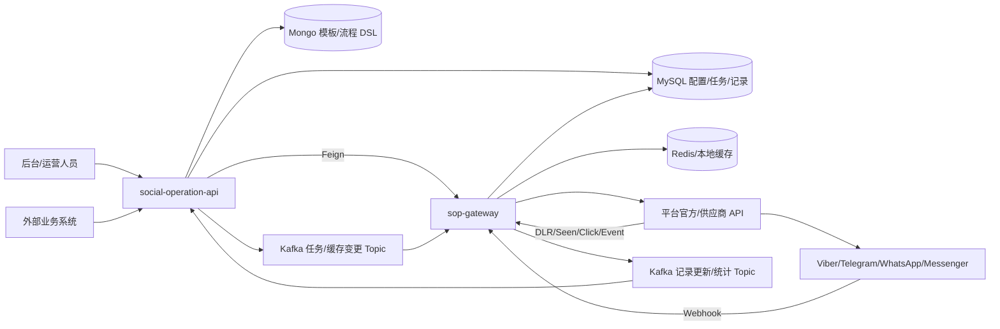
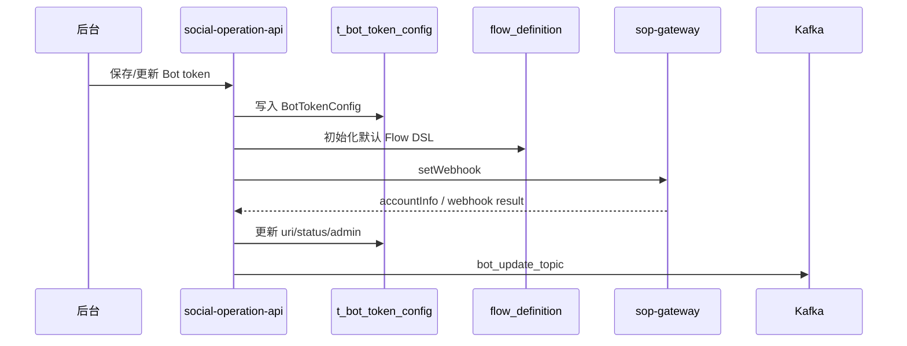
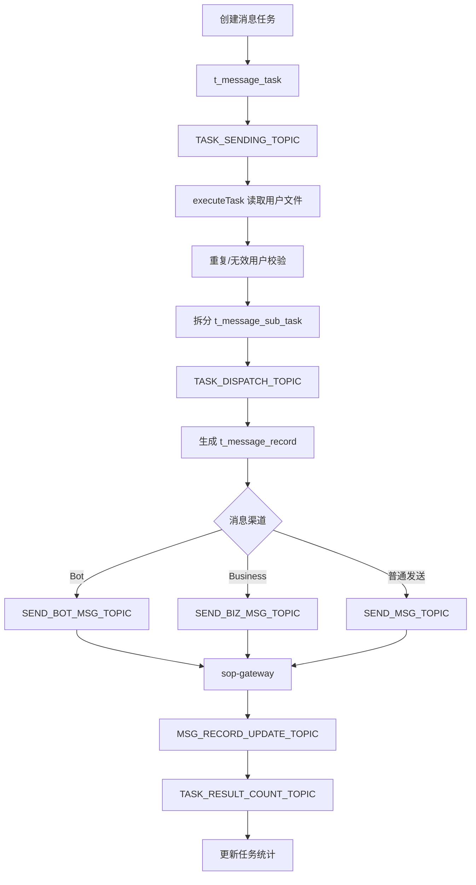
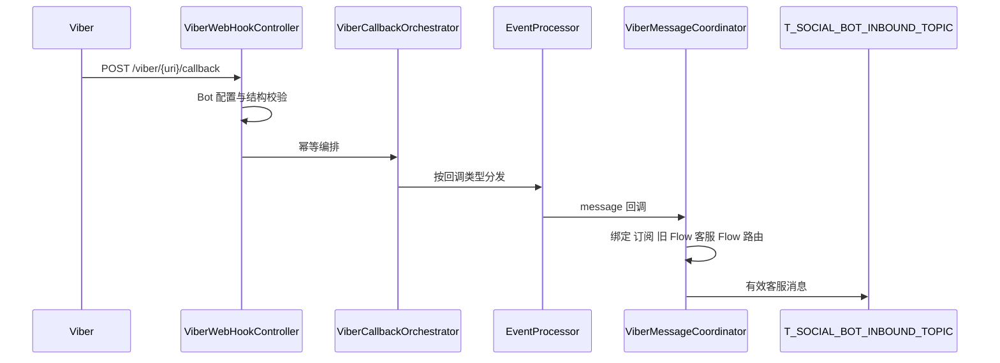
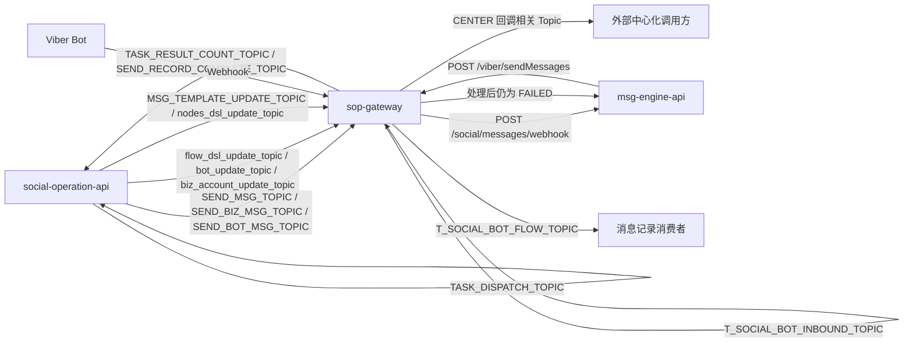

# social-operation-api 与 social-sop-api 项目能力说明

生成时间：2026-07-06 ; 最后修改时间：2026-07-26

本文档基于当前代码复核 `social/social-operation-api` 与 `social/social-sop-api/sop-gateway` 两个项目的实际能力、实现细节、入口、出口、核心链路和数据表清单。当前重点是消息发送能力、任务编排、流程处理和运行时网关能力；活动、游戏、RPA 控号等业务侧能力也会列出，但作为低优先级背景说明。

## 1. 总体定位

这两个项目是一组控制面与运行时网关的组合：

| 项目 | 服务名 | 定位 | 核心职责 |
| --- | --- | --- | --- |
| `social-operation-api` | `c66-social-operation-api` | 控制面、后台配置、任务编排服务 | 维护 Bot/账号/模板/流程/消息任务；拆分任务；创建发送记录；通过 Kafka 和 Feign 通知运行时服务。 |
| `social-sop-api/sop-gateway` | `c66-social-sop-api` | 运行时网关、平台接入、消息执行服务 | 接收 Viber/Telegram/WhatsApp/Messenger 回调；加载配置与流程缓存；执行 Flow DSL；调用平台 API 发送；处理状态回执并更新记录。 |

整体分工可以理解为：

```text
social-operation-api 负责“配置什么、发给谁、何时发、用什么模板”
social-sop-api/sop-gateway 负责“实际怎么接收平台事件、怎么发出去、怎么回写状态”
```

## 2. 总体链路



## 3. social-operation-api 能力

### 3.1 项目基础

| 项 | 内容 |
| --- | --- |
| 入口类 | `com.digiplus.social.operation.SocialOperationApplication` |
| Java / Spring Boot | Java 21 / Spring Boot 3.4.4 |
| 主要中间件 | MyBatis Plus、MongoDB、Kafka、Nacos、Redis/CacheClient、XXL-Job、OpenFeign |
| 配置入口 | `src/main/resources/application.properties`，通过 `spring.config.import=nacos:${spring.application.name},nacos:c66-mms-public-config` 加载 Nacos |
| Mapper 扫描 | `com.digiplus.social.operation.repo.dao.mapper`、`com.digiplus.social.operation.heavyjob.dao` |
| Feign 扫描 | `com.digiplus.oms.client.feign`、`com.digiplus.gateway.common.domain.*.client`、`com.digiplus.social.operation.client` |

### 3.2 对外 HTTP 入口

| 能力 | Controller / Facade | 主要路径 | 说明 |
| --- | --- | --- | --- |
| Bot token / Webhook 配置 | `BotTokenController` | `/api/token` | 维护 Viber/Telegram/WhatsApp/Messenger Bot 配置；保存后调用 SOP 设置 Webhook，并发 Kafka 刷新缓存。 |
| Channel token 配置 | `ChannelTokenController` | `/api/channel` | 管理 Channel 类型 token。 |
| Business 账号配置 | `BizAccountConfigController` | `/api/biz-account/` | 管理 Viber Business / Messenger Business 等业务账号 API key、secret、accountId、lineage。 |
| Flow DSL 配置 | `AutoMessageFlowController` | `/api/flow` | 查询、编辑、初始化、分组、启停自动流程；提供 `/api/flow/internal/query` 给 `sop-gateway` 读取流程。 |
| 消息模板 | `MessageTemplateController` | `/api/message-template` | 管理模板内容，模板存 Mongo；提供 internal 查询给 SOP。 |
| Bot 消息任务 | `MessageTaskController` | `/api/messageTask` | 创建、编辑、查询、取消批量消息任务，下载源文件/结果文件。 |
| Channel 消息任务 | `MessageChannelTaskController` | `/api/channelTask` | 创建和调度 Viber Channel / Telegram Channel 任务。 |
| 外部消息审核 | `MessageAuditController` | `/api/msg-audit` | 查询、查看、审核外部业务创建的消息请求。 |
| 外部消息授权 | `MessageApiAuthorizationController` | `/api/msg-authorization` | 维护外部调用方 callerId、callerSecret、账号映射。 |
| 消息账号配置 | `MessageApiAccountController` | `/api/msg-account` | 管理消息发送账号展示名、API 名称、状态。 |
| 系统任务 | `SystemTaskController` | `/api/system-task` | 管理自动任务配置、cron、handler、接收人群、模板和账号。 |
| VIP 用户/按钮 | `VipUserController`、`VipButtonController` | `/api/vip-user`、`/api/vip-button` | 维护 VIP 用户与 Viber 菜单/按钮节点配置。 |
| 用户管理报表 | `UserManagementController` | `/api/user-management` | 查询渠道用户、订阅状态、标签、最近交互等报表信息。 |
| 外部业务 Facade | `OperationFacadeImpl` | `/biz-send/*`、`/eventPublish/*` | 外部系统调用的服务入口，例如创建模板、创建中心化消息任务、批量发送业务消息、查询可用活动发布内容。 |

低优先级但存在的能力：

| 能力 | Controller | 说明 |
| --- | --- | --- |
| RPA / 社交账号池 | `SocialAccountController`、`AccountProfileController`、`AccountTagController`、`RpaApiController` | 账号池、指纹 profile、账号标签、RPA 队列。 |
| 控号/养号 | `ControlTaskController`、`ControlStrategyController`、`DialogueContentController`、`AccountNurturingRecordController` | 创建控号任务、策略、对话内容与养号记录。 |
| 活动/展示配置 | `EventPublishController`、`GamePlacementController`、`event/*Controller` | 活动发布、游戏位、奖励配置等业务展示能力。 |

### 3.3 主要出口

| 出口类型 | 目标 | 说明 |
| --- | --- | --- |
| Feign | `SopFacade` -> `c66-social-sop-api` | 调用 `/viber/setWebHook`、`/tg/setWebHook`、`/viber/sendChannelMessage`、`/tg/sendChannelMessage`、`/whatsapp/setWebHook`、`/messenger/setWebHook` 等。 |
| Feign | `UgOfficeFacade` -> `public-ug-office-api` | 查询 lineage、business、product、client 配置。 |
| Feign | `CampaignFacade` -> `c66-social-campaign-api` | 魔术数字等活动用户查询；当前消息主链路低优先级。 |
| Kafka | 任务调度 Topic | `TASK_SENDING_TOPIC`、`TASK_DISPATCH_TOPIC`、`CHANNEL_TASK_SENDING_TOPIC`。 |
| Kafka | SOP 发送 Topic | `SEND_MSG_TOPIC`、`SEND_BIZ_MSG_TOPIC`、`SEND_BOT_MSG_TOPIC`、`T_SEND_OTP_MSG_TOPIC`、`T_SEND_GP_OTP_MSG_TOPIC`。 |
| Kafka | 缓存刷新 Topic | `flow_dsl_update_topic`、`bot_update_topic`、`biz_account_update_topic`、`nodes_dsl_update_topic`、`MSG_TEMPLATE_UPDATE_TOPIC`。 |
| Kafka | 统计/回调 Topic | `TASK_RESULT_COUNT_TOPIC`、`SEND_RECORD_COMPLETE_TOPIC`、`CENTER_CALLBACK_COUNT_TOPIC`、`CENTER_CALLBACK_TOPIC`。 |
| MongoDB | `flow_definition`、`message_template` 等集合 | 保存自动流程 DSL、消息模板和批量发送模板。 |
| MySQL | `t_message_task`、`t_message_sub_task`、`t_message_record` 等 | 保存任务、批次、发送记录、配置和报表。 |

### 3.4 Bot 配置与 Webhook 初始化

核心类：

- `BotTokenController`
- `BotTokenService`
- `PlatformCombineFactory`
- `ViberBotService`、`TelegramBotService`、`WhatsAppBotService`
- `SopFacade`

主要步骤：

1. 后台通过 `/api/token/save` 或 `/api/token/update` 保存 Bot 配置到 `t_bot_token_config`。
2. `BotTokenService.save(...)` 校验 Bot 名称和 token 是否重复。
3. Chat Bot 类型创建时，会调用 `FlowDslService.initFlowDefinition(...)` 初始化默认 Flow DSL。
4. 异步调用 `processWebHook(...)`，通过 `SopFacade.setWebhook(...)` 请求 `sop-gateway` 设置平台 Webhook。
5. SOP 返回账号信息后，更新 `uri`、`botStatus`、管理员信息等字段。
6. 发送 `bot_update_topic`，通知 `sop-gateway` 刷新 Bot 缓存。



### 3.5 Flow DSL 管理

核心类：

- `AutoMessageFlowController`
- `FlowDslService`
- `default_flow_definition*.json`

能力：

- 新 Bot 创建时初始化默认流程。
- 按 Bot、平台、场景组查询流程。
- 编辑流程节点、公共节点、节点图片。
- 启停流程、调整分组。
- 物理删除或逻辑删除流程。
- 提供 internal 查询给 `sop-gateway`。
- 修改后延迟 3 秒发送 `flow_dsl_update_topic`，通知 SOP 刷新缓存。

存储：

| 存储 | 内容 |
| --- | --- |
| Mongo `flow_definition` | Viber 默认流程 DSL。 |
| Mongo 平台集合 | Telegram、WhatsApp、Messenger 有各自默认流程 JSON 和集合映射。 |

### 3.6 消息模板管理

核心类：

- `MessageTemplateController`
- `MessageTemplateService`
- `MsgTemplateLoader` 在 SOP 侧消费缓存刷新

能力：

- 维护普通模板和批量发送模板。
- 支持文本、图片、视频、Rich Media、按钮、Open URL 等模板字段。
- 模板存储在 Mongo 集合，例如 `message_template`、`message_template_batch_send`。
- 更新后通过 `MSG_TEMPLATE_UPDATE_TOPIC` 通知 SOP 刷新模板缓存。

### 3.7 消息任务编排

核心类：

- `MessageTaskController`
- `MessageTaskService`
- `MessageSubTaskService`
- `MessageTaskListener`
- `SendMessageJob`

主要表：

- `t_message_task`
- `t_message_sub_task`
- `t_message_record`

主要 Kafka：

- `TASK_SENDING_TOPIC`
- `TASK_DISPATCH_TOPIC`
- `SEND_MSG_TOPIC`
- `SEND_BIZ_MSG_TOPIC`
- `SEND_BOT_MSG_TOPIC`
- `SEND_RECORD_COMPLETE_TOPIC`
- `TASK_RESULT_COUNT_TOPIC`

任务创建链路：

1. 后台上传用户文件并创建任务。
2. `MessageTaskService.createTask(...)` 保存模板到 Mongo，写入 `t_message_task`。
3. `startPendingTask()` 根据并发上限把待执行任务推到 `TASK_SENDING_TOPIC`。
4. `MessageTaskListener.taskSending(...)` 消费任务 ID，调用 `executeTask(...)`。
5. `executeTask(...)` 读取原始文件，做重复用户校验，拆分为 10000 人一批。
6. 写入 `t_message_sub_task`，生成批次文件。
7. 每个批次号推送 `TASK_DISPATCH_TOPIC`。
8. `MessageSubTaskService.executeBatchTask(...)` 生成 `t_message_record`，再按渠道推送到 SOP 发送 Topic。
9. SOP 发送后回写 `MSG_RECORD_UPDATE_TOPIC`，最终回到 operation 统计任务结果。



### 3.8 外部业务消息入口

核心类：

- `OperationFacade`
- `OperationFacadeImpl`
- `MessageAuthorizationService`
- `MessageAuditService`

主要入口：

| 路径 | 能力 |
| --- | --- |
| `/biz-send/createMessageTemplate` | 外部系统创建消息模板。 |
| `/biz-send/createCenterMessageTask` | 外部系统创建中心化消息任务，写入 `t_message_audit`，等待审核。 |
| `/biz-send/batchSendBizMessage` | 审核通过后外部系统批量发送业务消息。 |
| `/biz-send/getTemplateCollection` | 查询模板集合。 |
| `/biz-send/getChannelAccountName` | 查询可用渠道账号名。 |
| `/biz-send/getWhatsAppTemplate` | 查询 WhatsApp 模板并转换成本系统结构。 |
| `/biz-send/SendOtpMessage` | 发送 OTP 消息。 |

实现要点：

- 使用 `callerId + callerName + callerSecret` 生成 MD5 签名进行验签。
- `MessageAuthorization` 决定外部调用方可使用的账号。
- 中心化消息任务先写审核表 `t_message_audit`，审核通过后才能发送。
- Business 消息会按登录名查用户中心，得到手机号后生成 `MessageRecord`。
- WhatsApp 有 Free / Billing / AutoFree_or_Billing 的额外判断，依赖 `t_channel_sub_user` 和最近 23 小时交互记录。
- Messenger Business 会按业务账号配置查 senderId，并查询用户订阅 ID。

### 3.9 定时与异步任务

XXL-Job：

| Handler | 类 | 作用 |
| --- | --- | --- |
| `messageTaskScanHandler` | `SendMessageJob` | 扫描可执行消息任务。 |
| `resendMessageJobHandler` | `ResendMessageJob` | 重发符合条件的失败/未完成消息记录。 |
| `systemTaskScanHandler` | `SystemTaskJob` | 扫描系统自动任务。 |
| `ControlTaskHandler` | `ControlTaskJob` | 控号任务调度。 |
| `SocialProfileAssignHandler` | `SocialProfileAssignJob` | 社交账号 profile 分配。 |
| `SocialAccountReleaseHandler` | `SocialAccountReleaseJob` | 社交账号释放。 |

Kafka Listener：

| Listener | Topic | 作用 |
| --- | --- | --- |
| `MessageTaskListener` | `TASK_SENDING_TOPIC`、`TASK_DISPATCH_TOPIC`、`SEND_RECORD_COMPLETE_TOPIC`、`TASK_RESULT_COUNT_TOPIC` | 任务执行、批次调度、批次完成和任务统计。 |
| `ControlTaskListener` | `CTX_TASK_SENDING_TOPIC`、`CTX_TASK_DISPATCH_TOPIC`、`CTX_TASK_NURTURING_TOPIC` | 控号/养号任务链路。 |
| `BotConfigChangeListener` | `bot_update_topic` | operation 自身缓存刷新。 |
| `SystemTaskListener` | `SYSTEM_TASK_INTERNAL_CALL_TOPIC` | 系统任务内部调用。 |
| `HeavyJobService` | `HEAVY_JOB_SUB_TASK_TOPIC` | 重型任务子任务执行。 |

## 4. social-sop-api / sop-gateway 能力

### 4.1 项目基础

| 项 | 内容 |
| --- | --- |
| 父工程 | `social-sop-api/pom.xml`，artifact 为 `sop`，只有 `sop-gateway` 模块。 |
| 模块入口 | `social-sop-api/sop-gateway` |
| 入口类 | `com.digiplus.sop.gateway.SopGatewayApp` |
| Java / Spring Boot | Java 21 / Spring Boot 3.4.0 |
| 主要中间件 | MyBatis Plus、Kafka、Nacos、Redis/CacheClient、OpenFeign、XXL-Job、RestTemplate、WebClient、Caffeine |
| 配置入口 | `sop-gateway/src/main/resources/application.properties`，通过 `spring.config.import=nacos:${spring.application.name}` 加载 Nacos |
| Mapper 扫描 | `com.digiplus.sop.gateway.dao.mapper` |
| Feign 扫描 | `com.digiplus.sop.gateway.client`、`com.digiplus.gateway.common.domain.*.client` |

### 4.2 对外 HTTP / Webhook 入口

| 能力 | Controller / Facade | 路径 | 说明 |
| --- | --- | --- | --- |
| Viber Bot Webhook | `ViberWebHookController` | `/viber/{uri}/callback` | 接收 Viber Bot 回调事件，按 URI 校验 Bot 配置并交给 `ViberCallbackOrchestrator`。 |
| Viber Channel 回调 | `ViberWebHookController` | `/viber/{channelId}/channelCallback` | 当前仅校验配置并记录日志，未进入 Bot 客服处理。 |
| Viber Business DLR/Event | `ViberBizWebHookController` | `/{platform}/{uri}/dlr`、`/{platform}/{uri}/event` | 接收供应商回执、已读、点击等事件，推送记录更新 Topic。 |
| Telegram Webhook | `TgWebHookController` | `/{platform}/{uri}/tgCallback` | 接收 Telegram Bot 事件。 |
| WhatsApp Webhook | `WhatsAppWebHookController` | `/{platform}/{uri}/whatsappCallback` | GET 做 webhook verify，POST 接收消息/状态。 |
| Messenger Webhook | `MessengerWebHookController` | `/{platform}/{uri}/messengerCallback` | GET verify，POST 接收 Messenger 事件。 |
| 系统控制入口 | `SystemController` | `/viber/setWebHook`、`/tg/setWebHook`、`/whatsapp/setWebHook`、`/messenger/setWebHook` 等 | 显式设置平台 Webhook、查询账号和设置菜单；Viber Webhook 不是启动时自动注册。 |
| Viber 工具入口 | `ViberController` | `/viber/*` | 重置菜单、查询在线、设置/重置 session、更新订阅信息等维护能力。 |
| Viber 客服出站 | `SopFacade` / `SopFacadeImpl` | `/viber/sendMessages` | 接收 Engine 的单条 Viber Bot 回复请求，返回 `SimpleResult<ViberMessageResp>`。 |
| SOP 其他 Facade | `SopFacadeImpl` | `/viber/getChannelSubUser`、`/viber/sendChannelMessage`、`/tg/sendChannelMessage`、`/whatsapp/getWhatsAppTemplate` 等 | 给内部服务调用的其他能力接口。 |
| WiFi code | `WifiCodeController` | `/wifiCode/generate`、`/wifiCode/detail`、`/wifiCode/verify` | Viber Free WiFi 场景辅助能力。 |

### 4.3 主要出口

| 出口类型 | 目标 | 说明 |
| --- | --- | --- |
| 平台 API | Viber REST Bot API | `set_webhook`、`send_message`、`get_account_info`、`get_online`、`get_user_details`、`post`。 |
| SDK | `message-center` | 客服回复通过 `Messenger.viber().sendToBot(...)` 调用 Viber REST Bot API。 |
| 供应商 API | Promotexter Viber Business | `/viber/send`，发送 Viber Business 消息并配置 DLR/Event callback。 |
| 平台 API | WhatsApp / Messenger / Telegram | 设置 Webhook、发送模板/交互消息、发送 Telegram 图文/视频/MediaGroup 等。 |
| Feign | `c66-social-operation-api` | 读取 Flow DSL、消息模板、VIP button 节点 DSL。 |
| Feign | `c66-fdt-msg-engine-api` | 客服入站调用 `/social/messages/webhook`，回调 `FAILED` 调用 `/social/message/status`；名称可由 `feign.message-engine.name` 覆盖。 |
| Feign | 用户中心 | `c66-gp-upg-user-api`、`c66-ap-upg-user-api`、BP 用户中心等，完成 Viber 绑定和用户信息查询。 |
| Feign | `c66-social-campaign-api` | 邀请、magic number 等活动动作；消息主链路低优先级。 |
| Kafka | 发送/更新/缓存/客服 Topic | 消费 operation 任务；客服链路使用 `T_SOCIAL_BOT_INBOUND_TOPIC` 和 `T_SOCIAL_BOT_FLOW_TOPIC`。 |
| MySQL | 运行时表 | `t_channel_message_record`、`t_channel_sub_user`、`t_session_record`、`t_message_record` 等。 |
| Redis/CacheClient | 缓存 | Bot token、业务账号、流程 DSL、消息模板、session、幂等标记、messageToken 与 recordId 映射。 |

### 4.4 Viber Webhook 接收与流程处理

核心类：

- `ViberWebHookController`
- `ViberCallbackValidator`
- `ViberCallbackOrchestrator`
- `EventProcessor`
- `BaseEventHandler`
- `ViberMessageCoordinator`
- `ViberAdmissionDecider`
- `ViberRouteDecider`
- `MessageHandler`
- `MessageProcessor`
- `ActionProcessor`
- `ChannelSubUserHelper`
- `ContextCacheHelper`

处理步骤：

1. Viber 回调固定进入 `/viber/{uri}/callback`。
2. `ViberWebHookController` 按 URI 查询 Bot 配置，并将请求体反序列化为 `ViberEventDto`。
3. `ViberCallbackValidator` 校验回调类型对应的结构字段。
4. `ViberCallbackOrchestrator` 对消息、会话开始、订阅和退订回调使用
   `uri + message_token` 做幂等；当前没有校验 Viber 官方签名。
5. `EventProcessor` 按 Viber 回调类型分发：
   - `subscribed` / `unsubscribed` -> `SubscribeHandler`
   - `delivered` / `seen` / `failed` -> 先走 `ViberMessageStatusService`，新关联未命中再回退
     `MessageStatusHandler`
   - `conversation_started` -> `ConversationHandler`
   - `message` -> `ViberMessageCoordinator`
   - `webhook` -> `WebhookHandler`
6. `BaseEventHandler` 对非状态类回调执行通用处理：
   - 解析 deeplink / context。
   - 保存 `t_channel_message_record`。
   - 根据 Bot 配置和上下文匹配 Flow DSL。
   - 初始化或更新 `t_channel_sub_user`。
   - 初始化变量映射。
7. `ViberMessageCoordinator` 先执行用户准入和新旧链路分流：
   - 未绑定或 `flag != 1` -> 下发分享手机号 Keyboard。
   - 等待手机号状态下的 `contact` -> 复用原有 `ContactMessageHandler`。
   - 旧菜单控制消息 -> 复用原有 `MessageHandler`。
   - 有效客服 Flow 会话中的普通消息 -> 发布 `T_SOCIAL_BOT_INBOUND_TOPIC`。
   - 客服 Flow 无效 -> 记录并阻断，不误送 Engine。
8. 原有 `MessageProcessor` 按消息类型分发：
   - `contact` -> `ContactMessageHandler`
   - `text` -> `TextMessageHandler`
   - picture/video/file/location/sticker/carousel/url/other -> `OtherMessageHandler`
9. `ActionProcessor` 执行 Flow DSL 中的 DECISION / PROCESS / TERMINATOR 节点。



### 4.5 自动流程执行

核心类：

- `ActionProcessor`
- `ActionExecutor`
- 各平台 action 包：`callback/action/**`
- `ViberApiServiceImpl`
- `KeyboardHelper` / `ViberKeyboardHelper`
- `ChannelMessageRecordHelper`

实现要点：

- Flow DSL 中节点分为 `DECISION`、`PROCESS`、`TERMINATOR`。
- `DECISION` 节点执行后返回分支 key，再继续下一个节点。
- `PROCESS` 节点执行具体动作，例如发送菜单、绑定账号、活动动作、WiFi code 等。
- 为避免一次事件重复发送，`eventContext.isKeyBoardSent()` 会阻止重复发送。
- Viber 自动回复最终通过 `ViberApiServiceImpl.sendKeyboard(...)` 调用 Viber `send_message`。
- 成功发送后会通过 `ChannelMessageRecordHelper` 记录系统回复/推送流水。
- 普通 Flow Keyboard 可由 `ViberKeyboardButtonFactory` 追加图片式客服入口；当前客服 Flow
  不重复追加，并通过 `InputFieldState` 保持旧 Flow 输入框栅栏。

### 4.6 客服入站异步链路

核心类：

- `ViberInboundEventPublisher`
- `ViberInboundListener`
- `CustomerIdentityIndex`
- `MessageWebhookRequestAssembler`
- `MsgEngineServiceFacade`
- `ViberFlowEventPublisher`
- `ToImMessageRecordConverter`

处理步骤：

1. Webhook 将 `ViberFlowEvent` 发布到 `T_SOCIAL_BOT_INBOUND_TOPIC`，分区键为
   `viberUserId`。
2. `ViberInboundListener` 对 `MESSAGE` 补充 `customerId`。
3. 组装单条 `MessageWebhookReq.message`。
4. 调用 Engine `POST /social/messages/webhook`。
5. Engine 成功后，将消息记录发布到 `T_SOCIAL_BOT_FLOW_TOPIC`。
6. 所需动作完成后手动 ACK。

内部 `ViberFlowEvent` 当前 schema 版本为 `3`。平台原生消息类型在内部完整保留，
只在 Engine 边界归一为 `text`、`image`、`video` 或 `other`。

### 4.7 Viber Bot 客服出站与状态

核心类：

- `SopFacade` / `SopFacadeImpl`
- `ViberMessageDispatchService`
- `ViberMessageService`
- `ViberOutboundSendService`
- `ViberOutboundIdempotencyService`
- `ViberOutboundStatusService`
- `ViberMessageStatusService`
- `ViberMarketReceiptPublisher`

实现细节：

- Engine 通过 `POST /viber/sendMessages` 发送单条消息。
- `channelId` 和 `messageId` 必填，`loginName` 与 `customerId` 至少一个非空。
- Bot 客服消息支持 `text`、`image`、`video`、`rich`。
- `market=false` 的客服回复先发布 `MESSAGE` 到 `T_SOCIAL_BOT_FLOW_TOPIC`，再调用
  `message-center` Viber SDK；明确失败时发布 `SEND_FAILED`。
- `market=true` 走营销模式，并通过 `isMarket` 决定送达/已读是否继续发送到原有消息记录
  Topic。
- SDK `tracking_data` 使用 `{messageId}:0`。
- SDK 成功返回 `message_token` 后，Redis 保存 `messageId` 与
  `botUri + message_token` 的关联；TTL 由 `ViberOutboundStatusService` 固定为 24 小时。
- 状态允许 `FAILED -> DELIVERED/SEEN`，不允许 `DELIVERED -> FAILED` 或
  `SEEN` 回退。
- `DELIVERED` 和 `SEEN` 不上报 Engine；`FAILED` 处理后只要当前状态仍为 `FAILED` 就上报
  `/social/message/status`。当前没有按 `sendMode` 或 `statusAccepted` 限制，重复或营销
  `FAILED` 也可能上报。

### 4.8 Viber Business 发送与回执

核心类：

- `MessageTaskService.sendRecord(...)`
- `MessageTaskService.buildSendBizMsgReq(...)`
- `ViberBizApiService.sendBizMsg(...)`
- `ViberBizWebHookController`
- `MessageRecordUpdateListener`
- `MessageRecordDlrListener`
- `MessageRecordSeenListener`
- `MessageRecordClickListener`

发送：

- `ViberBizApiService` 调用 Promotexter `https://api.promotexter.com/viber/send`。
- 账号配置优先从 `BizBotConfigLoader` 获取 `t_biz_account_config`，没有则使用默认 `api.key`、`api.secret`、`senderViberId`。
- 设置 DLR callback：`{viber.webHook.base.url}/viber/{accountName}/dlr`。
- 设置 Event callback：`{viber.webHook.base.url}/viber/{accountName}/event`。

回执：

- `/{platform}/{uri}/dlr` 处理 delivery 状态，更新 `deliveryStatus`、`delivered` 等字段。
- `/{platform}/{uri}/event` 处理 seen/click 等事件。
- 回执最终推送到 `MSG_RECORD_UPDATE_TOPIC` 或细分的 `MSG_RECORD_DLR_TOPIC`、`MSG_RECORD_SEEN_TOPIC`、`MSG_RECORD_CLICK_TOPIC`。
- `MessageRecordUpdateListener` 批量更新 `t_message_record` 和 `t_message_sub_task` 进度，并推送 `SEND_RECORD_COMPLETE_TOPIC`。

### 4.9 缓存刷新机制

| 来源 | Topic | SOP Listener | 作用 |
| --- | --- | --- | --- |
| Bot 配置变化 | `bot_update_topic` | `BotConfigChangeListener` | 刷新 Bot token 本地/Redis 缓存。 |
| Flow DSL 变化 | `flow_dsl_update_topic` | `FlowConfigChangeListener` | 刷新 Flow DSL 缓存。 |
| 业务账号变化 | `biz_account_update_topic` | `BizAccountConfigChangeListener` | 刷新 Viber Business / Messenger Business 账号缓存。 |
| 消息模板变化 | `MSG_TEMPLATE_UPDATE_TOPIC` | `MessageTemplateListener` | 刷新模板缓存。 |
| VIP button 节点变化 | `nodes_dsl_update_topic` | `VipButtonChangeListener` | 刷新按钮节点 DSL。 |

### 4.10 定时与维护任务

XXL-Job：

| Handler | 类 | 作用 |
| --- | --- | --- |
| `updateSubInfoHandler` | `UpdateSubInfoJob` | 更新订阅用户信息。 |
| `sessionExpiredJobHandler` | `SessionExpiredJob` | 处理 session 过期。 |
| `resetMessageLimitHandler` | `ResetMessageLimitJob` | 重置消息额度/限制相关状态。 |
| `importTmpCrowdUserHandler` | `ImportTmpCrowdUserJob` | 导入临时人群用户并推送 `TMP_FILE_USER_TOPIC`。 |
| `importOldViberUserHandler` | `ImportOldViberUserJob` | 导入历史 Viber 用户并发送菜单。 |
| `importApOldViberUserHandler` | `ImportApOldViberUserJob` | AP 线历史 Viber 用户导入。 |

## 5. 两个项目之间的接口关系

### 5.1 operation 调用 SOP

`social-operation-api` 的 `SopFacade` 调用 `c66-social-sop-api`：

| operation 调用 | SOP 入口 | 用途 |
| --- | --- | --- |
| `setWebhook(...)` | `/viber/setWebHook` | Viber Bot Webhook 初始化。 |
| `setTgWebhook(...)` | `/tg/setWebHook` | Telegram Webhook 初始化。 |
| `getMe(...)` | `/tg/getMe` | 查询 Telegram Bot 信息。 |
| `setChatMenuButton(...)` | `/tg/setChatMenuButton` | 设置 Telegram 菜单按钮。 |
| `sendChannelMessage(...)` | `/viber/sendChannelMessage` | Viber Channel 发送。 |
| `setWhatsAppWebhook(...)` | `/whatsapp/setWebHook` | WhatsApp Webhook 初始化。 |
| `getWhatsAppTemplate(...)` | `/whatsapp/getWhatsAppTemplate` | 查询 WhatsApp 模板。 |
| `setMessengerWebhook(...)` | `/messenger/setWebHook` | Messenger Webhook 初始化。 |
| `sendTelegramChannelMessage(...)` | `/tg/sendChannelMessage` | Telegram Channel 发送。 |

### 5.2 SOP 调用 operation

`sop-gateway` 的 `SocialOperationFacade` 调用 `c66-social-operation-api`：

| SOP 调用 | operation 入口 | 用途 |
| --- | --- | --- |
| `queryFlow(...)` | `/api/flow/internal/query` | 读取 Flow DSL。 |
| `getMessageTemplate(...)` | `/api/message-template/internal/list` | 读取消息模板。 |
| `queryNodeDsl(...)` | `/api/vip-button/queryNodeDsl` | 读取 VIP button 节点 DSL。 |

### 5.3 Kafka 协作关系



## 6. 数据模型视图

本节按“两个项目公用表、Viber 消息专项表、项目独有表、Mongo 集合”组织。客服链路在
SOP 侧只对接 `msg-engine-api`；Engine 之后的客服网关和第三方客服系统不属于当前代码
基准，因此不在本节推断其表结构。

### 6.1 两个项目公用表

以下表同时被 `social-operation-api` 和 `social-sop-api/sop-gateway` 引用，是控制面与运行时网关之间的主要数据桥梁。

| 表名 | 作用 |
| --- | --- |
| `t_message_task` | 消息发送任务主表。记录任务配置、发送渠道、模板、执行状态、统计数量等信息。 |
| `t_message_sub_task` | 消息子任务或批次表。记录任务拆分后的批次执行状态、文件路径和各类统计数量。 |
| `t_message_record` | 单用户或单消息发送流水表。记录发送状态、回执、已读、点击、计费状态以及相关上下文信息。 |
| `t_message_audit` | 消息请求审核/审计表。记录业务系统或后台发起的消息请求、审核状态、回调及审计信息。 |
| `t_channel_message_record` | 社交渠道交互记录表。记录用户上行消息、菜单点击、上下文、事件类型和交互元数据。 |
| `t_channel_sub_user` | 渠道订阅用户表。记录 `subId`、`loginName`、手机号、订阅状态、头像、国家、语言等渠道用户信息。 |
| `t_bot_token_config` | Bot token 配置表。记录平台、Bot 类型、token、回调 URI、verify token、WhatsApp phone id、Bot 状态等平台配置。 |
| `t_biz_account_config` | 业务账号配置表。记录 `accountId`、API key、API secret、平台、lineage、过期时间和删除标记等信息。 |
| `t_event_config` | 活动/事件基础配置表。 |
| `t_event_scheme_config` | 活动方案配置表。记录活动展示文案、图片、成功/失败提示等配置。 |
| `t_event_rule_config` | 活动规则配置表。记录领取周期、领取上限、单次领取数量等规则。 |
| `t_event_rewards_config` | 活动奖励配置表。记录奖励库存或 CDK 配置。 |
| `t_event_rewards_record` | 活动奖励记录表。记录奖励领取或发送结果。 |
| `t_vip_button` | VIP 按钮配置表。记录按钮位置、图片地址、动作方式、浏览器打开方式、跳转 URL、回复消息 ID 和节点标识。 |
| `t_vip_user` | VIP 用户表。记录 `loginName`、用户状态和创建时间等信息。 |

### 6.2 Viber 消息能力相关表

Viber 能力在代码中大致分为两类：

- **Viber Bot / Channel 消息**：通过 Bot token、Webhook、流程 DSL、菜单和用户会话完成交互。
- **Viber Business 消息**：通过业务账号配置向手机号发送业务消息，并接收 DLR、已读、点击等回执。

#### 6.2.1 配置类

| 表名 | 作用 |
| --- | --- |
| `t_bot_token_config` | Viber Bot/Channel 的核心配置表。保存 `platform = VIBER`、Bot 类型、Bot 名称、token、Webhook URI、Bot 状态、管理员 subId 等。`social-operation-api` 负责维护配置并设置 Webhook，`sop-gateway` 启动或收到变更消息后加载到本地缓存和 Redis。 |
| `t_biz_account_config` | Viber Business 账号配置表。保存业务账号名、`accountId`、API key、API secret、平台、lineage、过期时间等。`sop-gateway` 会按 `platform_lineage_accountName` 缓存，用于 Viber Business 发送。 |
| `t_message_account` | 消息发送账号配置表。主要在 `social-operation-api` 后台侧维护发送账号展示名、API 名称、渠道和状态，可作为消息任务选择账号的配置来源。 |
| `t_message_authorization` | 外部业务调用消息发送能力时的授权配置表。保存调用方 `callerId`、`callerSecret`、消息渠道、账号 API 名称等，用于业务系统接入 Viber/其他社交消息发送能力。 |
| `t_vip_button` | Viber 菜单/VIP 按钮相关配置表。用于配置按钮位置、图片、跳转链接、回复消息 ID 和流程节点标识。 |

#### 6.2.2 账户与用户类

| 表名 | 作用 |
| --- | --- |
| `t_channel_sub_user` | Viber 订阅用户核心表。Viber 中 `subChannel = 1`，`subId` 对应 Viber 用户 ID，`subAccount` 对应 Bot URI；同时保存 `loginName`、手机号、订阅状态、头像、国家、语言、设备系统、Viber 版本等。 |
| `t_vip_user` | VIP 用户表。Viber 流程处理时会按 `loginName` 判断用户是否 VIP，从而影响菜单、按钮或流程展示。 |
| `t_channel_user_tag` | 渠道用户标签表。保存 `loginName` 与标签 ID/名称/来源/时间，可作为 Viber 用户分群或后续运营判断的辅助数据。 |
| `t_user_management_report` | 用户管理报表表。后台侧用于汇总 Viber 用户 ID、Viber 名称、Bot、订阅状态、标签、手机号和最近交互时间等信息。 |

#### 6.2.3 任务与模板类

| 表名 | 作用 |
| --- | --- |
| `t_message_task` | Viber 消息任务主表。保存任务标题、平台、消息渠道、账号、模板 ID、发送类型、执行状态、用户统计和发送统计。Viber Bot、Channel 或 Business 批量发送都会围绕该表组织任务。 |
| `t_message_sub_task` | Viber 消息子任务/批次表。保存批次号、批次文件、执行状态和各类用户数量，支撑大批量发送拆分。 |
| `t_message_audit` | 外部业务请求消息发送时的审核/审计表。Viber Business 或中心化消息发送链路会通过该表记录请求、调用方、账号、模板和回调信息。 |

#### 6.2.4 发送与回执记录类

| 表名 | 作用 |
| --- | --- |
| `t_message_record` | Viber 发送结果主流水表。记录每个接收用户/手机号的 `recordId`、`messageToken`、任务 ID、批次号、发送状态、回执状态、已读、点击、计费状态、失败原因等。Viber Business 的 DLR、已读、点击回调最终会更新该表。 |
| `t_channel_message_record` | 原有 Viber 菜单/Flow 渠道交互流水表。原有处理器记录用户消息、菜单点击和系统回复；新的客服消息路径不在 SOP 本地表持久化，而是发布 `T_SOCIAL_BOT_FLOW_TOPIC` 交给下游保存。 |

#### 6.2.5 会话与扩展能力类

| 表名 | 作用 |
| --- | --- |
| `t_session_record` | Viber 会话上下文表。保存 Viber 用户 ID、渠道、消息上下文和过期时间，用于 24 小时会话窗口、菜单重置和流程上下文处理。 |
| `t_wifi_code` | Viber Free WiFi 场景专用表。按 Viber ID 生成和校验 WiFi code，记录 code 状态、过期时间、使用时间和每日使用次数限制。 |

### 6.3 social-operation-api 独有表

以下表在 `social-operation-api` 中被引用，但未在 `social-sop-api/sop-gateway` 中发现引用。它们更多偏后台配置、任务编排、账号运营、控号和系统调度。

| 表名 | 作用 |
| --- | --- |
| `t_social_account` | 社交账号池表。记录账号 ID、账号名、手机号、Telegram API id/hash、session 地址、二级密码、RPA 机器人 ID、浏览器指纹身份 ID、账号状态、标签和限制时间。 |
| `t_account_profile` | RPA 或浏览器指纹身份配置表。记录机器人 ID、profile ID/名称、客户端 IP、代理配置、指纹配置和身份状态。 |
| `t_account_tag` | 社交账号标签规则表。用于账号筛选和账号状态统计。 |
| `t_account_message_record` | 账号侧消息发送记录表。用于账号运营/控号任务，记录社交账号向目标用户发送消息的流水。 |
| `t_account_nurturing_record` | 账号养号对话记录表。记录 A/B 账号、手机号、对话内容 ID、发送时间、完成时间和发送状态。 |
| `t_control_strategy` | 控号/养号策略配置表。记录策略类型、最大对话人数、对话内容列表、每轮超时时间、回复类型和回复超时时间。 |
| `t_control_task` | 控号任务主表。记录策略、账号筛选条件、目标用户文件、批次数量、用户数量、执行时间和任务状态。 |
| `t_control_sub_task` | 控号子任务表。记录主任务 ID、子任务 ID、目标用户文件、用户数量、执行状态、开始时间和结束时间。 |
| `t_dialogue_content` | 对话内容库表。用于控号/养号任务，记录对话顺序、对话方向、文本内容和图片地址。 |
| `t_event_publish` | 活动发布展示配置表。记录 banner、展示时间窗口、目标社交平台、VIP 排除、跳转动作和弹窗规则。 |
| `t_game_placement` | 游戏位展示配置表。记录游戏 ID/名称、平台信息、展示时间窗口、游戏类型和排序。 |
| `t_heavy_job_sub_record` | 重型后台任务子记录表。记录 handler 名称、handler 参数、批量大小、执行状态和 Mongo 结果 ID。 |
| `t_message_account` | 消息发送账号配置表。记录消息渠道、账号展示名、账号 API 名称和账号状态。 |
| `t_message_authorization` | 外部调用方授权配置表。记录 caller id、caller secret、消息渠道、账号 API 名称、WhatsApp 渠道/账号映射和 API 状态。 |
| `t_remove_bound_user_task` | 解绑用户清理任务表。记录任务标题、执行状态、总数/剩余数、排除账号、完成文件路径和完成时间。 |
| `t_system_task` | 系统自动任务配置表。记录任务类型、cron、服务名/handler 名称、接收人群、消息模板、账号/Bot、启用状态和调度时间。 |
| `t_system_task_log` | 系统任务执行日志表。记录执行时间、消息总数、成功数量、执行状态和失败原因。 |
| `t_user_management_report` | 用户管理报表。记录平台、Bot、用户账号、订阅状态、标签、手机号和用户交互时间等报表字段。 |

### 6.4 social-sop-api/sop-gateway 独有表

以下表在 `social-sop-api/sop-gateway` 中被引用，但未在 `social-operation-api` 中发现引用。它们更多偏运行时状态，例如会话上下文、渠道用户标签、临时人群和 WiFi code 状态。

| 表名 | 作用 |
| --- | --- |
| `t_session_record` | 运行时会话上下文表。记录渠道、`subId`、上下文、创建时间和过期时间，用于流程和会话处理。 |
| `t_channel_user_tag` | 渠道用户标签表。记录 `loginName`、标签 ID、标签名称、标签来源、打标时间和更新时间。 |
| `t_tmp_crowd_user` | 临时人群用户表。目前结构较轻，主要按 `loginName` 保存临时人群成员。 |
| `t_wifi_code` | WiFi code 使用记录表。记录 Viber ID、生成的 code、使用状态、过期时间、使用时间和更新时间。 |

### 6.5 Mongo 集合

以下不是 MySQL 表，但也是消息配置、自动流程和 Viber 能力的重要存储。

| 集合名 | 作用 |
| --- | --- |
| `flow_definition` | Flow DSL，保存节点、分支、动作和场景组。`Platform.VIBER` 对应该集合，用于保存不同 Bot、场景组和节点流程。 |
| `message_template` | 通用消息模板集合。保存后台维护的消息模板内容。 |
| `message_template_batch_send` | 批量发送消息模板集合。Viber 批量发送任务创建记录时会按模板 ID 读取该集合中的模板内容。 |
| `vip_button` | VIP 按钮流程节点相关集合，和 `t_vip_button` 的按钮配置共同参与菜单/节点能力。 |

## 7. 典型排查入口

| 问题 | 优先查看 |
| --- | --- |
| Bot Webhook 没生效 | `BotTokenService.processWebHook(...)`、`SopFacade.setWebhook(...)`、`SystemController`、`ViberApiServiceImpl.initializeWebhook(...)`。 |
| Viber 回调未处理 | `ViberWebHookController`、`ViberCallbackValidator`、`ViberCallbackOrchestrator`、`EventProcessor`。 |
| 客服消息未进入 Engine | `ViberMessageCoordinator`、`ViberRouteDecider`、`ViberInboundEventPublisher`、`ViberInboundListener`、`MsgEngineServiceFacade`。 |
| 客服出站未发送 | `SopFacadeImpl`、`ViberMessageDispatchService`、`ViberMessageService`、`ViberOutboundSendService`。 |
| 客服状态关联失败 | `ViberMessageStatusService`、`ViberOutboundStatusService`、`STATUS_CORRELATION_LOOKUP` / `STATUS_CORRELATION_MISS` 日志。 |
| 自动流程不触发 | `FlowDslService`、`flow_dsl_update_topic`、`FlowConfigChangeListener`、`BotConfigLoader.getFlowByBotConfigAndContext(...)`。 |
| 消息任务不执行 | `MessageTaskService.startPendingTask(...)`、`MessageTaskListener.taskSending(...)`、`MessageTaskListener.taskDispatch(...)`。 |
| 批次没有发送记录 | `MessageSubTaskService.executeBatchTask(...)`、`t_message_sub_task`、`t_message_record`。 |
| SOP 收到记录但未发送 | `SendMsgListener` / `SendBotMsgListener` / `SendBizMsgListener`、`MessageTaskService.sendRecord(...)` / `sendBotRecord(...)`。 |
| 发送状态不回写 | `MSG_RECORD_UPDATE_TOPIC`、`MessageRecordUpdateListener`、`MessageRecordDlrListener`、`MessageRecordSeenListener`、`MessageRecordClickListener`。 |
| 任务统计不更新 | `TASK_RESULT_COUNT_TOPIC`、`MessageTaskListener.taskResultCount(...)`。 |
| 模板内容不一致 | `MessageTemplateService`、Mongo 模板集合、`MSG_TEMPLATE_UPDATE_TOPIC`、`MsgTemplateLoader`。 |
| 用户绑定/订阅异常 | `ChannelSubUserHelper`、`ChannelSubUserServiceImpl`、`t_channel_sub_user`、用户中心 Feign。 |

## 8. 当前边界与注意点

1. `social-operation-api` 不直接调用 Viber/WhatsApp/Messenger 官方发送 API；它主要通过 SOP 或 Kafka 触发运行时执行。
2. `sop-gateway` 是平台 API 的实际调用点，也是 Webhook 回调入口。
3. Flow DSL 的配置在 operation，执行在 SOP；两边通过 Mongo 查询和 Kafka 缓存刷新保持一致。
4. 消息模板配置在 operation，发送时 SOP 从缓存读取，缓存没有再回查 operation。
5. 批量发送任务采用“主任务 -> 子批次 -> 单条记录 -> SOP 发送 -> 记录回写 -> 统计聚合”的异步模型。
6. Viber Bot 消息和 Viber Business 消息是两套发送路径：Bot 走 Viber REST Bot API，Business 走 Promotexter 供应商 API。
7. `ViberWebHookController.channelCallback(...)` 当前只校验和记录日志，未进入完整事件处理。
8. `social-campaign-api` 在当前关注方向中是低优先级业务系统，只有活动动作或用户筛选会被这两个项目调用。
9. SOP 客服链路只把 Engine 作为上下游边界，不推断 Engine 之后的客服网关实现。
10. Viber Bot Webhook 当前只做结构校验，尚未实现官方签名校验。
11. 客服入站消费者没有 DLT；重试耗尽后记录完整消息并提交恢复位点。
12. 客服消息不在 SOP 本地业务表持久化，统一通过 `T_SOCIAL_BOT_FLOW_TOPIC` 交给下游保存。
13. 状态回调副作用没有统一检查 `statusAccepted`，重复回调可能重复触发 Engine 或营销旧
    Topic。

## 9. 相关文档

| 文档 | 说明 |
| --- | --- |
| `social/docs/Viber消息流程说明.md` | Viber 用户交互、消息流转和数据处理说明。 |
| `social/docs/ViberBot客服SOP侧入站链路开发计划.md` | ViberBot客服SOP侧入站链路开发计划。 |
| `social/docs/ViberBot客服SOP侧出站链路开发计划.md` | ViberBot客服SOP侧出站链路开发计划。 |
